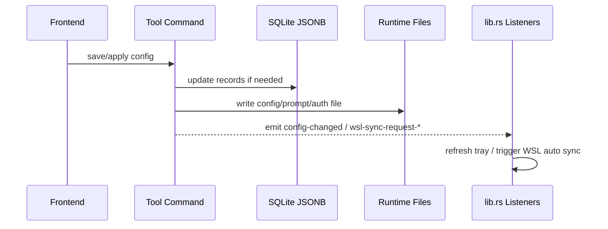

# Coding 模块说明

## 一句话职责

- `tauri/src/coding/` 是内置 coding 工具、Skills、MCP、WSL/SSH 同步和运行时定位的共享后端域。
- 这里最重要的不是某个工具单独怎么存，而是跨工具共享的路径决议、事件约定和跨平台执行语义。

## Source of Truth

- 各工具的业务配置主数据分别存于 SQLite JSONB 和对应运行时配置文件，两者都重要，但“当前生效路径”不是简单看页面输入框，而是由 `runtime_location` 统一决议。
- `runtime_location` 是各 coding tab 当前运行时位置、WSL Direct 状态和派生文件路径的唯一共享规则源。
- `runtime_location` 的同步 helper 只允许读取进程内 runtime location cache 或无 DB fallback；需要 SQLite、环境变量和 shell 配置参与解析时，必须走异步 refresh API 先刷新缓存，不能在同步 helper 里查 DB 或 `block_on`。
- 对这些 runtime tab，`source` 与 `is_wsl_direct` 是两个独立维度：`source` 只说明路径来源，`is_wsl_direct` 只说明当前生效路径是否为 WSL UNC；`module_statuses` 来自后者，不来自页面展示。
- runtime tab 分成两类：OpenCode/OpenClaw 是“配置文件路径模块”，Claude/Codex/Grok CLI/Gemini CLI 是“根目录模块”。后续 prompt、auth、plugins、skills 等派生路径都必须先尊重这个分层。
- `config-changed`、`wsl-sync-request-*`、`skills-changed`、`mcp-changed` 是跨模块联动的主事件契约；事件本身不保存状态，只触发后续动作。Grok 使用 `wsl-sync-request-grok`，与其他根目录模块保持同一监听层语义。
- provider 增删改、排序和导入操作需要继续触发 `config-changed`；全局监听器会用它刷新托盘并主动清空 Gateway provider 缓存。
- Magic Context 配置是 CortexKit 共享文件，不是 OpenCode plugin options 或 Pi extension 文件。AI Toolbox 当前只管理用户级配置；本机 Unix 路径优先使用 `$XDG_CONFIG_HOME/cortexkit/magic-context.jsonc`，未设置时回退 `~/.config/cortexkit/magic-context.jsonc`，Windows 使用 `%USERPROFILE%\.config\cortexkit\magic-context.jsonc`。Magic Context 上游支持的项目级配置不在当前配置卡片/API 范围内。WSL Direct 下用户级路径必须按 WSL 用户 home 派生为 UNC 路径。

## 核心设计决策（Why）

- runtime tab 的运行时路径统一收敛到 `runtime_location.rs`，避免每个模块各自判断 WSL UNC、默认路径和派生路径，导致逻辑分叉。
- dsh/Hermes 的目录优先级解析器仍由工具模块复用，`runtime_location` 调用同一解析器登记状态并统一判断 UNC；保存目录后必须刷新缓存，再通知 WSL 设置页与自动同步。不要因路径代码位于工具模块就把它排除在 Direct 状态集合之外。
- 托盘刷新采用全局 `config-changed` 事件，而不是每个模块各自直接操作托盘，这样主窗口和托盘入口可以共享一套刷新机制。
- WSL 自动同步用 `lib.rs` 里的事件监听器集中触发，而不是在每个业务命令里直接调用 WSL 同步实现；这样可把“是否开启自动同步”判断统一放在监听器层。

## 关键流程

## 易错点与历史坑（Gotchas）

- 通用配置「从当前文件提取」以及 DB 为空时的磁盘 common 回退 / save-local base_common，都会直接读 WSL UNC / 网络根目录下的 runtime 文件。`Path::exists` / `fs::read_to_string` 在不可达路径上可能长时间阻塞；这些路径必须用 `coding::file_io` 做 `spawn_blocking` + 超时读，前端 extract 也要有兜底超时（`web/utils/withTimeout.ts`）。不要把 extract 复用成“读完整 settings（含 auth）”的 helper。`tokio::time::timeout` 只保证 await 返回，不会取消已卡住的 OS 读；超时后 blocking 线程仍可能短暂占用，应避免在不可达路径上连续重试打满线程池。
- 不要把“页面上显示的 `source`”和“WSL/SSH 设置页里的 `moduleStatuses.is_wsl_direct`”混为一谈。前者是路径来源标签，后者是对当前生效运行时路径的统一诊断结果。
- 不要把 OpenCode/OpenClaw 与 Claude/Codex 按同一种“自定义配置”处理。前两者改的是文件路径，后两者改的是根目录；一旦混写，后续所有派生路径都会偏掉。
- Claude Code 2.1.126 本机实测路径语义：未设置 `CLAUDE_CONFIG_DIR` 时，`settings.json` / `CLAUDE.md` / `config.json` / `plugins/` / `skills/` 位于 `~/.claude/` 下，MCP 与 onboarding 使用用户 home 下的 `~/.claude.json`；显式 `root_dir` / `CLAUDE_CONFIG_DIR` / shell 配置目录后，上述目录和 `.claude.json` 都位于该配置目录内。即使显式配置目录正好是 `~/.claude`，`.claude.json` 也应按显式目录解析为 `~/.claude/.claude.json`，不能只按路径值等于默认目录来判断。
- Claude plugins 还有独立的 `CLAUDE_CODE_PLUGIN_CACHE_DIR` 覆盖项；实测设置后 `known_marketplaces.json` / `installed_plugins.json` 位于该 plugin cache 目录，而不是 `CLAUDE_CONFIG_DIR/plugins`。这个路径同样要通过 runtime location cache 派生，不能在同步 helper 里临时查环境变量或 shell 配置。
- Claude Code 的本机自定义配置目录只影响本机 Claude CLI 消费路径；普通 WSL/SSH 同步仍把远端写到默认 `~/.claude/*` 与 `~/.claude.json`。只有当前运行时路径本身是 WSL Direct 自定义根目录时，WSL 目标才跟随该 Linux 配置目录，例如 `/home/user/custom-claude/settings.json`、`/home/user/custom-claude/plugins`、`/home/user/custom-claude/.claude.json`。
- 改 `root_dir` / `config_path` 保存逻辑时，保存 DB 后要先刷新对应 runtime location cache，再继续 apply 配置文件、比较 Skills 目标路径、发 WSL/SSH 相关同步事件。否则后续同步 helper 可能继续消费旧路径。
- 对 OpenCode、Claude Code、Codex、Grok CLI、OpenClaw、Gemini CLI 这类模块，文件 I/O 能直接读写 UNC 路径，不代表 CLI 也能直接吃 UNC 路径。新增 CLI 能力时必须先经过 `runtime_location::*_runtime_location_async` 判定。
- 对 OpenCode、Claude Code、Codex、Grok CLI、OpenClaw、Gemini CLI 这类用户自行安装的 CLI，不要默认 GUI 进程里 `PATH` 可用。尤其 macOS 从 Dock/Finder 启动时，新增调用应优先解析已知安装位置或显式配置路径，再回退到 `PATH`。
- WSL Direct 下为了补充 CLI shim 路径而使用 shell wrapper 时，动态 root、PATH 前缀和 CLI 参数必须作为位置参数传入固定脚本，不能插值进 `sh -c` / `bash -c` 文本；补充目录必须前置到 WSL 原 `$PATH`，不能用有限的硬编码目录覆盖整个 PATH。
- 本机 CLI 查找统一走 `cli_resolver.rs`。不要在单个工具模块里各自手写 `which`/`where`、nvm、volta、fnm、bun 或 Windows `.cmd`/`.bat` 处理，否则 Dock/Finder 启动和 Node/bun 全局安装场景会再次分叉。
- 每个有 CLI 的 tab（opencode/claude/grok/pi/omp/hermes/dsh/openclaw）可在“更多选项”手动指定本机 CLI 路径。路径按命令名存入 `AppSettings::cli_manual_paths`，由 `settings::store` 读写时同步到 `cli_resolver` 的手动覆盖注册表；`resolve_local_cli_program` 优先采用已存在的手动路径，文件不存在时静默回退自动发现。保存前必须用 `--version`/`-v`/`version` 探测版本，可用才允许保存；“更多选项”打开时每次都重新探测并显示版本。版本探测必须在 async Tauri command 中执行，每个参数尝试都要有有界超时并在超时后终止子进程；自动路径发现的同步 `where`/`which` 也必须放进 `spawn_blocking`，不能阻塞 Tauri 主线程。改动本机 CLI spawn 或新增 CLI tab 时，要同步检查该覆盖、版本校验、超时和“更多选项”入口是否覆盖。
  实现位置：`tauri/src/coding/cli_resolver.rs`（注册表 + `probe_cli_version`）、`tauri/src/settings/types.rs`/`adapter.rs`/`store.rs`/`commands.rs`（存储与同步 + `set_manual_cli_path`/`probe_manual_cli_version` 命令）、`web/components/common/CliManualPathSetting.tsx`（前端入口）。
  测试隔离：手动覆盖注册表是进程级全局可变状态（`manual_cli_override_registry`），任何 `settings::store` 的 load/save 都会经 `sync_manual_cli_overrides` 用持久化设置覆盖它——加载默认空设置即清空注册表。并行测试下，某测试清空注册表可能夹在另一测试 `set_manual_cli_overrides` 与 `resolve_local_*_program` 之间，导致回退到裸命令名并断言失败。`cli_resolver` 的 manual-cli 测试须持 `crate::coding::test_env::lock()`；`settings::store::sync_manual_cli_overrides` 在 `cfg(test)` 下也持同一把 `test_env` 锁，使所有写入注册表的路径与读取方互斥（两处用同一锁，无重入：`set_manual_cli_overrides` 本体不持 `test_env` 锁）。新增依赖注册表瞬时状态的测试或 settings 存储路径时必须沿用此约定，否则在多线程 `cargo test` 下偶发失败。`coding::test_env::lock()` 还必须中毒自愈（`unwrap_or_else(|p| p.into_inner())`），否则一个可选 CLI 集成测试 panic（如本机恰好装有 opencode 导致集成测试失败）会毒化锁并级联拖垮所有持锁测试。
- Windows GUI 宿主（`windows_subsystem = "windows"`）spawn 短生命周期 CLI / `wsl` / `where` 时必须设 `CREATE_NO_WINDOW`（`0x08000000`），否则会闪 cmd 黑窗。本机命令统一经 `build_local_*_command`（内部已应用）；`where` lookup 也在 `cli_resolver` 内处理。直接 `Command::new("wsl")` 的路径需调用 `apply_create_no_window` / `apply_create_no_window_tokio`。捕获 stdout/stderr 时用 `CREATE_NO_WINDOW`，不要用 `DETACHED_PROCESS`。
- 后端本机 git clone 统一复用 `coding::skills::git_fetcher::clone_or_pull`（如 Codex 插件市场 LocalWindows 分支）。Windows MAX_PATH 260 会让 playwright 这类含超长路径文件的仓库在 clone/checkout 阶段报 `Filename too long`，因此 `git_cmd()` 在 Windows 上注入 `-c core.longpaths=true`，并在 clone 失败时清理半成品 dest 目录；新增 clone 能力时不要绕开它直接 spawn git，也不要另写一套不带该配置的 WSL/本机 git 调用。
- `cli_resolver` 的全局 bin 候选除 nvm/volta/fnm/nvm-windows/npm 外，还必须覆盖 bun：`$BUN_INSTALL/bin` 与默认 `~/.bun/bin`（Windows 含常见扩展后缀）。GUI 进程通常不继承终端 shell PATH，`bun install -g pi` 一类安装在 PATH 外时只能靠这些候选路径命中。
- `cli_resolver` 的全局 bin 候选还必须覆盖 mise 与 asdf。mise 数据根扫描顺序：`$MISE_DATA_DIR` → `$XDG_DATA_HOME/mise` → `~/.local/share/mise` → `%LOCALAPPDATA%\mise`（Windows）；asdf：`$ASDF_DATA_DIR` → `~/.asdf`。每个根下扫 `shims` 与 `installs/node`（mise）/`installs/nodejs`（asdf）版本 bin。mise `npm:` backend 包（如 `mise use -g npm:earendil-works/pi-coding-agent`）的真实 bin 路径含包名无法泛化，shim 目录才是稳定入口。mise/asdf shim 本质是 `exec mise`/`exec asdf`，依赖本体在子进程 PATH；`build_local_command_path` 必须在检测到 shims 存在时，把 shims 与本体常见目录（`~/.local/bin`、`/opt/homebrew/bin`、`/usr/local/bin`）补进子进程 PATH，否则即便命中 shim 也会因找不到本体而 spawn 失败。无 mise/asdf 时该补齐为空操作。单元测试必须通过可注入的 data roots 测候选/PATH 逻辑，禁止直接依赖宿主 `MISE_DATA_DIR`/`ASDF_DATA_DIR`，否则真实 mise 开发机会 flaky。
- 找到 Node-based CLI shim 本身还不够。像 Pi 的 `pi` 脚本可能通过 `#!/usr/bin/env node` 再查找 `node`；macOS GUI 启动环境即使能解析到 `pi`，子进程 `PATH` 也可能缺少 Node bin。新增本机 CLI spawn 能力时应复用 `cli_resolver` 构造命令，让它同时补齐 CLI 所在目录和可发现的 Node runtime 目录。
- 「在用户终端里非阻塞启动常驻 CLI」（如 `hermes dashboard` / `openclaw gateway` / `dsh web`）走 `cmd /C start ... cmd /K "<cli>"`（macOS 用 osascript、linux 用 `*-terminal -e`）。Linux 把命令交给 `sh -c` 且用双引号包裹可执行路径时，只转义反斜杠、`$` 与反引号，不能把用于路径分组的双引号转成字面量。`spawn()` 在这种分层派生下**无论子进程是否真正起来都会返回 Ok**——CLI 不存在或启动即报错时，新开终端打印错误后关闭，但 Tauri 命令已返回 Ok，前端会弹误导性成功 toast。启动前必须先用 `cli_resolver::resolve_local_cli_by_name(name)`（含候选目录扫描，覆盖 `~/.local/bin`、homebrew、`/usr/local/bin` 及 nvm/volta/fnm/bun/mise/asdf 全局 bin）验证 CLI 可解析，找不到就返回 `local_cli_missing_hint(name)` 的明确错误，由前端引导，不要等 spawn 后再去探活。PATH-only 的 `cli_resolved_on_path(name)` 仅查 `where`/`which`，macOS 从 Dock/Finder/Spotlight 启动 GUI 进程时不继承终端 PATH，会把装在版本管理器里的 CLI 误判为缺失，常驻 CLI 启动门禁不要再用它。
- 删除已保存的 prompt 配置只删 SQLite 记录，不删除/清空当前 runtime 本地 prompt 文件（如 `AGENTS.md` / `CLAUDE.md`）。产品语义是“删除记录”，不是“清空本地生效提示词”；Claude Code / OpenCode / Codex / Grok / Gemini CLI / Pi 统一此规则。
- 「禁用」（`disable_*_prompt_config`，2026-09 为 issue #326 新增）是唯一显式清除生效提示词的语义：把全部 `is_applied` 置 false（统一用 `db_update_applied_status(target_id=None)` 的原子事务）并把 runtime 提示词文件写空字符串，同时**保留 DB 记录**（内容与名称不动），用户之后可重新应用。它必须沿用各模块 apply 的事件链路（`config-changed` + 各自 sync 事件），保证托盘与 WSL/SSH 同步跟随清空结果。为记录不存在的 id 调用禁用返回 not found；`__local__` 是本地文件桥接不是 DB 记录，天然被 not found 拒绝。前端各工具 service 的 disable 命令映射由 `web/test/services/globalPromptCommands.test.ts` 与 `lib.rs` 注册做一致性校验。
- 删除 Claude/Codex/Grok/Gemini 这类 DB-backed provider 也只删 SQLite 记录，不回滚/清空当前 `config.toml` / `settings.json` / `auth.json`。本地生效配置只在用户显式“应用”其他 provider 时改写。Pi 例外：它的 provider 事实源就是 runtime 文件，删除会按 scope 改 `auth.json` / `models.json`。
- 新增跨工具共享规则时，优先放在共享层，不要把通用逻辑塞进某个单独工具目录，否则后续很快出现“相邻工具修了一边，另一边继续错”。
- **「本地文件桥接态」的 id 与显示名是共享常量，不要再写字面量**：`local_bridge::LOCAL_CONFIG_ID`（`__local__`）/ `LOCAL_CONFIG_NAME`（`default`）。这个值在仓库里曾有 **51 处字面量散在 33 个文件**（构造桥接记录、`if config_id ==` 判定、`tray_support.rs` 过滤、各模块 `constants.rs` 的 const 别名），第一轮只迁了 9 个构造点就宣布完成，剩下的靠 `grep -rn '"__local__"' tauri/src --include=*.rs` 逐条清干净（2026-10-07）。**各模块自己的 const 别名保留名字、值指到共享常量**（如 `const CODEX_LOCAL_PROVIDER_ID: &str = crate::coding::local_bridge::LOCAL_CONFIG_ID;`），这样调用方一行不用改。前端对应 `web/features/coding/shared/localConfig.ts`，**两边必须同值**（`local_bridge.rs` 有断言测试钉住）。判断「抽常量是否做完」的判据是**旧写法的残留数为 0**，不是「新的写对了」。
- npm 12 在**项目级**安装（`npm install --prefix <agentDir>/npm`）里不接受从用户级 `~/.npmrc` 继承的 `allow-scripts`，会报 `EALLOWSCRIPTS` 并让整个扩展安装/卸载失败；而 Pi/OmO 的 `pi install` 正是走这个 prefix。`run_cli_command_preferring_no_approve` 在该错误上做一次自动修复：读用户级 `~/.npmrc`（WSL Direct 下是该发行版用户根）里的 `allow-scripts` 行，复制进 `<agentDir>/npm/.npmrc` 后重试一次；项目级已有该键时**不覆盖**，用户级没有该键时**不虚构**（返回原错误，保留 `npm_policy_hint` 提示）。修复只搬用户已声明的允许列表，不放宽任何策略。
- `expand_local_path` 展开 Unix 风格环境变量时必须按完整变量 token 匹配：支持 `$VAR` 和 `${VAR}`，但 `$VAR_SUFFIX` 不能被当作 `$VAR` 加后缀替换；该 helper 被 MCP stdio、WSL、SSH 与私钥路径等共享调用。
- All API Hub 导入的浏览器扩展发现属于跨工具共享后端能力。当前应按 Chrome 优先、Edge 兜底的顺序扫描 Chromium profile 的 `Local Extension Settings`；Edge 既要兼容从 Chrome Web Store 安装的扩展 ID，也要兼容 Edge Add-ons 当前 ID。不要在 Claude/Codex/OpenCode/OpenClaw/Pi 页面各自实现浏览器发现。
- CC Switch 导入属于跨工具共享后端能力（`cc_switch.rs`）：只读 `~/.cc-switch/cc-switch.db`，不写 CCS。
  - **Providers**：`has_cc_switch_db`（30s 缓存）控制工具页按钮；`list_cc_switch_providers` 按 `app_type` 提取渠道。行表工具（Claude/Codex/Gemini）写入本应用 SQLite 且 `source_provider_id=ccs:{app}:{id}`、默认不 apply；map 工具（OpenClaw/OpenCode）用 CCS `raw_id` 作 key 并一次 save。Claude 侧整份拷贝 `settings_config.env`（含模型映射与自定义 env），忽略 CCS UI 杂字段与 `meta`；渠道导入剥离 provider 内嵌 MCP。
  - **MCP**：无独立按钮。`list_cc_switch_mcp_servers` 读 `mcp_servers` 表；`mcp_scan_servers` / `mcp_import_from_tool("cc_switch")` 挂入现有「导入现有 MCP」。
  - **Skills**：无独立按钮。`skills` onboarding 的 `EXTRA_SKILL_SOURCES` 扫 `~/.cc-switch/skills` 磁盘目录；不导 `skill_repos`。
- 跨 WSL/SSH/备份恢复的目标端字段清理规则统一放在 `config_cleanup.rs`。平台固定规则（例如 Claude 非 Windows 目标清理 Windows-only env）和用户映射配置的 `cleanup_paths` 都只作用于目标副本或恢复后的目标数据，不能反向污染 Windows 源配置。
- Magic Context 的 `doctor` 通过 `npx @cortexkit/magic-context@latest doctor --harness opencode|pi` 运行。本机命令解析要走 `cli_resolver.rs`，WSL Direct 要在目标 distro 内执行 `npx`，不能用 Windows home 或 Windows PATH 代表 WSL 运行环境。
- 硬编码 tab / module key 的清单遗漏会导致同步静默跳过，也可能让 WSL Direct 模块重复同步。`useWSLSync.ts`/`useSSHSync.ts` 的旧 `TAB_TO_MODULE` 曾漏掉新 tab，使其永远进入 `skipModules`；issue #331 则是 dsh/Hermes 映射已经读取 UNC 根目录，`runtime_location` 却未输出状态，最终把 Windows UNC 交给 Linux `cp`。新增工具要同时核对前端映射清单、统一状态、缓存刷新与后端文件/MCP/Skills 过滤，不按“路径由模块自行解析”豁免状态登记。侧栏 key 与 visible_tabs 的权威来源仍分开维护，自定义排序用户不强制插入新 tab。完整清单和历史见根 `AGENTS.md` 的「Tab / Page-Key Allowlist Rules」。

## 跨模块依赖

- 被 `wsl/`、`ssh/`、`skills/` 和各工具模块依赖：它们都会消费 `runtime_location` 的派生路径或 WSL Direct 状态。
- 被前端 `web/features/settings/` 和各工具页面间接依赖：前端展示的路径来源、WSL Direct 提示和同步跳过逻辑最终都依赖这里的后端状态。

## 典型变更场景（按需）

- 新增需要调用工具 CLI 的能力时：
  先检查现有内置工具是否都存在同类调用点，并确认本机/WSL Direct 两套执行路径。
- 新增新的跨模块事件时：
  先判断是否应复用现有事件契约；如果新增，必须同时梳理监听端和前端刷新端。

## 最小验证

- 改 `runtime_location` 后，至少验证一个本机路径场景和一个 WSL UNC 路径场景。
- 改事件约定后，至少验证主窗口保存、托盘刷新、WSL 设置页状态三者是否仍一致。
