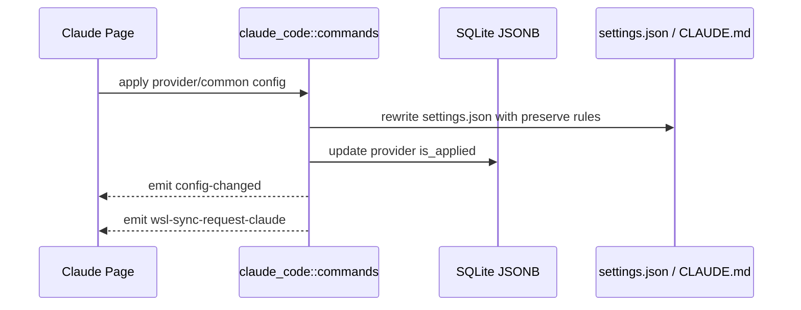

# Claude Code 后端模块说明

## 一句话职责

- `claude_code/` 负责 Claude Code provider/common config、`settings.json`、`CLAUDE.md`、plugin 运行时文件和 Claude MCP 相关配置。

## Source of Truth

- 当前生效根目录优先级是：应用内 `root_dir` > 环境变量 `CLAUDE_CONFIG_DIR` > shell 配置 > 默认根目录。
- Provider、common config 和 prompt config 的主存储是 SQLite JSONB；旧 SurrealDB 仅用于启动时一次性导入。
- Claude Code 是“根目录模块”，`settings.json`、`CLAUDE.md`、`config.json`、`plugins/`、`skills/` 都是从当前根目录派生出来的。
- `.claude.json` 需要按 Claude CLI 的默认/显式根目录语义单独处理：默认根目录时是用户 home 下的 `~/.claude.json`；只要根目录来自应用自定义、`CLAUDE_CONFIG_DIR` 或 shell 配置，就位于该配置目录下的 `.claude.json`。
- `plugins/` 默认从当前根目录派生，但 `CLAUDE_CODE_PLUGIN_CACHE_DIR` 会独立覆盖 plugin runtime root；`known_marketplaces.json` 和 `installed_plugins.json` 应跟随这个目录。
- prompt 的业务记录在数据库里，但运行时真正生效的是当前根目录下的 `CLAUDE.md`。

## 路径矩阵（Claude Code 2.1.126 本机实测）

| 场景 | `settings.json` / `CLAUDE.md` / `config.json` | `.claude.json` | `skills` | plugin metadata |
|------|-----------------------------------------------|----------------|----------|-----------------|
| 默认本机 | `~/.claude/*` | `~/.claude.json` | `~/.claude/skills` | `~/.claude/plugins/{known_marketplaces,installed_plugins}.json` |
| 显式 `root_dir` / `CLAUDE_CONFIG_DIR` / shell 根目录 | `<root>/*` | `<root>/.claude.json` | `<root>/skills` | `<root>/plugins/{known_marketplaces,installed_plugins}.json` |
| 显式根目录刚好是 `~/.claude` | `~/.claude/*` | `~/.claude/.claude.json` | `~/.claude/skills` | `~/.claude/plugins/{known_marketplaces,installed_plugins}.json` |
| `CLAUDE_CODE_PLUGIN_CACHE_DIR` | 不改变根目录文件 | 不改变 `.claude.json` | 不改变 `skills` | `<plugin-cache>/{known_marketplaces,installed_plugins}.json` |
| 普通 WSL/SSH 同步本机自定义根 | 本机源来自自定义根 | 远端目标仍是 `~/.claude.json` | 远端目标仍是 `~/.claude/skills` | 远端目标仍是 `~/.claude/plugins/*` |
| WSL Direct 自定义根 | Linux 目标跟随 `<linux-root>/*` | `<linux-root>/.claude.json` | `<linux-root>/skills` | `<linux-root>/plugins/*`，除非本机 plugin cache 被独立覆盖 |

## 官方参考

- Claude Code environment variables: https://code.claude.com/docs/en/env-vars
  - 这里记录 `CLAUDE_CONFIG_DIR` 与 `CLAUDE_CODE_PLUGIN_CACHE_DIR` 的官方语义；改根目录、plugin cache 或同步路径前必须先核对。
- Claude Code settings: https://code.claude.com/docs/en/settings
  - 这里记录 `settings.json` 等配置文件默认位置；改 settings/common config 落盘前必须先核对。
- Claude Code plugin marketplaces: https://code.claude.com/docs/en/plugin-marketplaces
  - 这里记录 marketplace 与 plugin runtime 文件行为；改 `known_marketplaces.json`、`installed_plugins.json` 或 marketplace CLI 集成前必须先核对。

## 核心设计决策（Why）

- 对 Claude Code 这类根目录模块，路径来源和运行时文件派生必须一致收敛，否则前端看的是一个目录、实际写到另一个目录，很容易状态分叉。
- `apply_config_internal` 统一负责写文件、更新 `is_applied`、发 `config-changed` 和 `wsl-sync-request-claude`。
- 自定义 provider 的 `extra_settings_config` 是 provider 私有的 `settings.json` 额外字段层。`extra_settings_merge_strategy` 是 provider 级行为开关，缺失时默认 `provider_overrides_common`，三种语义分别是：渠道配置覆盖通用配置、通用配置覆盖渠道配置、通用配置与渠道配置递归合并（数组元素去重，标量冲突渠道优先）。
- 配置应用顺序仍然是：磁盘/runtime 未知字段 → 按策略合并 common config 与 extra settings → provider 表单派生字段；前两种策略的数组整体替换，第三种策略才合并同路径数组元素。
- plugin/MCP 运行时文件要保留 CLI 自己拥有的字段，不能按 AI Toolbox 的部分结构反序列化后整文件重写。

## 关键流程

## 易错点与历史坑（Gotchas）

- `extract_claude_common_config_from_current_file` 只读当前根目录 `settings.json`。WSL UNC / 网络路径上 `Path::exists` / `fs::read_to_string` 可能长时间阻塞；extract 必须走 `coding::file_io` 的 `spawn_blocking` + 超时读，超时错误要带实际路径。不要在 extract 路径上同步直读磁盘。
- Provider 卡片上的 **CLI 启动**（`launch_claude_provider_cli`）是旁路启动，不是 apply：写系统 temp 下的极简 settings（仅 provider `env` 非空字符串），用 `claude --settings <temp>` 打开终端；不改 `settings.json`、不改 `is_applied`、不发 apply 相关联动。是否附加 `--dangerously-skip-permissions` 由前端读取 `AppSettings.claude_cli_launch_full_access` 后经 `full_access` 参数传入。无论是否有 `--settings`，本机与 WSL Direct 启动都必须注入当前 runtime root 对应的 `CLAUDE_CONFIG_DIR`，否则自定义 root / shell root 会回落到默认 `~/.claude`。包含 provider env 的临时 settings 必须使用随机文件名并按私有权限写入；Windows `.cmd` / `.bat` CLI shim 要用 `call` 返回当前 launcher，确保清理语句执行。
- Windows 打开哪个终端由 `AppSettings.preferred_terminal`（`cmd`/`powershell`/`wt`/`gitbash`）驱动，经前端 `terminal` 参数传入；未知/缺失值按 `cmd`（系统默认）处理，首选终端启动失败时也自动回退 `cmd`（`fall_back_to_cmd_on_failure` 统一处理，Git Bash 未安装 mintty.exe 时同样回退）。本地与 WSL Direct 两条 Windows 启动路径共用同一套分支，调整启动方式时不要只改其中一条。Git Bash 走 `usr\bin\mintty.exe` + `bash --login` 运行 sh 启动脚本（`build_unix_session_script`，与 macOS/Linux/WSL 内层脚本共用同一模板）；bash 内部操作（`cd`、脚本路径、trap 清理）用 `windows_path_to_msys_path` 转换的 POSIX 路径，Claude 程序与 `--settings` 参数保持 Windows 路径形式，`.cmd`/`.bat` shim 优先取同目录无扩展名 sh shim；mintty 子进程设置 `MSYS_NO_PATHCONV=1` 与 `MSYS2_ARG_CONV_EXCL=*`，防止 WSL `/tmp/...` 参数被 MSYS 自动改写。
- 不要把 Claude Code 当成“配置文件路径模块”。它保存的是根目录，后续文件都要从根目录派生。
- CLI 选择工作目录后会 canonicalize；Windows 去除 verbatim 前缀时必须把 `Prefix::VerbatimDisk` 的字节转换成盘符字符，并保留 UNC share，不能格式化成 ASCII 数值后拼路径，否则跨盘启动会丢失工作目录。
- 不要把“根目录路径等于 `~/.claude`”和“来源是默认根目录”混为一谈。实测 `CLAUDE_CONFIG_DIR=$HOME/.claude` 时，Claude Code 会使用 `$HOME/.claude/.claude.json`，而不是 `$HOME/.claude.json`。
- 不要把 `CLAUDE_CODE_PLUGIN_CACHE_DIR` 漏掉。实测该变量存在时，marketplace 元数据会写入它指向的目录，settings 与 `.claude.json` 仍跟随 `CLAUDE_CONFIG_DIR` / 当前根目录。
- 改写 `settings.json` 时要显式保留运行时自有字段，如 `enabledPlugins`、`extraKnownMarketplaces`、`hooks`，不能整文件按受管字段重建。
- Claude 插件启用/禁用必须继续通过 `claude plugin enable/disable --scope user` 这类官方 CLI 操作。批量启用/禁用也只处理 user scope 已安装插件，不要直接改写 `settings.json.enabledPlugins`，避免绕过 Claude CLI 自己的 marketplace/plugin 元数据规则。
- `extra_settings_config` 不管理 `enabledPlugins`、`extraKnownMarketplaces`、`hooks`，也不能覆盖 provider 表单派生的 `ANTHROPIC_*` env 与模型字段。切换 provider 或编辑已应用 provider 时，必须先按上一份已应用 provider 的 extra settings 清理旧受管字段，再合入当前配置，避免旧 extra key 残留。
- 切换 `extra_settings_merge_strategy` 或编辑已应用 provider 时，清理必须使用上一份已应用策略和配置，不能让第三种策略产生的数组合并结果累积到下一次应用；旧 provider 缺失该字段时按 `provider_overrides_common` 处理。
- 清理非默认策略的上一份 Extra settings 时，空对象也代表受管路径，必须删除对应运行时字段；common config 的空对象标记仍要保留运行时字段细节，不能复用同一清理语义。
- 回收上一份通用配置字段时，`env` 不能按普通顶层字段整块删除；只允许按上一份通用配置实际管理的变量名逐项清理，必须保留用户或运行时自行写入的其它环境变量。
- Claude provider 模型字段的新写入源是 `settingsConfig.env`：`ANTHROPIC_MODEL`、`ANTHROPIC_DEFAULT_HAIKU_MODEL`、`ANTHROPIC_DEFAULT_SONNET_MODEL`、`ANTHROPIC_DEFAULT_OPUS_MODEL`、`ANTHROPIC_DEFAULT_FABLE_MODEL` 以及四个 `ANTHROPIC_DEFAULT_*_MODEL_NAME`。后端拆分/合并 settings 时必须继续兼容旧顶层 `model` / `haikuModel` / `sonnetModel` / `opusModel` / `fableModel`，但保存和应用时统一迁移到 env 字段；旧 provider 没有 Fable 字段时前端保持为空，不用 Opus 回填。
- **`CLAUDE_CODE_SUBAGENT_MODEL` 与 `ANTHROPIC_CUSTOM_MODEL_OPTION` / `_NAME` 是 env-only 模型字段**（2026-10-16 加入）：它们没有旧顶层写法（诞生于表单改用 env 之后），所以**不进 `PROVIDER_MODEL_FIELD_MAPPINGS`**（那是旧字段→env 的迁移表），而是登记在 `PROVIDER_MODEL_ENV_ONLY_FIELDS`，并加进 `PROVIDER_MODEL_NAME_ENV_FIELDS`（仅 `_NAME`）与 `KNOWN_ENV_FIELDS`。三个清单分工不同，缺任一处都会出问题：不进 `is_provider_model_env_field` 会在拆分时把它们漏进 common config（切渠道后子代理仍走旧渠道）；不进 `KNOWN_ENV_FIELDS` 则清理受管 env 时删不掉旧值。`settings_merge.rs` 有对应集成测试（split 不落 common、merge 覆盖旧值、extra settings 不能夹带）。
- 网关接管（single/failover）时 `patch_claude_settings` 会 `remove` 这三个键、备份持有原值，`restore_claude_settings` 按 pointer 精确还原：它们描述的是**某个具体渠道的**模型，接管期间留着会让子代理和 `/model` 里那一条钉在旧渠道，而其余请求已经改走网关。
- `ANTHROPIC_REASONING_MODEL` / `reasoningModel` 只作为遗留读取兼容。新 provider apply 不应再写入 `ANTHROPIC_REASONING_MODEL`；清理受管 env 时仍要把它视为已知旧字段，避免旧运行时值残留。
- 跨平台目标端清理统一走 `coding::config_cleanup`，Claude 对外仍可保留 `settings_merge::sanitize_claude_settings_*` 兼容入口。普通 Windows 源配置不能被同步后处理反向污染；WSL/SSH/非 Windows 恢复只清理目标副本或恢复后的目标数据。当前非 Windows 目标必须移除 `CLAUDE_CODE_USE_POWERSHELL_TOOL` 与 `CLAUDE_CODE_SHELL`；后续如果出现 Linux/远端不适用的 Claude env，也应扩展共享清理规则，而不是在各同步模块里散落硬编码。
- 清空 optional 字段时不要用 truthy 判断，否则会把“用户明确清空”误当成“没有提交”，导致旧值残留。
- 普通“新建 provider”和“复制已应用 provider”都属于创建新记录，默认不应自动应用；不要因为源 provider 当前已应用，就把新记录写成 `is_applied = true`。
- `save_claude_local_config` 里的 `__local__` 不是普通新增 provider，而是把当前生效的本地运行时配置正式收编入库；在这个产品语义下，它保持 `is_applied = true` 是合理的，不要把这条链路误修成“保存但取消应用”。
- `save_claude_local_config` 收编 `__local__` 时仍要保留 provider `meta`，包括 Gateway 计费配置里的 `costMultiplier` / `pricingModelSource`；不要只保存 settings/common 而把表单提交的 meta 丢成 `None`。
- Claude Code 当前没有独立的官方订阅账号表；不要把纯官方本地运行态自动导入或展示成 `__local__` provider。`__local__` 只表示可收编的第三方/API-key/base-url 本地配置。
- Claude plugins 的 `known_marketplaces.json` 和 `installed_plugins.json` 会带运行环境相关路径。Windows 本机生成的 `installLocation` / `installPath` 不能在同步到 WSL/SSH 时原样保留，否则远端仍会指向 `C:\...` 而失效。
- 重写后的 `installLocation` / `installPath` 必须是**真实绝对 Linux 路径**，不能写 `~/.claude/...`。Claude CLI 2.1.126+ 在校验 marketplace 时直接把字段值当 literal path 用，不展开 `~`，留 `~` 会被判定 corrupted。`plugin_metadata_sync::rewrite_claude_plugin_metadata_if_needed` 本身只做字符串拼接，不负责展开 `~`；调用方(WSL 端 / SSH 端)必须先通过 `sync::get_wsl_user_home(distro)` 或 `sync::get_remote_user_home(session)` 把 target_plugins_root 头部的 `~` 解析成真实 home，再传进来。
- 本机自定义根目录只改变本机消费路径。普通 WSL/SSH 同步的远端目标仍保持 Claude 默认布局：`~/.claude/settings.json`、`~/.claude/CLAUDE.md`、`~/.claude/config.json`、`~/.claude/plugins`、`~/.claude/skills` 和 `~/.claude.json`。WSL Direct 自定义根目录是例外，目标应跟随该 Linux 根目录。
- `hasCompletedOnboarding` 的“无值”与“显式 false”是两种不同语义，不能互相折叠（issue #449）。`clear_claude_onboarding_skip` 写 `false` 而不是删除字段，这样 `get_claude_onboarding_status` 能如实读回“当前不跳过”；但**这个 `false` 不会传播到 WSL**，因为它是持久化状态而非一次性重置指令，照它执行会让只用 WSL 的用户每次同步都被删掉已完成状态。WSL 侧只镜像 `true`，判定在 `wsl::commands::plan_onboarding_sync`；改这里之前先看 `tauri/src/coding/wsl/AGENTS.md` 对应条目。

## 跨模块依赖

- 依赖 `runtime_location`：统一得到根目录、prompt 路径、MCP 配置路径和 WSL 目标路径。
- 被 `web/features/coding/claudecode/` 依赖：页面读取 `get_claude_root_path_info()` 并通过共享 RootDirectoryModal 编辑根目录。
- 被 `wsl/`、`skills/` 间接依赖：同步和 Skills 目标目录都依赖这里的根目录决议。

## 典型变更场景（按需）

- 改根目录来源逻辑时：
  同时检查 `settings.json`、`CLAUDE.md`、`config.json`、`.claude.json`、`CLAUDE_CODE_PLUGIN_CACHE_DIR`、插件运行时文件、Skills 路径和 WSL/SSH 目标路径。
- 改 provider/common config 落盘逻辑时：
  同时检查受管字段清理、runtime-owned 字段保留、`is_applied` 更新和 WSL 同步事件。

## 最小验证

- 至少验证：切换 provider 后 `settings.json` 改写、`is_applied` 更新和托盘刷新都成立。
- 至少验证：修改已应用 prompt 时会改写当前根目录下的 `CLAUDE.md`。
- 改根目录派生路径后，至少跑 `cargo test coding::runtime_location::tests`，覆盖默认本机、自定义本机、显式默认根、plugin cache 覆盖、WSL Direct 默认根和 WSL Direct 自定义根的 MCP、Skills、plugins、prompt 与 config 路径。
