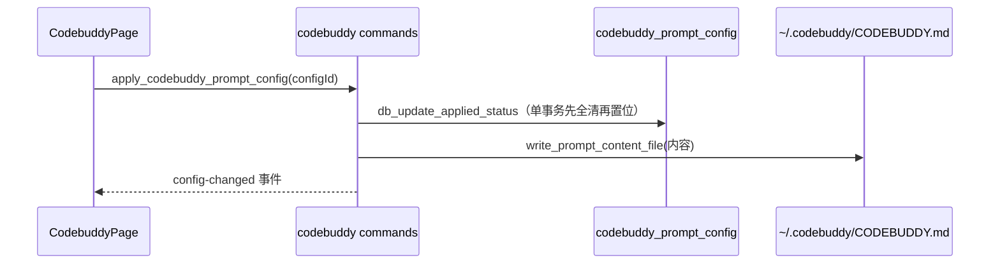

# codebuddy 后端模块说明

## 一句话职责

- `codebuddy/` 是 CodeBuddy Code CLI（`~/.codebuddy`）的后端：配置根决议、`models.json` 渠道、`CODEBUDDY.md` 提示词预案，以及 `settings.json` 只读预览。

## Source of Truth

- 渠道数据与 WorkBuddy 桌面版**同源同格式**，契约在 `../workbuddy_family/AGENTS.md`；本模块不重复实现。
- 配置根优先级：应用内 `config_dir` > `CODEBUDDY_CONFIG_DIR` > `WORKBUDDY_CONFIG_DIR` > shell 配置 > `~/.codebuddy`。同时认 `WORKBUDDY_CONFIG_DIR` 是因为桌面版内嵌这个引擎时两个变量都会设。**该顺序自 CLI 源码**（`getUserConfigPath`）**与真机实测双重确认**。
- **MCP 用户级文件是 `~/.codebuddy.json`（home 下的兄弟文件），不是 `~/.codebuddy/.mcp.json`，也不是 `~/.codebuddy/mcp.json`。** 见下方「已实测的文件契约」——那两个目录内文件在真机上**根本不会被创建，写入也会被忽略**。
- 提示词是 `CODEBUDDY.md`，走标准 `codebuddy_prompt_config` 表（与其它 CLI 一致的 `is_applied` / `sort_index` 语义）。

### 已实测的文件契约（CodeBuddy Code CLI v2.178.1，2026-10-30）

以下全部是本机装真 CLI 后跑出来的事实，不是文档推断。**改本模块前先读这一节**：

| 关注点 | 真机事实 | 验证方式 |
|---|---|---|
| 配置目录 | `~/.codebuddy` | `codebuddy config set -g theme dark` → 写入 `~/.codebuddy/settings.json` |
| `settings.json` | **存在**，是 CLI 的配置 JSON（如 `{"theme":"dark"}`） | 同上 |
| `models.json` | **存在且被真实读取**，`id`/`url`/`apiKey` 直接生效 | 写一条 `url=http://127.0.0.1:9/...` 后 `codebuddy -p "hi" --model <id>` 报 `ECONNREFUSED 127.0.0.1:9` |
| MCP `local`（默认） | `~/.codebuddy.json` → `projects[<cwd>].mcpServers` | `codebuddy mcp add probe -- echo hi` |
| MCP `project` | `<cwd>/.mcp.json` | `codebuddy mcp add probe -s project -- echo hi` |
| MCP `user` | `~/.codebuddy.json` → **顶层** `mcpServers` | `codebuddy mcp add probe -s user -- echo hi` |
| `~/.codebuddy/.mcp.json` | **不读取、不创建** | 三种 scope 全试过，该文件始终 absent |
| `~/.codebuddy/mcp.json` | **不读取、不创建** | 同上 |
| 会话转录 | `~/.codebuddy/projects/<cwd编码>/<sessionId>.jsonl` | 真跑一次 `-p` 后生成 |
| `sessions/` 目录 | 会被创建但为空；**会话不在这里** | 同上 |

会话 JSONL 与 WorkBuddy 桌面版**同一套 item 类型**（`message` / `reasoning` / `function_call` / `function_call_result` / `file-history-snapshot` / `credit-usage` / `session-meta` / `ai-title`），字段一致；差异只在 CodeBuddy 多 `__codebuddyLocal`、`_meta.baggage` 里前缀是 `codebuddy.*`。

源码佐证（`dist/codebuddy.js` 的 `getUserConfigPath`）：

```js
const envDir = process.env.WORKBUDDY_CONFIG_DIR?.trim()
            || process.env.CODEBUDDY_CONFIG_DIR?.trim();
if (envDir) return join(envDir, "models.json");
const dir = customUserDataDir?.trim()
         || (isWorkBuddyProduct(productName) ? ".workbuddy" : USER_DATA_DIR_NAME);
return join(homedir(), dir, "models.json");
```

`models.json` 只在 product feature `CustomModelsJSON` 打开时生效，且 `CODEBUDDY_DISABLE_CUSTOM_MODELS_FILE=1` 可整体关闭——这是产品开关，不改变本模块的读写位置。

## 核心设计决策（Why）

- **提示词走 DB 预案，身份文件不走**：`CODEBUDDY.md` 是单文件全局提示词，与 Claude/Codex/Kimi 的形态相同，适合「多套预案切换」；WorkBuddy 桌面版的四个身份文件则各是一份不同的文档，直接编辑（见 `../workbuddy/AGENTS.md`）。
- `list_codebuddy_prompt_configs` 在 DB 为空时返回一条 `__local__` 桥接记录，内容是当前 `CODEBUDDY.md`。这是共享 `GlobalPromptSettings` 的既定契约，不是特例。
- `disable_codebuddy_prompt_config` 接收 `config_id` 只为对齐共享 `GlobalPromptApi.disableConfig(configId)`，效果是全局的（清空所有 applied 并清空文件），与其它 CLI 一致。

## 关键流程



## 易错点与历史坑（Gotchas）

- **不要把 MCP 用户级路径改回 `~/.codebuddy/` 下**。本模块第一版按「同引擎所以和 WorkBuddy 一样」推断成 `~/.codebuddy/.mcp.json`，还写了一整段「CLI 先读 `.mcp.json` 再读 `mcp.json`」的注释——**全错**，真机实测两个文件都不被创建也不被读取。用户级 MCP 的实际位置是 **`~/.codebuddy.json` 的顶层 `mcpServers`**。这是本模块最贵的教训：**同引擎 ≠ 同布局**，MCP 作用域语义来自 CLI 自己，必须实测。
- **不要把 MCP 路径改回 `mcp.json`**。这是与 WorkBuddy 桌面版最容易混淆的一处：桌面版写 `~/.workbuddy/mcp.json`（已实测为 `{"mcpServers":{}}`），CLI 的用户级在 `~/.codebuddy.json`，两者既不同文件也不同形状（后者带 `projects` 嵌套层）。
- **模型改名走 `upsert_model_renaming`**，不要「先 `remove_model` 再 `upsert`」——后者会丢掉该条目上产品写的键并把行挪到末尾。契约与回归在 `../workbuddy_family/AGENTS.md`。
- 改提示词的写入口必须自己持锁覆盖「捕获旧快照 → 写 DB → 写文件」整个窗口；本模块当前无并发写入口，新增时要补。
- `settings.json` 只读：`read_codebuddy_settings_file` 返回原文而不是解析后重建，解析再序列化会丢键顺序和注释。

## 最小验证

- `cargo test --lib codebuddy --jobs 2`：覆盖空文件、形状往返、`__local__` 桥接、adapter 往返、空 `config_dir` 不落盘、schema 表存在。
- 改提示词链路后验证：新建预案 → 应用 → 文件内容变化 → 禁用 → 文件清空且 DB 记录仍在。
- **改任何文件路径前先复测真机**：装一次 CLI（`npm install -g @tencent-ai/codebuddy-code`），用 `codebuddy mcp add -s <scope>` / `codebuddy config set -g` 看 CLI 自己报告修改了哪个文件——**不要读文档、不要按 WorkBuddy 推断**。测完把探针删掉（`codebuddy mcp remove` / `codebuddy config remove`）。
- 验 `models.json` 是否真的被消费：写一条 `"url": "http://127.0.0.1:9/v1/chat/completions"` 的模型，然后 `codebuddy -p "hi" --model <id>`；出现 `ECONNREFUSED 127.0.0.1:9` 就证明读取链路通。测完删除该条目。
