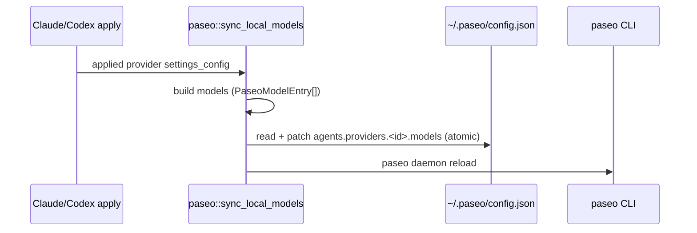

# Paseo 模型列表同步

## 一句话职责

- `paseo/` 把当前已应用的 Claude Code / Codex 渠道模型列表写入 Paseo 的 `config.json`，并供本机 apply、WSL 同步、SSH 同步复用。

## Source of Truth

- Paseo 每个 daemon 使用独立的 home：默认 `~/.paseo`，可用 `PASEO_HOME` 或 CLI `--home` 覆盖；配置文件是 `<home>/config.json`。
- 模型列表字段是 `agents.providers.<provider>.models`（provider id：`claude` / `codex`）。
- Paseo 的 `models` 是**替换列表**（内置 provider 的 `profileModelsAreAdditive = false`），`additionalModels` 才是追加列表。AI Toolbox 只覆盖 `models`，不碰 `additionalModels`。
- 条目形状：`{ id, label, description?, isDefault?, thinkingOptions? }`。`thinkingOptions` 元素形状：`{ id, label, description?, isDefault? }`。
- Paseo 不监听 `config.json` 的文件变化；写完后必须 `paseo daemon reload`（或重启 daemon）才生效。

## 关键规则（Why）

- **Claude**：按 `ANTHROPIC_DEFAULT_HAIKU_MODEL` → `..._SONNET_...` → `..._OPUS_...` → `..._FABLE_...` → `CLAUDE_CODE_SUBAGENT_MODEL` → `ANTHROPIC_CUSTOM_MODEL_OPTION` 的顺序收集，按 id 去重。`label` 优先用对应 `*_MODEL_NAME`，否则用去掉 `[1M]` 后缀的 id；`id` 保留 `[1M]`。**Opus 档模型标 `isDefault: true`**。
- **Claude 兜底**：四档角色 + Subagent/Custom 全空时，才把 `ANTHROPIC_MODEL` 作为唯一列表项并标默认。provider-wide 默认模型不参与正常列表，否则会多出一个非档位条目。
- **Codex**：从 `settingsConfig.modelCatalog.models` 生成；`id = model`，`label = displayName || model`。`config.toml` 顶层 `model` 对应项标 `isDefault: true`；若目录没有该项则补一项。`reasoningLevels` → `thinkingOptions`，`defaultReasoningLevel` 对应项标默认。
- 任一渠道模型列表为空时**不写盘**：不能用空数组清空 Paseo 现有列表。
- 只改 `agents.providers.<provider>.models`；`daemon`、`relay`、`auth`、`agentProfiles`、其它 provider、`additionalModels` 全部保留。
- 原子写：本机走同目录临时文件 + persist；WSL 走 `write_wsl_file`；SSH 走 `write_remote_file_atomic`（同目录 `mktemp` + `mv`）。
- 目标端没有 `~/.paseo/config.json` 时跳过，不主动创建 Paseo home。
- 同步是 best-effort：apply / WSL / SSH 的主流程不能因为 Paseo 写失败而失败；reload 失败只记日志。

## 关键流程

WSL / SSH 同步在各自 `do_full_sync` 的收尾阶段调用同一组 pure builder + patch，再由各自的文件传输写入目标端。

## 易错点

- 不要把 `models` 当成追加字段；写它会替换 Paseo 的运行时模型目录，内置模型会从选择器消失。需要保留内置模型时应改用 `additionalModels`，但当前产品需求明确使用 `models`。
- 不要把 `additionalModels` 清掉；用户明确要求只覆盖 `models`。
- Claude 的 `[1M]` 是存储值的一部分：`id` 必须保留，只有展示用 `label` 才去掉。Paseo 的 `models` 条目 schema **没有** contextWindow 字段；Claude provider 的 `getClaudeContextWindowMaxTokens()` 只在 model id（trim 后、大小写不敏感）以 `[1m]` 结尾时返回 1,000,000，否则只查内置 manifest（`deepseek-v4.1-flash` 这类自定义 id 查不到，就没有 1M）。所以剥掉 id 后缀等于丢掉 1M 信息。
- Codex 的 `displayName` 可能来自 camelCase 或 snake_case；两种都要读。
- `PASEO_HOME` 只用于本机解析；WSL/SSH 当前固定写目标用户 `~/.paseo/config.json`。
- 本机 Windows 的 Paseo CLI 不在 PATH 上，`local.rs` 会回退到 `%LOCALAPPDATA%\Programs\Paseo\resources\bin\paseo.cmd`。

## 最小验证

- `cargo test --lib coding::paseo`：模型顺序、Opus 默认、`[1M]` label 剥离、Codex reasoningLevels、配置 patch 保留其它字段。
- 本机验证：打开 Claude 更多选项的「同步模型列表到 Paseo」，确认 `~/.paseo/config.json` 的 `agents.providers.claude.models` 被写入且 Opus 项带 `isDefault: true`，随后 Paseo 的 `provider models claude` 立即反映新列表。
- WSL/SSH：执行一次同步，确认目标端 `~/.paseo/config.json` 对应 provider 的 `models` 更新，且 `paseo daemon reload` 无报错。
