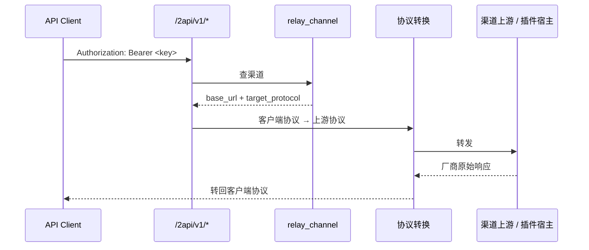

# 2API Module Notes

## 一句话职责

- 提供一个与 CLI 接管无关的独立 API 网关入口：渠道自建、模型自管，能力由 OpenCode 插件扩展。

## Source of Truth

- 渠道是一张**独立**的 JSONB 表（`relay_channel`），不是任何 `*_provider` 表的视图。现有 CLI 渠道按 CLI 分物理表、每条记录绑死某 CLI 的 runtime 配置；2API 面对任意 API 客户端，没有 CLI 可言。两者的语义不能合并，也不要为了“复用”把 2API 渠道写进 `ClaudeProvider`/`CodexProvider` 之类的表。
- `DbTable` 枚举、`ALL_TABLES`、`name()` 三处必须同步；漏进 `ALL_TABLES` 会让 v1 建表与 `sqlite_jsonb` 的全表断言同时失败。
- 八张表的建表在 `db/migrations.rs` 的 `migrate_v33`；`TARGET_SCHEMA_VERSION` 是全局单调游标，改动前先确认没有与其它分支撞号。
- 插件产出的响应是**厂商原始 wire**，不是 OpenAI Chat。`relay_model.npm` 决定上游协议（`@ai-sdk/anthropic` → Anthropic Messages，`@ai-sdk/openai` → Responses，其余 → Chat）。协议转换必须插在插件之后：客户端 → 转换 → 插件 fetch → 厂商原始响应 → 转换 → 客户端。
- 一个 npm 包可以导出**多个**插件函数（WorkBuddy 导出一个包两个站点）。`relay_plugin_provider.entry_export` 记录是哪个导出产生的，宿主据此定位；只取 `default` 或首个导出会让一半能力消失。
- 插件账号的 `auth_json` 按 OpenCode 的 `auth.json` 形状**原样**保存。插件通过 `getAuth()` 读、通过 `client.auth.set` 写，任何“规范化”都会让插件认不出自己的凭证。

## 核心设计决策（Why）

- 为什么自建插件宿主而不是对接现成的 agent2api 插件：agent2api 的插件协议绑定它自己的账号库与回调面，且协议 crate 是 AGPL-3.0。OpenCode 插件是公开契约（magpie 跑的就是同一套），npm 上现成的社区包可直接装。
- 为什么 Bun 是运行时下载而不是随包分发：安装包体积会按平台各涨约 90 MB，而多数用户不装插件。代价是离线用户用不了插件——这条降级到“插件页不可用”，不能拖垮 2API 的普通渠道。
- 为什么签到交给插件：`auth.checkin(getAuth, provider)` 是插件能自己实现的钩子，签到逻辑本身就是厂商知识。宿主只负责调度（每日计划、`attempted_at` 防重、补签），不承载任何按厂商写死的分支。
- 为什么 tab 默认隐藏：不给不用 2API 的用户增加无关入口。因此 `OTHER_TABS` **必须**登记（那是设置页里唯一的开关），而 `CURRENT_DEFAULT_VISIBLE_TABS` 与 `visible_tabs` 默认值**不能**加。

## 关键流程

## 易错点与历史坑（Gotchas）

- **签到契约的六种 outcome 都是终态，只有 `failed` 会在当天重试**：`claimed`（刚签成功）/ `done`（今天已签）/ `ineligible`（账号不参与）/ `inactive`（当前没有活动）/ `captcha`（厂商要验证码）/ `failed`。`captcha` **永不代解**——代解等于绕过厂商防护，正确做法是提示用户去官方 App。
- **台账键用 `provider|account_key`，不用显示名**：两个账号可以显示名相同（WorkBuddy 的两个登录共用默认名），按显示名记会让第二个账号永远签不到。magpie 为这个踩过坑（plugins#254）。
- **`attempted_at` 必须在执行前落库**：签到中途退出后重启不能重跑主轮，否则一天签两次。
- **写台账失败不能让签到报错**：上游积分已经领到，台账缺一条只该打 verbose 日志。这条同样适用于已经成功的删除/清理链路。

## 最小验证

- 建表：`cd tauri && cargo test --test sqlite_jsonb --jobs 2`（含 `v33_migration_adds_relay_tables_to_an_already_v32_database`）。
- 编译：`cd tauri && cargo check --lib`。
- 前端：`pnpm exec tsc --noEmit`、`pnpm test`（含 i18n key 覆盖与 `MainLayout` 的工具 tab 模板测试）。
