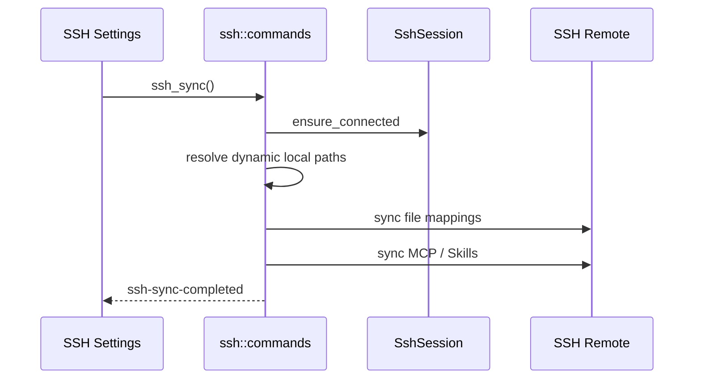

# SSH 同步模块说明

## 一句话职责

- `ssh/` 负责 SSH 连接管理、文件映射同步，以及 MCP/Skills 到远端主机的同步。

## Source of Truth

- `sync_entity` 的 `kind=ssh_config` / `ssh_defaults_version` / `ssh_connection` / `ssh_file_mapping` 是 SSH 配置、连接和映射的主数据；当前主存储是 SQLite JSONB，不再双写旧库。
- SSH 设置页里显示的本地路径会根据 `module_statuses` 改写成 WSL UNC 友好展示，但真正同步路径仍由后端在执行时动态解析。
- 当前仓库里，SSH 不应按“自动同步模块”理解。公开产品语义仍是手动同步为主。

## 核心设计决策（Why）

- SSH 连接状态与同步执行分离：连接由 `SshSessionState` 管理；启用 SSH 只建立连接，不再自动全量同步；手动「立即同步」和切换 active connection 才会执行全量同步。
- 读写 SSH 配置时必须 SQLite-first；active connection、`last_sync_*` 状态、连接 CRUD、mapping CRUD 和默认 mapping backfill 都要同步更新 SQLite。
- `module_statuses` 仍会带进 SSH 配置里，是为了正确展示 WSL Direct 本地路径，而不是为了让 SSH 像 WSL 一样自动跳过或自动监听。
- MCP/Skills SSH 同步走独立链路，不复用普通文件映射，因为它们的源数据和目标路径决议不同。

## 关键流程

## 易错点与历史坑（Gotchas）

- 不要把 SSH 写成“自动同步”模块。当前应明确为手动同步主模型；启用 SSH 只建立连接、不自动同步，切换 active connection 仍会跑一次全量同步，但这不等于存在像 WSL 那样的事件驱动自动同步监听体系。
- SSH 同步的远端命令链路只支持 POSIX Shell（Linux/macOS）。Windows OpenSSH 默认用 `cmd.exe` / PowerShell，`mkdir -p`、`rm -rf`、`$HOME`、`sh -c` 等命令会失败，且中文 Windows 的控制台错误是 GBK。`do_full_sync` 必须先探测 Shell 方言，非 POSIX 时在写入任何远端文件前返回明确错误；`exec_command` 的 stderr 解码必须按 UTF-8 → UTF-16 BOM → GB18030 兜底。连接测试也必须报告 `shell_kind`，不能像以前那样忽略 `uname -a` 的退出码、把 Windows 远端显示成“已连接”。
- 同步设置保存只 patch 用户字段，不能回写表单里的历史状态或清掉 `last_sync_warnings`；配置、普通状态和警告写入均在同一次 SQLite 连接锁内完成。全量同步须把 Skills 阶段已收集警告合入返回结果与完成事件，包含该阶段最终失败的情况；Skills 阶段的同步哈希写入失败、目标目录无法解析也必须进入警告链路，不能只留日志或静默跳过（普通目录映射的 `.ai-toolbox-synced-hash` 写入失败只记日志并留待下次重传，不影响本次已完成的同步结果）。
- SSH 设置页不会像 WSL 设置页那样按 `is_wsl_direct` 禁用模块。它只是把左侧本地路径显示成完整 UNC，真正同步仍由后端解析。
- 不要只看普通 file mappings 就判断 SSH 同步是否完整。MCP 和 Skills 都走独立链路，其中 Skills 的源目录仍是中央仓库，不是某个工具当前目录。
- `sync_entity(kind=ssh_config).active_connection_id` 只是持久化配置，不等于进程内 `SshSession` 已恢复。冷启动后若要支持首次手动同步，必须先按已保存的 active connection 恢复 session，或在 `ssh_sync()` 里按当前 active connection 懒建连；不要把 `session.ensure_connected()` 当成会自动从数据库补回连接信息。
- 排查 SSH “没同步”时，先分三层：
  连接是否有效；
  映射和动态路径是否正确；
  MCP/Skills 独立同步链路是否执行。
- Claude Code 本机自定义根目录只改变本机源路径，不改变普通 SSH 远端目标布局；`CLAUDE_CODE_PLUGIN_CACHE_DIR` 也只改变本机 plugin 源目录。远端仍应同步到默认 `~/.claude/*`、`~/.claude/plugins`、`~/.claude/skills` 和 `~/.claude.json`；只有本机路径本身是 WSL Direct 自定义根目录时，SSH 的本地源会是 UNC，远端目标仍按后端动态解析结果处理。
- SSH 普通 file mapping 的目录模式支持按目录名配置 `directory_excludes`，默认跳过 `.git`、`.venv`、`venv`、`node_modules`、`__pycache__`、`.pytest_cache`、`.mypy_cache`、`cache`。匹配语义是目录名 segment 精确匹配，不是 glob/gitignore；非目录和 glob mapping 不应受影响。Skills 独立 SSH 目录上传也要复用同一默认排除，避免中央 Skill 内的 `.venv` 被整目录上传。`codex-plugins` 额外排除 `.plugin-appserver`（Windows 专用 Codex exe，Linux/macOS 远端用不到）；该排除要在默认列表和运行时 `effective_directory_excludes_for_mapping` 两层同时生效，避免已有数据库映射漏掉。
- SSH 目录上传使用两遍：先遍历本地并创建远端目录，再以 8 路并发流式上传文件；单文件/目录上传复用 `SshSession` 缓存的同一个 SFTP 会话，`disconnect` 时缓存失效。不要退回“每个文件新建 SFTP 会话 + 整文件读入内存”的实现，否则大量插件/技能文件会非常慢且占内存。
- 目录映射上传前会先算本地元数据哈希（相对路径 + size + mtime + symlink target，seed 包含远端路径和排除列表），与远端目标内的 `.ai-toolbox-synced-hash` 比较；一致则跳过整目录。哈希失败时回退全量上传，marker 写入失败只记日志、下次重传。SSH 的哈希必须跟随符号链接（与 SFTP 上传语义一致）；WSL 的哈希不跟随（与 tar 语义一致）。
- Claude root 权限修正只在 SSH 同步链路、`SSHSyncConfig.claude_root_permission_fix`（默认关闭）开启且远端登录用户为 root 时生效。前端开关必须走 `ssh_set_claude_root_permission_fix` 单字段 patch，不要用 `ssh_save_config` 全量保存：后者会重写当前 file mappings，并在连接已断时可能触发一次最长 30 秒的重连。同步开始时用一次 `id -u` 判定（仅 POSIX；失败按非 root，只记日志）；它只改远端副本，本机源文件绝不修改。命中条件是 `module == "claude"`、非目录/非通配、远端 basename 精确为 `settings.json` 或 `settings.local.json`；`claude-config` 的 `config.json` 不在范围内。只有 `permissions.defaultMode == "bypassPermissions"` 时才改为 `"auto"`，并删除嵌套/顶层的 `dangerouslySkipPermissions` 与 `skipDangerousModePermissionPrompt`；其他模式一律不动。字段清理与权限修正合并为一次远端读、一次远端写，`synced_files` 只追加一条合并 marker。测试连接的 `is_root` 只用于展示，不可替代同步时的重新探测。
- SSH 同步对 host-local 字段采用“先读远端、上传后合并”的两步法。`prepare_host_local_values_on_ssh` 在 `sync_file_mapping_with_progress` 之前读取远端文件（Claude/CodeBuddy/Gemini/ZCode 的 hooks、Claude statusLine、Codex notify/projects/hooks 与 `~/.codex/hooks.json`）；远端文件非空但解析失败时直接跳过该 mapping 并记入 errors，绝不能用本机文件覆盖。上传后 `post_process_synced_file_on_ssh` 只读一次远端文件，先合并 host-local 字段，再执行 `cleanup_paths` 与 root 权限修正，最后最多写回一次。目标值始终优先（显式空值也算目标值）；Windows 本机 → Unix 远端时 `fill_missing=false`，目标没有的 hooks/notify/projects 不会从本机导入；Unix 本机 → Unix 远端时才允许补缺。目录/pattern 映射不参与该逻辑。合并阶段决定文件格式时优先用 spec 的 JSON/TOML，不要只靠路径后缀推断（自定义映射的远端文件名可能没有后缀）。**MCP 同步阶段**会再次整文件上传 `codex-config`/`geminicli-settings`/`zcode-cli-config`，必须调用 `sync_file_mapping_preserving_host_local`，不能绕过它直接整文件上传，否则文件阶段刚合并的目标字段会被无条件覆盖。
- `claude-plugins` 是目录排除默认值的例外：默认不能排除 `cache`，因为 Claude CLI 的 `installed_plugins.json` 可能把 `installPath` 指向 `~/.claude/plugins/cache/...`。如果跳过该目录，同步后的远端元数据会指向不存在的插件文件；后续不要把通用目录默认值直接套回 `claude-plugins`。
- 对 Claude `claude-plugins` 目录，同步到远端后还要修补 `known_marketplaces.json` / `installed_plugins.json` 里的 `installLocation` / `installPath`。这些字段若保留 Windows 本机路径，远端插件运行时不会自动替你转换。
- 对 JSON/TOML 单文件映射，`cleanup_paths` 是同步到 SSH 后只作用于远端目标副本的字段清理规则，不能反向改写本机源文件。Claude `claude-settings` 还会自动追加非 Windows 目标平台规则，移除 Windows-only env（`CLAUDE_CODE_USE_POWERSHELL_TOOL`、`CLAUDE_CODE_SHELL`）；`HTTP_PROXY` / `HTTPS_PROXY` / lowercase 代理 env 这类字段不应再做 SSH 全局开关，应由具体映射的 `cleanup_paths` 控制。
- Claude 插件元数据补写属于 best-effort 后处理。即使 `known_marketplaces.json` / `installed_plugins.json` 读取、改写或写回失败，也不能把已经成功完成的主文件同步整体标成失败；最多记录 warning/error 供排查。
- Skills SSH 工具目标与 WSL 共用 `skills::remote_target` 的归属校验和替换脚本：Cursor、Antigravity CLI 强制复制，其余工具用链接。只有中央仓库下的受管链接，或 `.ai-toolbox-skill-source` 标记匹配当前中央源的副本可更新/删除；无标记真实目录与外部链接保留并 warn。复制先准备临时副本再替换；取消同步、禁用、孤立清理也必须识别副本。远端中央目录本身是 app 私有，可按原语义清理。
- Skills SSH 同步警告与 WSL 同构：保留/失败/跳过 emit `ssh-sync-warning` 并经 `commands::update_sync_warnings` 持久化到 `sync_entity(kind=ssh_config)` 记录的 `last_sync_warnings`（随 `ssh_get_status` 返回）。同一工具下多个“技能路径未托管”的警告会在持久化前由 `skills::sync_warnings::merge_foreign_path_warnings` 合并成一句，避免一次同步刷出整屏重复提示。该助手只能由 skills 链路调用；文案为稳定中文格式，前端经 `syncMessageTranslator` 的 `skills*` 模式翻译。
- Skills 的每个“技能 × 工具”目标维护默认是一次远端 shell 调用；绝大多数是幂等的 `unchanged` 检查，串行执行会让未变化同步也耗上几分钟。当前先收集单个技能的目标操作，优先用 `remote_target::build_remote_skill_target_batch_command` 合并成一次 `sh -c`（每个操作在独立 command substitution 中执行，单个失败不终止其余操作）；批处理整体失败或解析失败时回退到 `SKILL_TARGET_CONCURRENCY = 8` 的并发单操作调用。每个 target 路径唯一，不会互相竞争；不要退回逐个串行 await。完成日志里的 `target_operations/hash_ms/target_ms` 用于区分本地内容哈希与远端目标维护的耗时。
- Skills SSH 目标解析需要与该工具的远端配置布局一致。OpenCode/Claude/Codex/Grok/Kimi/OpenClaw/Pi/Oh My Pi/Gemini CLI 在 WSL Direct 时沿用统一解析出的 Linux 路径，否则回退远端默认目录；Hermes 的文件映射固定写 `~/.hermes/*`，Skills 也继续写 `~/.hermes/skills`，不能仅因新增 Direct 状态就改到本机自定义 Linux 根目录。SSH 不因 WSL Direct 跳过上传。
- 写入到 `known_marketplaces.json` / `installed_plugins.json` 的 `installLocation` / `installPath` **必须是远端真实绝对 Linux 路径**，不能保留 `~/.claude/...`。Claude CLI 2.1.126+ 不会展开 JSON 字段值里的 `~`，留 `~` 会被判定 corrupted。读写文件路径可继续走 `read_remote_file` / `write_remote_file` 的 `$HOME` 展开；但作为字段**值**落盘前，必须先用 `sync::get_remote_user_home(session)` 拿到远端真实 `$HOME`，再交给重写逻辑。这条规则也覆盖以后任何往工具配置里写"远端路径字段值"的同步场景。
- Codex prompt 映射不要硬编码 active 文件名。同步 `codex-prompt` 时要镜像 `AGENTS.md` 与 `AGENTS.override.md` 两个已知文件：本机存在就同步到 SSH 同名目标，本机不存在就清理 SSH 同名目标，避免远端保留 stale override。
- Codex `config.toml` 可能通过顶层 `model_catalog_json = "ai-toolbox-codex-model-catalog.json"` 引用 AI Toolbox 生成的模型映射文件。同步 `codex-config` 时必须连带镜像这个同目录 companion JSON；但只处理 AI Toolbox 自有文件名，不要接管用户自定义的外部 catalog 路径。
- Grok 默认映射覆盖 `auth.json`、`config.toml`、`AGENTS.md` 和 `plugins/`，不默认同步 `sessions/`；SSH 仍是手动同步主模型，Grok MCP 由 `grok-config` 映射承载。
- Kimi 默认映射覆盖 `config.toml`、`AGENTS.md`、`credentials/` 和 `plugins/`，不默认同步 `sessions/`；SSH 仍是手动同步主模型，kimi 无事件驱动自动同步，配置不走 MCP 专用同步。新增映射走 `ssh_defaults_version` v15 backfill，只补本版本新加的 id。
- dsh 的 `dsh-mcp`（home 级 `cordis.patch.yml`）与 `dsh-profile-patch`（`profiles/<active>/cordis.patch.yml`）都参与 MCP 专用同步；后者路径按当前活动 profile 动态解析（DB 固定值 → desktop → web → 最新），固定回退 `profiles/desktop`。新增 dsh 映射时同步更新 `mcp_sync.rs` 白名单与 `ssh_defaults_version` backfill。
- 新增通过文件映射承载 MCP 配置的工具时，不能只加默认 file mapping。还要同步更新 `mcp_sync.rs` 的 MCP 配置 mapping 白名单、进度/错误文案，以及 `cmd /c` 后处理识别。MCP 专用同步只能包含实际承载 MCP 配置的文件，不能把同模块的 env、prompt、OAuth 等普通映射一起纳入。
- bump `ssh_defaults_version` 新增默认映射时，只能 backfill 本版本新加的 mapping id。不要把所有缺失的默认 mapping 重新插回去，否则会恢复用户之前主动删除的旧默认映射；新安装空列表仍应一次性创建完整默认集合。
- OpenCode Markdown Agent 的规范目录是复数 `~/.config/opencode/agents`（单数 `agent` 仅为旧版别名，不再作为默认映射同步）。把它作为一个独立目录映射即可；不要用整个 OpenCode 配置目录替代，否则 SSH 同步会意外接管无关文件。
- SSH `auth_method = "none"` 是显式的 SSH none authentication，不等同于空密码的 password authentication。UI 仍必须要求 username；后端应调用 `authenticate_none(username)`，不要通过“密码为空”自动推断成 none。

## 跨模块依赖

- 依赖 `runtime_location`：仅用于模块状态和本地路径展示/动态路径解析。
- 依赖 `mcp_sync.rs`、`skills_sync.rs`：普通文件映射成功后再执行这两条独立链路。
- 被 `web/features/settings/` 的 SSH 设置页独占消费。

## 典型变更场景（按需）

- 新增 SSH 同步文件类型时：
  先判断它应走普通 file mappings 还是独立链路。
- 修改“启用 SSH”或“切换连接”逻辑时：
  不要顺手把它升级成事件驱动自动同步；如果真要引入，需要在产品语义上单独确认。

## 最小验证

- 同步警告回归：`cargo test --lib saving_sync_preferences_preserves_latest_skills_warnings` 和 `cargo test --lib concurrent_sync_status_and_warnings_preserve_both_snapshots` 验证旧表单保存不会覆盖新的警告/状态，以及独立链路并发写入时字段不丢失。
- 至少验证：手动点击 Sync Now 会执行同步，并带出进度事件。
- 至少验证：启用 SSH 不会自动同步；切换 active connection 时会完成一次全量同步。
- 至少验证：WSL Direct 本地路径在 SSH 设置页显示为 UNC，但不会导致模块被禁用。
