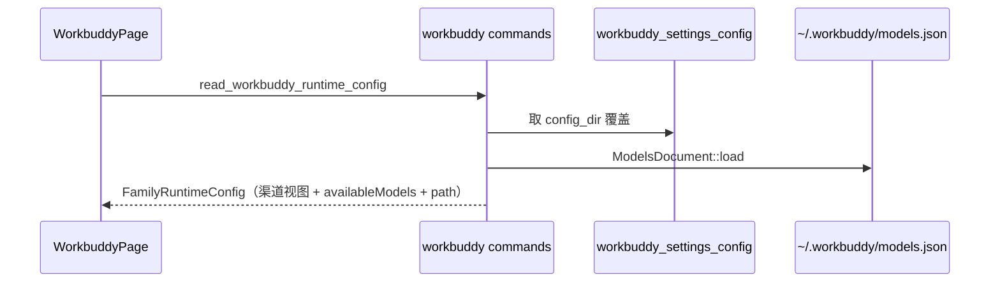

# workbuddy 后端模块说明

## 一句话职责

- `workbuddy/` 是 WorkBuddy 桌面版（`~/.workbuddy`）的后端：配置根目录决议与 `models.json` 渠道读写命令。

## Source of Truth

- **渠道数据不在 SQLite**。表 `workbuddy_settings_config` 只存一个字段：配置根目录覆盖（`config_dir`）。渠道永远从 `models.json` 现读，契约见 `../workbuddy_family/AGENTS.md`。
- 配置根目录优先级：应用内 `config_dir` > `WORKBUDDY_CONFIG_DIR` > `CODEBUDDY_CONFIG_DIR` > shell 配置 > `~/.workbuddy`。
- `~/.workbuddy/app` 是 Electron 的 `userData`，不是配置根；`normalize_selected_root` 会把用户误选的这一层折回上一级，但只在父目录确实像个配置根时才这么做。

## 核心设计决策（Why）

- **身份文件模块已整体移除**（2026-11-01，用户指定「删掉 身份文件 这个模块吧」）。原先的四份文档（`IDENTITY.md` / `USER.md` / `SOUL.md` / `BOOTSTRAP.md`）由产品自己 seed 成**空白模板**，AI Toolbox 原样读出来会把「Fill this in when the moment fits」这类样板文字当成有效配置展示，而产品自己的 UI 把它们当「未填写」。两边口径不一致，用户判断这个模块没有必要，连同 `get/save_workbuddy_identity_state|file` 两个命令与 `workbuddy_family/identity.rs` 一并删除。**不要在看到 `.workbuddy/user-*/` 目录时把它加回来**。
- **删除渠道 = 删除该组下所有模型条目**，不是删一条记录。`delete_workbuddy_provider(base_url, api_key)` 先按分组键取出成员，再逐条删除；不属于该组的条目原样保留。
- 改名走 `upsert_model_renaming(entry, previous_id)`（契约与回归在 `../workbuddy_family/AGENTS.md`）。**不要退回「先删旧 id、再 upsert 新 id」**：那样模型能改名，但产品写在条目上的键会丢，条目还会被挪到列表末尾。

## 关键流程

## 易错点与历史坑（Gotchas）

- 本模块**没有**托盘支持，这是有意的：托盘用来在多个「已应用」的 provider/模型间切换，而这里既没有单一 active provider，也没有可靠的默认自定义模型指针。不要为了「和其它 tab 对齐」凭空加一个。
- `models_write_lock()` 只在本模块内串行化读写；CodeBuddy 模块有自己的锁、操作另一个文件。
- 身份文件在未登录时不可用：`active_identity_dir` 返回 `None`，页面必须显示原因（`unavailableReason`），不能显示不存在的路径。
- 保存配置根目录后要刷新 `runtime_location` 缓存（`refresh_runtime_location_cache_for_module_async(&state, "workbuddy")`），否则后续同步链路会继续用旧路径。

## 最小验证

- `cargo test --lib workbuddy --jobs 2`：覆盖身份状态（未登录/已登录/缺文件）、`~/.workbuddy/app` 折叠、路径来源标签、runtime config 三态。
- 改写入路径后验证：在产品里手加一条模型 → 页面能看到 → 在页面编辑另一条 → 第一条不丢。
