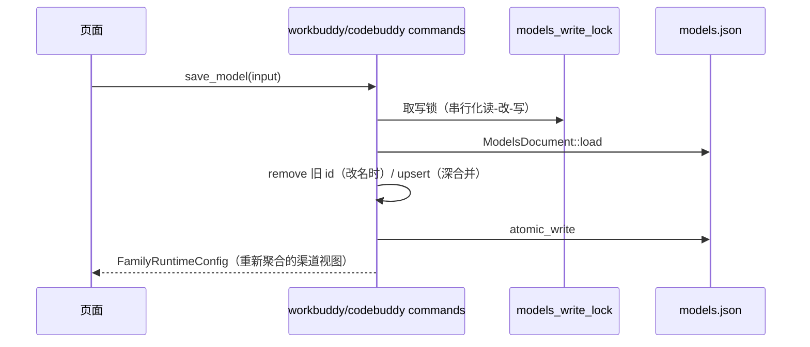

# workbuddy_family 后端模块说明

## 一句话职责

- `workbuddy_family/` 是 WorkBuddy 桌面版与 CodeBuddy Code 共用的引擎契约层：两者是同一个引擎的两张皮，`models.json` 的形状、渠道聚合方式、身份文件定位都只在这里实现一次。

## Source of Truth

- **`models.json` 是渠道的唯一事实源**。不存在 `workbuddy_provider` 之类的表；页面上的「渠道」是按 `(规范化 url, apiKey)` 分组得到的**视图**，其 `id` 是这对值的 FNV-1a 哈希，从不落盘。
- 文件接受两种顶层形状：`{models: [...], availableModels: [...]}` 对象，或裸数组。**写回时必须保持读到的形状**——产品自己也会写这个文件，形状漂移会让它的加载器走到另一条分支。
- `availableModels` 的三态语义：**缺失**和**空数组**都表示「显示全部模型（含 59 个内置模型）」。只有非空列表才是限制。AI Toolbox 从不主动收窄这个列表（计划 §11 风险表第一行）。
- 身份文件按账号隔离：`user-<uid>-<enterpriseId|personal>`，`uid` 来自 `storage/skeleton/account-snapshot.json` 的 `primary.uid`。未登录时该能力整体不可用，页面显示原因而不是报错。
- **`uid` / `enterpriseId` 按不可信输入处理**：它们来自产品写的快照文件，会直接拼进目录名。含 `/`、`\`、`:`、`\0`、`..` 或为空时 `active_identity_dir` 返回 `None`（能力不可用），不允许解析到配置根之外。回归在 `identity::tests::a_uid_that_could_escape_the_config_root_is_refused`——它用 `serde_json` 构造快照，不用 `format!`，否则含反斜杠的用例会因为生成非法 JSON 而「通过」，实际没测到守卫。

## 核心设计决策（Why）

- **分组而不是建模成 provider 记录**：`models.json` 里一条模型就是一个 endpoint + 一个 key，产品没有 provider 概念。若我们自己引入 provider 表，用户在 WorkBuddy 里直接加一条模型就会被我们的记录覆盖。分组视图保证「产品写的任何条目都立即出现在页面上」。
- **`upsert_model` 用深合并而不是替换**：产品会往条目上写自己的键（`credits`、`tags`、`reasoning`、`iconUrl`），整体替换会把它们丢掉。
- **改名必须走 `upsert_model_renaming(entry, previous_id)`，不能「先 `remove_model` 再 `upsert`」**：后者仍能把模型改名，但会丢掉该条目上产品写的全部键，并把它挪到列表末尾——两件都不报错。`upsert_model_renaming` 用旧 id 定位后原地合并再改 id，并清掉可能重复的同 id 行。回归：`workbuddy::commands::tests::renaming_a_model_keeps_its_position_and_product_owned_keys`（把实现改回旧语义会从 2 行变 3 行）。
- **原子写（临时文件 + 改名）**：桌面版以 1 秒防抖监听这个文件，半写状态会被它读成解析错误。
- **容错解析**：产品自己的加载器在失败前会先剥 BOM、去 `//` 与 `/* */` 注释、去尾逗号（`parseJsonWithRepair`）。我们镜像同一套容错，否则一个产品自己能读的文件会让我们的整页报错。

## 关键流程

## 易错点与历史坑（Gotchas）

- **不要为了「整理」把 `availableModels` 写成当前渠道里的模型列表**。空值 = 不限制；写成列表 = 内置模型全部消失。唯一的例外是用户显式进入该开关，而当前 UI 并不提供。
- **`channel_key_of` 对没有 `url` 的条目返回 `None`**，这类条目在页面上不显示，但**必须原样留在文件里**——它们可能是产品写的、我们看不懂的条目。
- **URL 规范化只影响分组，不影响写盘**：`normalize_channel_base_url` 去掉 `/chat/completions` 与尾斜杠用于比较；写回走 `to_chat_completions_url`，它会先折叠重复后缀再补一次，与产品的 `normalizeChatCompletionsUrl` 一致。`useCustomProtocol: true` 的条目会跳过规范化——这是产品行为，不要「修正」。
- 两个模块的 `models_write_lock()` 是**各自模块内**的锁，互不覆盖。它们操作不同的文件，这是有意的；如果将来两者共用一个配置根，需要合成一把锁。

## 最小验证

- `cargo test --lib workbuddy_family --jobs 2`：覆盖裸数组/对象形状保持、未知键保留、`availableModels` 三态、深合并、channel 分组、URL 规范化、容错解析、磁盘往返。
- 改这里任何写入路径后，至少验证「含未知字段的文件 → 编辑一条模型 → 读回」不丢字段。
