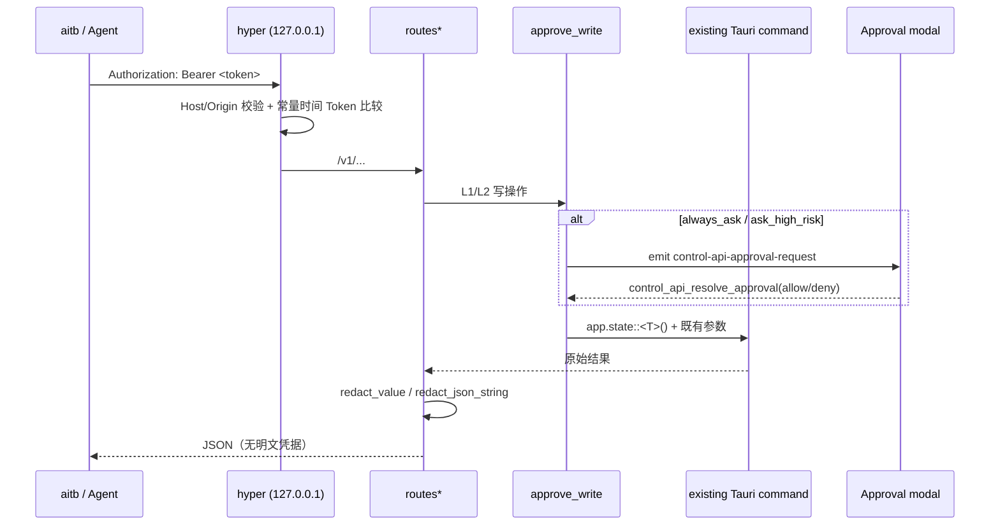

# Control API 后端模块说明

## 一句话职责

- `tauri/src/control_api/` 是仅绑定 `127.0.0.1` 的本地 Agent 控制面：HTTP 路由、Bearer 鉴权、L0/L1/L2 风险分级、桌面授权等待、按 CLI 分发到既有 Tauri 命令、凭据脱敏，以及 `aitb` 安装/状态命令。
- 它不重新实现任何 CLI 配置写入逻辑；所有 provider/model/config/prompt/gateway/plugin 操作都通过 `app.state::<T>()` 调用既有 `#[tauri::command]` 实现。

## Source of Truth

- 控制面设置独立存于 SQLite `settings` 表的 `id = control_api` 行，**不要**并入 `settings/app`。`save_settings` 是全量替换，旧前端快照会把授权策略静默重置回默认值。
- 运行期状态（监听端口、Bearer Token、待授权请求）只在内存 `ControlApiState`；Token 同时写入发现文件 `~/.ai-toolbox/control.json`（Unix 0600），文件是 CLI 的唯一凭据来源。
- Token、明文 API Key、OAuth token、`plugin-auth.json` 永远不是 HTTP 响应、弹窗摘要或 Tauri 命令返回值的一部分。前端只看状态、设置和脱敏后的审批摘要。
- 各 CLI 的 provider/config/prompt 事实源仍是原模块：DB 接管型在 SQLite `cli_provider` / `cli_config`，文件型在各 CLI 的规范配置文件，运行时型在 `read_*_runtime_config` 返回的路径。控制面只是调用者。

## 核心设计决策（Why）

- **直接复用 Tauri 命令而不是抽服务层**：现有命令的参数就是 `tauri::State<'_, T>`，通过 `AppHandle::state::<T>()` 可以原样构造；这样 provider 归一化、self-loop 校验、备份、事件广播、WSL 同步、应用配置写入全部继承，避免复制一套易漂移的解析器。新增 CLI 能力时，先找既有命令，不要在 `cli_dispatch.rs` 重新写配置格式。
- **独立 Settings 行 + 默认 `always_ask`**：控制面默认开启但所有写操作都要桌面确认；模式包括 `always_ask` / `ask_high_risk` / `auto_approve` / `read_only`。`read_only` 直接拒绝写请求，不是靠前端隐藏按钮。
- **授权用 oneshot 而不是轮询**：`ApprovalHub` 注册 `requestId` + `oneshot::Sender<bool>`，HTTP handler `await` 同一个 channel；前端 `ControlApiApprovalModal` 调 `control_api_resolve_approval` 解阻塞。超时 408、拒绝 403，CLI 都映射为退出码 4。
- **本地插件 reload 的快速通道只限 L1**：`always_ask` + 用户开启 `auto_approve_local_plugin_reload` 时，只有本地目录来源、且风险为 L1 的 `plugin reload` 跳过弹窗；L2 永远需要确认。策略纯函数 `approval::decide` 必须保持可单测。
- **风险分级集中在路由层**：L0 只读；L1 可逆写（provider/model/config/prompt/reload/enable/restart/health reset）；L2 删除 provider、远程安装插件、卸载插件、gateway start/stop/takeover。不要在 `cli_dispatch` 里偷偷执行未过 `approve_write` 的写操作。
- **发现文件是同机唯一凭据载体**：CLI 读取 URL + Token，绝不打印；桌面端只显示路径。服务停止/退出时必须删除自己 pid 的发现文件，避免下一次启动误读旧 Token。
- **HTTP 客户端独立**：`cli/` 不依赖 Tauri/WebView，使用 clap + 手写阻塞 HTTP/1.1；不要为了复用后端类型把 CLI 拖进 Tauri 依赖树。

## 关键流程

插件写入走 `plugin_commands::*`；CLI 写入走 `cli_dispatch::*`；Gateway 写入走 `proxy_gateway::commands::*`。三者都不绕过既有命令。

## 易错点与历史坑（Gotchas）

- **Windows 栈溢出**：所有 `control_api_*` 命令必须收口在 `control_api::invoke_handler`（`#[inline(never)]`），由 `lib.rs` 在 `generate_handler!` 大 `match` 之前转发。不要把命令合并回根 handler；Windows MSVC debug 主线程栈只有 1 MiB，会把启动打爆。
- **`public_db_provider` 的 `hasApiKey` 必须在脱敏前计算**：`hasApiKey` 本身要加入 `redact_value` 的豁免名单（`normalized == "hasapikey"`），否则会被当成 `*ApiKey` 掩码掉。不要用公开 DTO 做 PATCH 的输入；更新路径必须重新读取原始 provider（含明文 settingsConfig），再做 secret-preserving merge。
- **`settingsConfig` 是字符串**：DB provider 的 settingsConfig 在存储层是 JSON 字符串，公开 GET 返回解析后的脱敏对象，PATCH 接受对象或字符串。`merge_settings_config` 必须先把对象合并回字符串再交给 update 命令，不能把临时 `Value` 丢弃。
- **Canonical 捷径必须落到各 CLI 的类型化结构**：`baseUrl` / `apiKey` / `model` 不是通用扁平字段。ZCode 写 `providerId`/`providerName`/`config.api`/`config.access`/`models`/`defaultModelId`；Grok 写顶层 `baseUrl` + `modelCatalog.models[]` + `defaultModelKey`；Kimi 写 `providerConfigs.<key>.base_url` + `modelCatalog.models[]` + `defaultModelKey`；Codex 写 `auth.OPENAI_API_KEY` 与 TOML `config`。新增 CLI 时先对照其 settings builder/validator，否则 create 能成功但 apply 会失败。
- **脱敏是结构 + 文本双层**：对象键按 secret 名识别；TOML/YAML/env 文本走正则。`apiKeyEnv`、`hasApiKey`、token 用量计数必须豁免。任何新的 GET/LIST/日志/网关响应都要显式调用 `redact_value`，不要假设底层日志已经脱敏。
- **掩码不可写回**：JSON patch/replace 用 `merge_patch_preserving_secrets` / `fill_redacted` 回填 `***`；TOML/YAML 原文含 `***` 直接 400，避免把 `***` 写进配置文件。这是“不传 Key 保持原 Key”的另一半。
- **读取配置不等于能写配置**：CodeBuddy 的 `settings.json` 由产品拥有，控制面 `readOnly: true`，PUT 必须拒绝；WorkBuddy 没有独立全局配置文件编辑入口，`/config` 返回只读错误，不要为对称性伪造写接口。
- **文件型 CLI 的 patch 必须保留未知字段**：OpenCode/OpenClaw/Pi/OMP/Hermes/DSH/OMO 的公开结构只是视图，写入要用模块的 `save_*` helper，不要在 `cli_dispatch` 手写整文件覆盖。
- **WorkBuddy/CodeBuddy 的 channel 身份是 `(baseUrl, apiKey)`**：channel id 由 FNV 派生；`update` 不能原地改这两项（会变成新 channel），模型编辑走 model 端点。`delete` 必须重新读取原始 channel 拿真实 key，不能使用脱敏后的 `***`。
- **Gateway 响应同样要脱敏**：status/logs/health/takeover 返回值可能包含 provider URL、header、请求体；`routes_gateway` 的每个 `to_value` 结果都要过 `redacted`。
- **Stop 保护来自后端**：`gateway.stop` 在仍有 CLI 被接管时会报错；不要为了“让 CLI 成功”在路由层跳过检查。接管/恢复本身是 L2，必须弹窗。
- **Host/Origin 防护不能放宽**：只接受 `Host: 127.0.0.1:<port>` / `localhost:<port>`，任何 `Origin` 头直接 403；Bearer 比较必须常量时间。不要加入 CORS 或“开发模式例外”。
- **发现文件删除要认 pid**：`remove_discovery_file_if_owned` 只删除属于当前进程的文件；测试/多实例时不要直接 `remove_file`。
- **CLI 安装路径**：Windows 写 HKCU `Environment\Path` 时必须保留 `REG_EXPAND_SZ` 的类型与 UTF-16 编码；不要用 `setx`（会截断）或把 PATH 写成 `REG_SZ`。Unix 只管理带标记的 `~/.profile` 行。找不到 `aitb` 二进制时返回明确错误，不要把应用自身复制/改名。
- **授权超时竞态**：超时分支必须先从 hub 移除再发 `control-api-approval-expired`，否则前端允许按钮会打到一个已死的 channel。前端收到 `resolved: false` 只提示过期，不要重试 resolve。

## 跨模块依赖

- 依赖 `db/`（`SqliteDbState`、`DbTable::Settings`）、`coding/<cli>/commands` 与 `types`、`coding/proxy_gateway/{commands,types}`、`plugins/{commands,store,installer}`、`coding/skills/builtin.rs`（内置技能嵌入 `references/control-cli.md`）、`app_paths::resolved_data_dir`。
- 被 `lib.rs` 托管（`ControlApiState` + `start_if_enabled` + `RunEvent::Exit` 清理）并转发 `control_api_*` 命令。
- 前端契约：`web/services/controlApi.ts`、`web/features/settings/components/ControlApiSettingsCard.tsx`、`web/components/common/ControlApiApprovalModal.tsx`。字段名（settings snake_case，status camelCase）是公开契约，改动要同步前端与 `references/control-cli.md`。
- `aitb`（`cli/`）消费发现文件和 HTTP 契约；退出码 0/2/3/4/5 是 Agent 依赖的稳定接口，不要改语义。

## 最小验证

- `cd tauri && cargo test --lib control_api --jobs 2`
- `cd tauri && cargo test --lib plugins:: --jobs 2`（插件路由复用回归）
- `cd tauri && cargo check`
- `cd cli && cargo test --offline`
- 手工：设置页开关 → `aitb status --json`；创建 provider 触发弹窗 → 拒绝看退出码 4 → 允许后 GET 确认已写入；`GET` 响应中搜索真实 Key 确认不存在；`aitb config get` 的掩码原样 PATCH 后 GET 确认 Key 未变。
