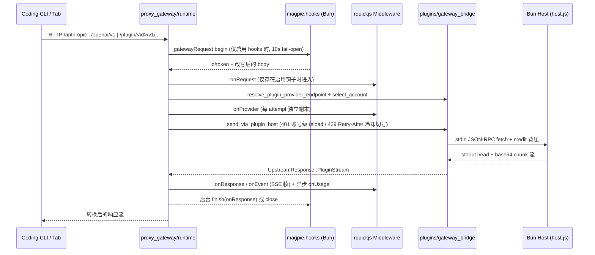

# Plugins 后端模块说明

## 一句话职责

- `tauri/src/plugins/` 是 AI Toolbox 的 Magpie 兼容插件宿主：负责插件与自定义市场源持久化、按需 Bun 运行时管理、OpenCode v1 / Magpie Provider 宿主进程、进程内 `rquickjs` 网关中间件引擎、Bun 宿主内窄版异步网关钩子（`magpie.hooks` 的 `onRequest` / `onResponse`）、插件 `tool` 钩子到本机网关 Streamable HTTP MCP 服务端（`/mcp/plugins`，兼容别名 `/mcp/magpie/tools`）与中央 MCP 同步、按需启动的插件自定义页面与面板静态服务器（`magpie.page` / `magpie.pages` / `magpie.panels`）、菜单项清单（`magpie.actions`）、插件私有持久化存储（`storage:kv` / `storage:files`）、插件 OAuth 后台续期与渠道级每日自动签到、npm 插件版本检查与后台自动更新，以及网关和 17 个 CLI Tab 的双向接入桥接。

## Source of Truth

- 插件清单、自定义市场源、Provider 选项开关（`auth.options`）、账号展示元数据与插件设置全部存于 SQLite JSONB 表 `plugin_entity`（`DbTable::PluginEntity(PluginEntityKind)`，schema `v38`）；内置市场源 `magpie-community` 在迁移时用 `INSERT OR IGNORE` 预置，允许禁用但禁止删除。插件记录里的 `pages`（`magpie.page` / `magpie.pages` 探测结果）、`actions`（`magpie.actions`）、`panels`（`magpie.panels`）与 `permissions`（`magpie.permissions`）均为 `#[serde(default)]` 新字段，旧记录零迁移兼容。
- 插件私有数据不进 SQLite：`<app_data>/plugins/data/<slug>-<sha256前8位>/` 下保存 `kv.json` 与 `files/`。目录名用确定性短哈希区分同名 slug 的不同插件，slug 仅保留 `[a-z0-9_-]` 并规避 Windows 保留名；所有读写入口都重新校验插件存在、`enabled` 与 `permissions`，绝不信任前端传入的 `pluginId`。
- 插件账号的真实 OAuth/API 凭据不在 SQLite 中，而是以 OpenCode/Magpie 兼容格式保存在 `<app_data>/plugins/plugin-auth.json`（`0600` 权限，读写必须经过 `store::acquire_auth_file_lock` 排他锁）。Tauri 命令 DTO 与诊断日志绝不返回或记录明文 `access`/`refresh`/`key`。
- 账号展示与签到元数据存于 `PluginAccountMetaRecord`（`plugin_entity` / `AccountMeta`）：除显示名、启用态、排序外，持久化 `quota` / `quota_updated_at`（`plugins_account_usage` 与 `plugins_account_check` 仅在快照含真实内容时落盘——宿主会把空响应归一化为全空对象，全空或仅 `error` 不覆盖旧快照，随 `plugins_list_accounts` 返回供前端秒开）以及全部 `#[serde(default)]` 的 `auto_checkin` 与 `last_checkin_day` / `last_checkin_until` / `last_checkin_outcome` / `last_checkin_at` / `last_checkin_message` / `last_checkin_credit` / `last_checkin_streak`，旧记录零迁移。
- 渠道级自动签到开关存于 `PluginSettings.provider_auto_checkin: HashMap<provider_id, bool>`（同样 `#[serde(default)]`，零迁移），由 `plugins_set_provider_auto_checkin` 单独写入；`store::resolve_provider_auto_checkin` 合并它和旧账号级 `auto_checkin`：显式渠道值优先，未记录的渠道只要任一账号旧标记为 `true` 就视为开启。`plugins_save_settings` 会保留该字段，避免运行时设置表单把它覆盖清空。
- 自动更新设置同样落在 `PluginSettings`：`auto_update_enabled`（`#[serde(default)]`，默认关闭）、`auto_update_interval_hours`（serde 默认 24，`save_plugin_settings` 统一 clamp 到 `1..=720`）、`last_auto_update_check_at`（`Option<String>`，**后端独占**：只有 `store::set_last_auto_update_check_at` 能写，任何 `save_plugin_settings` / `PUT /v1/plugins/settings` 都无条件保留 DB 中的值，包括调用方传来的过期非空时间戳）。
- 市场离线兜底数据来自编译期嵌入的 `tauri/resources/magpie_market_fallback.json`；拉取失败时内置源回退到该快照，自定义源回退到各自本地缓存，并记录 `last_error`。
- CLI Tab 的插件关联事实源分两类：6 个网关接管型 DB CLI（Claude Code / Claude Desktop / Codex / Grok / Kimi / Gemini CLI）以 `cli_provider` 记录的 `data.meta.pluginProvider` 为准；10 个文件配置型 CLI（OpenCode / OpenClaw / Pi / Oh My Pi / OmO Native / Hermes / DSH / ZCode / WorkBuddy / CodeBuddy）以各模块规范配置文件中指向本机网关 `/plugin/<provider_id>/v1` 的供应商节点为准；Antigravity CLI 仅支持 Google 官方 OAuth，刻意标记 `supported: false`。

## 核心设计决策（Why）

- **双引擎按需启动**：高频网关中间件（`magpie.middleware`）跑在进程内 `rquickjs`（QuickJS-NG，32 MiB 内存、512 KiB 栈、250ms/50ms 强超时中断、零外部依赖）；需要完整 Node/npm 生态与 OAuth 本地回调的 Magpie/OpenCode Provider 插件跑在按需拉起的 Bun 单子进程（`host.js`）。未安装 Provider 插件时不下载、不启动 Bun。
- **固定版本 Bun + SHA-256 校验**：探测顺序固定为 `bun_manual_path` → 托管下载目录（`<app_data>/plugins/runtimes/bun/<VERSION>/<asset>/`）→ `cli_resolver::resolve_local_cli_by_name("bun")`；自动下载强校验固定平台资产 SHA-256，防止未审二进制成为可执行代码。
- **插件 Provider 复用既有网关主链路**：`gateway_bridge` 只负责解析插件 endpoint/协议（`npm_to_ai_protocol`，模型 npm 优先于 provider 默认 npm；模型自身 `url` 优先于 provider `api`）、多账号轮询与账号级冷却切换、以及经由 Bun 宿主发送 `fetch` 返回 `UpstreamResponse::PluginStream`。协议转换（`transformer/`）、SSE 重写、usage 解析、JSONL 请求详情与 SQLite 统计全部原样复用 `proxy_gateway/runtime`。
- **能力矩阵随安装记录持久化**：`inspect_installed_package` 探测 `magpie.hooks`（字符串/对象/true 或目录下 `*.hooks.{js,mjs,ts,mts}`）、`magpie.panels` / `magpie.actions`（非空数组）、`magpie.page(s)[].replaces`（非空字符串）、`magpie.agent`（非空字符串/对象/true）与 `magpie.privacyModels`（非空数组/对象），写入 `InstalledPluginRecord.contributions`（`#[serde(default)]`，旧记录零迁移）。`hooks`、`panels`、`actions` 均已接入宿主；`unsupported_features` 只保留真正未接入的 `replaces`、`agent`、`privacyModels`（固定顺序）；`kind == Unknown` 且声明了这些能力时，安装错误必须逐项点名能力，而不是笼统报「不是插件」。
- **清单解析与 Magpie 对齐**：`magpie.actions` 只在包有页面时保留（动作打开插件页），id 必须匹配 `^[a-z0-9][a-z0-9-]{0,39}$`、菜单只接受 `provider` / `agent`、插件内重复 id 以第一条为准，上限 8；`magpie.panels` 只接受 `provider` / `settings` / `usage` / `agents` 四个 slot，`file` 必须通过 `resolve_page_entry`（存在、`.html`/`.htm`、不逃逸插件目录），非法条目逐条跳过（不阻断整包安装），显式 `id` 经清洗后使用、否则生成 `<slot>-<序号>`，上限 8。纯 panel 包（无 provider / middleware / page，但有 panels）归为 `PluginKind::Page` 且不启动 Bun。
- **Provider 字段透传保真**：`gateway_bridge` 从 `host.js::rowOf` 解析 `url` / `apiId` / `also` / `outputs` / `outputsSaid` / `accounts[].models` / `single` / `renews` / `renewLead` / `rotating`。`model_supports_chat` 是「未声明 outputs 视为可对话；声明了就必须含 `text`」的唯一判据，CLI 注入（`plugins_add_provider_to_cli` / `plugins_sync_cli_provider_models`）只发布可对话模型；`Single` 策略且插件给出账号模型列表时，再按该账号列表收窄。后台续期的 `renewLead` 只从已缓存的 provider rows 读取（缺失回落 15 分钟），**绝不为此主动启动 Bun**。
- **账号级 401 / 429 不重启宿主**：401 响应头 `x-magpie-sign-in: expired` 表示宿主已判定该账号凭据失效——冷却 300s，并在 `AutoRotate` 有其它候选时切号；其它 401 只调用宿主 `reload` RPC（`reload_account`，仅清该账号的 loader/auth 缓存）后同账号重试一次，严禁 `restart()`。429 用 `Retry-After`（十进制秒数或 HTTP-date，clamp 5s..=3600s）冷却该账号，缺失才回落 60s。
- **配额感知选号（保守降权）**：`gateway_bridge::is_quota_exhausted` 只看已持久化的 `AccountMeta.quota`：非空 `windows` 中任一窗口 `used >= limit`（无 `limit` 时按百分比 `used >= 100`）且 `resetsAt` 未过（缺失视为未过；存在但不可解析时该窗口不算耗尽）；无有效 `windows` 时才看 `balance` 是否 `<= 0` / `"0"` / `"$0"` / `"$0.00"`。`preferred_account_candidates` 先排掉耗尽账号，healthy 为空才回退全部候选；`select_plugin_account` 与 401/429 切号共用这条链，坏快照绝不会让某个账号彻底不可用。
- **`onAccount` 中间件钩子**：`middleware_rt::run_on_account` 把 `{ref, provider, name, kind, model}` 作为首参传给 `onAccount`，同时挂到 `ctx.account` 并保留给同一请求的后续钩子；只有返回对象且 `skip === true` 才跳过该账号（`AccountOutcome::Skip { by }`），抛错、超时、`null` / `undefined`、非法返回全部 fail-open。`ref` 是每中间件隔离的 16 字节 hex HMAC-SHA256（输入 `ai-toolbox account ref v1\0<middleware>\0<provider_id>\0<account_key>`），密钥持久化在 `<app_data>/plugins/account-ref.key`（32 字节 hex，首次 `create_new` 原子创建、Unix 0600、已有绝不覆盖；读不到才退化成本次运行随机密钥）。`upstream.rs` 在发送插件请求前遍历候选账号过滤被跳过的账号，全被跳过时回退原选号。
- **插件工具 → Streamable HTTP MCP**：Bun 宿主 `init` 时缓存每个插件的 `tools`（`host.js::toolList` 的 `{name, description, schema}`），`BunHost::list_tools` 在没有 `enabled && has_provider_entry` 插件时直接返回空表且不启动 Bun。`tools_mcp` 把工具命名为 `<插件短名>_<工具名>`（短名清洗到 `[A-Za-z0-9_-]`、≤24 字节，全名 ≤64 字节按 UTF-8 边界截断，重名加 `_2`/`_3`），在网关 `/mcp/plugins`（别名 `/mcp/magpie/tools`）回答 `initialize` / `ping` / `tools/list` / `tools/call`，请求体上限 4 MiB，`DELETE` 204、其它方法 405、无 `id` 的 notification 202；`tools/call` 走宿主 `tool` RPC（`{spec,name,args,ms,agent}`，55s），结果取 `{text}` 包成 MCP `content`/`isError`。这条路径在 `route_request_with_options` 匹配 provider 路由之前返回，**不经 provider、不计 token**。`plugins_list_tools` / `plugins_sync_tools_mcp_server` 生成 `http://<host>:<port>/mcp/plugins`（wildcard 归一化为 `127.0.0.1`），后者复用 `mcp_store::upsert_mcp_server` 维护中央 `ai-toolbox-plugins` HTTP server 并调用 `mcp_sync_all`。
- **代理与 caller/session 透传**：`PluginManager::proxy_url` 按 `PluginSettings.follow_app_proxy` 取应用自定义代理（system/direct 或关闭开关时为空串）；`providers` RPC 用 `{proxies: {provider: {"": proxy}}}`，`usage` / `checkin` / `check` / `keepSignedIn` 用 `proxy` 字段。网关中间件的 `ctx.caller` 优先解析入站 `x-magpie-caller-*` 头，否则由 `route.cli_key` / `route.route_name` 合成；插件 `fetch` 会从 `x-magpie-session` / `x-claude-code-session-id` / `x-session-id` / `session_id` 提取 `session` 传给 `chat.headers`。
- **按需捕获插件真实外网请求（`wire_request`）**：只有调用方显式传 `captureRequest`（`gateway_bridge::PluginRequestCapture`，且 `headers` / `body` 至少一项为真）时，`host.js` 才用专用 `AsyncLocalStorage` 包住那一次 provider fetch，并在 `globalThis.fetch` 包装里记录插件实际发出的 url / method / headers / body。捕获在 `head` 之前以独立 `{event:"wire_request"}` 帧回传，不占 `HEAD_MAX`、不占 credit 窗口；body 按 `min(maxBodyBytes, 256 KiB)` 截断后 base64，不可重放的流绝不读取；token 刷新类 URL 只在整次请求没有其他 fetch 时兜底保留。Rust 侧 `CapturedWireRequest` 严格校验 base64 与 512 KiB / `HEAD_ENTRIES` 上限，非法帧降级为 `HostMessage::Invalid`，最终随 `PluginFetchResponse.wire_request` → `PluginFetchReply.wire_request` 透出。
- **中间件改写插件名追踪**：`MiddlewareState` 记录每个阶段（`MiddlewareRewriteStage::{Request,Provider,Response}`）真正改变输出的插件显示名（优先 `name`，空则 `spec`），按阶段去重保序，通过 `rewrites_for` / `request_rewrites` / `provider_rewrites` / `response_rewrites` 读取。`onEvent` 的 `Replace` 与 `Drop` 都归入 `Response`；未改写时列表为空。
- **直连插件路由 `/plugin/<provider_id>/...`**：为不走网关接管的文件配置型 CLI 提供统一入口（支持探测、`/v1/models`、Chat / Responses / Anthropic Messages / Gemini Native 推理与自动跨协议转换），使全部可配供应商的 CLI 都能消费插件渠道。
- **插件页面与面板按需静态托管**：`page_server` 在首次 `plugins_open_page` / `plugins_open_panel` 时才 bind `127.0.0.1:0`，每个 `(plugin_id, page_id)` 用 `ring` 随机源 + HMAC 签发 32 字符 token，路由为 `/_plugin/<token>/<rel_path>`；token 只绑定入口 HTML 的父目录，逐段拒绝 `..` / `\` / NUL 并二次 canonicalize。面板共用同一张 token 表，作用域拼成 `panel:<panel_id>`；panel 永远不接受 `service_port`（CSP 的 `connect-src` 保持 `'none'`），避免沙箱面板被指向本机其他程序的端口。纯页面/纯 panel 插件（无 provider entry、无 hooks 且所有页面无 `service.port`）不进入 Bun 宿主，本地安装也不会触发 Bun 下载。`sync_enabled_plugins` 的期望表同时包含 `pages` 与 `panels`，因此禁用/卸载插件会吊销全部页面与面板 token。
- **窄版异步网关钩子（`magpie.hooks`）**：单文件 `*.hooks.{js,mjs,ts,mts}` 与包内 `magpie.hooks` 归类为 `PluginKind::Middleware`（有 provider entry 时为 `Both`），只设 `contributions.has_hooks` / `hooks_entry`，**不设 `middleware_entry`**，所以 rquickjs 引擎不会误加载它。`BunHost::host_plugin_items` 只纳入 `enabled && (has_provider_entry || contributions.has_hooks)` 且 `!is_page_only()` 的插件，并为钩子插件附加绝对路径 `"gateway"`；纯 rquickjs 中间件、纯页面或纯 panel 插件绝不会启动 Bun。`has_enabled_gateway_hooks()` 是缓存的原子标志（构造时读库，`notify_plugins_changed` / `restart` 刷新），网关热路径只付一次原子读。`runtime/upstream.rs` 在 rquickjs `onRequest` 之前调用 `gatewayRequest operation=begin`（10s 预算，fail-open），传入脱敏 `context`（protocol/model/stream/path/agent/session/cwd/query/caller）与 JSON body；插件改写后的 body 会再次校验 `stream` 未被篡改；请求结束在后台 `tokio::spawn` 发送 `finish`（整段 JSON 回复 + success）或 `close`（流式/早失败），绝不阻塞响应。`GatewayHookRun` 的 Drop 兜底 `close`，早退出不会泄漏 run。
- **页面持久化存储按权限开放**：`storage:kv` 提供单插件一个 JSON 对象（单值 ≤ 1 MiB、整体 ≤ 20 MiB），`storage:files` 提供 `files/` 私有文件树（单文件 ≤ 20 MiB、总量 ≤ 200 MiB）。KV 与文件写入都走同目录临时文件 + `sync_all` + rename（Windows 共享冲突 3×10ms 重试）；文件路径逐段拒绝绝对路径、`..`、`\`、`:`（NTFS ADS）、NUL、空段、盘符、Windows 保留名与超过 16 层的深度，并拒绝任何 symlink 组件。Bun 宿主通过 `AI_TOOLBOX_PLUGINS_DATA_DIR` 获知数据根目录。
- **插件账号后台维护按需启动 Bun**：`background_tasks::run_plugin_background_pass` 由 `coding/auth_refresh` 在启动后与每 15 分钟调用。它先只读 `plugin-auth.json` 与 SQLite：只有存在「启用中、OAuth、带 refresh、`expires > 0` 且距过期 ≤ 15 分钟（含已过期）」的账号时才调用宿主 `keepSignedIn`（宿主内部遵守 `auth.keepAlive !== false`）；只有存在「所属渠道级 `auto_checkin == true`、账号自身启用、对应插件启用且当天尚未结算」的账号时才调用 `checkin`，同一渠道下的每个启用账号各自记录 `last_checkin_*`。没有候选时绝不启动 Bun。`due_checkin_accounts` 是这条判定链的纯函数入口，单元测试直接覆盖渠道对多账号生效、停用账号跳过、渠道关闭不产生候选、旧账号级标记兼容。
- **自动更新是 opt-in 且独立于账号维护**：`run_plugin_background_pass` 不再因 `plugin-auth.json` 账号为空而提前 `return`；账号续期/签到之后总会调用 `maybe_auto_update_plugins`。它按 `auto_update_enabled` → `auto_update_due`（时间戳为空/不可解析视作到期）→ `auto_update_candidates`（`enabled && source == "npm" && package_name 非空 && 未锁定版本`）短路，任一不满足即零网络、零 Bun、不写时间戳。版本检查只发 `market::fetch_npm_latest_version` 的轻量 GET（走 `PluginManager::http_client()`，尊重 `npmRegistry` / `followAppProxy`），不启动 Bun；只有确认有新版本才用 `installer::install_plugin(pkg@latest, market_id)` 安装。
- **更新与所有已安装记录写入共用 `update_lock`**：`PluginManager::update_lock`（`tokio::sync::Mutex<()>`）串行化 `plugins_install` / `plugins_uninstall` / `plugins_set_enabled` / `plugins_set_options` / `plugins_page_bridge_set_options` / `reload_plugins` 与更新本身。`bun add` 期间用户不能卸载、改 enabled/options 或触发 reload，因此更新结束后用安装前快照 `restore_user_owned_fields` 回写 `spec` / `options` / `enabled` / `installed_at` / `market_id` 不会覆盖新状态、也不会复活已卸载记录。后台任务用 `try_lock()`，拿不到就跳过本轮，绝不排队。
- **页面 CSP 必须写明完整 origin**：WKWebView 的 `sandbox` 页面是不透明 origin，`'self'` 不匹配任何自身资源。HTML 响应的 `default/script/style/img/font-src` 同时列出 `http://<监听地址>/_plugin/<token>/`；SVG 响应单独下发 `sandbox; default-src 'none'; img-src 'self' data:; style-src 'unsafe-inline'; connect-src 'none'`，防止 SVG 脚本绕过出网限制。

## 关键流程

## 易错点与历史坑（Gotchas）

- **Bun 宿主读循环严禁 await 业务或持有写锁**：`bun_host` 必须保持独立的 stdout 读任务与 stdin 写任务，读任务只做行解码与 channel 投递；否则插件回调或背压写入会瞬间死锁。
- **流式背压与取消清理**：`PluginFetchResponse` 的 body stream 消费每帧后必须归还 `len + FRAME_OVERHEAD` credit，提前 drop 时必须发 `abort` 并同步移除 pending 槽位（`host.js` 对已取消的 fetch 不再回发完成帧，漏删会永久泄漏槽位）。
- **崩溃不做无限重启**：Bun 宿主连续崩溃走 `1/2/4/8/16s` 指数退避，连续 5 次进入熔断态，需显式调用 `restart()` 复位；主动重启必须递增 generation，防止旧 stdout 读循环退出时误记一次崩溃。
- **Windows 子进程与 `package.json` 脏尾**：所有 `bun` / `bun add` 调用必须加 `CREATE_NO_WINDOW`（`0x08000000`）；`bun add`/`remove` 前后必须调用 `mend_package_json` 修复 Windows 下覆写未截断导致的尾部脏字节（原文件备份 `.broken`）。
- **`rquickjs` 中间件禁止篡改 `stream` 且必须 fail-open**：`onRequest`/`onProvider` 改写或新增顶层 `stream` 字段会被立刻回滚并计入失败；除显式 `ctx.reject(status, message)` 外，抛错、超时或非法返回值一律 fail-open。热路径必须先判 `Snapshot` 的 per-hook 存在位，无活跃中间件时不得产生任何 JSON 解析开销。
- **异步 hooks 同样不得篡改 `stream`、不得阻塞响应**：`host.js::gatewayBegin` 已对 `stream` / `tools` / `model` 做校验，Rust 侧 `protect_gateway_hook_stream` 仍要兜底回滚并 warn。begin 的 10s 超时覆盖首次 host 启动与整条钩子链，超时/异常直接保留原请求；`finish` / `close` 必须 `tokio::spawn` 到后台（5s 超时、只 debug 日志），流式回复只发 `close`；早失败由 `GatewayHookRun::Drop` 兜底。`context` 只能含 identity 字段（protocol/model/stream/path/agent/session/cwd/query/caller），绝不能放 header、token 或账号凭据。
- **`wire_request` 捕获不得劫持请求或泄漏凭据**：捕获只记录 `globalThis.fetch` 实际收到的 url / method / headers / body，绝不重新发送、绝不消费 `ReadableStream` 等不可重放 body；`captureRequest` 缺失或两项开关都为 false 时必须完全不进入捕获路径、不发任何 `wire_request` 帧。`wire_request` 与 `head` 由同一个 stdout 有序队列写出，必须先于 `head`；Rust 只把它暂存在 `Pending::Head`，遇到 abort / 已发 head / 未知 id 时静默丢弃，不能让捕获失败影响主请求。
- **`plugins_list_providers` 必须合并持久化 `optionValues` 与 `autoCheckin`**：Bun 宿主 `providers` RPC 只返回插件声明的 `options` 定义，不含数据库里已保存的开关值；命令层必须从 `store::list_provider_options` 合并 `optionValues`，否则前端重载后开关会回弹到默认值。同理必须用 `store::resolve_provider_auto_checkin` 给每行补上渠道级 `autoCheckin`，前端渠道头部的签到开关才能显示真实状态（`plugins_refresh_provider_models` 也要走同一条合并链）。
- **不要把 `plugins_*` 命令合并回 `lib.rs` 根 `generate_handler!`**（2026-11-26 实测复发）：Windows MSVC 默认主线程栈仅 1 MiB，debug 构建（`opt-level = 0`）不会复用 `match` 分支栈槽，把 40 个插件命令塞进 `lib.rs` 既有的 700+ 命令大 `match` 会直接在 `pnpm dev:debug` 启动阶段打爆主线程栈（`0xc000041d`）。所有 `plugins_*` 命令统一收口在 `plugins::invoke_handler`（`#[inline(never)]`），同时 `tauri/build.rs` 对 Windows MSVC 二进制设置 `/STACK:8388608` 与 macOS/Linux 8 MiB 对齐。
- **文件型 CLI 写入不得绕过模块规范**：`cli_integration.rs` 写入各 CLI 配置必须复用目标模块的路径级 upsert helper（保留注释、未知字段、顺序与备份），写完统一触发 `config-changed` 与对应同步事件，不能手写整文件覆盖。
- **Codex 插件接管的 `model_provider` 必须是 `custom`**：`takeover_settings` 生成 `model_provider = "custom"` + `[model_providers.custom]`（`name = "AI Toolbox Plugin"`）。不要写 `plugin` 等插件专属 id——Codex 恢复会话时会要求保存的 provider 仍存在于当前 `[model_providers]` 且与当前选择一致，插件专属 id 会在用户切走/禁用插件后变成孤儿并阻断恢复。
- **页面/面板 token 必须随插件状态吊销**：`reload_runtimes` 必须调用 `page_server.sync_enabled_plugins(db)`，否则禁用/卸载插件后旧 token 仍可读取其 HTML 与静态资源。`sync_enabled_plugins` 的期望表必须同时列出 `pages` 与 `panels`（panel 路由 id 为 `panel:<panel_id>`、service 恒为 `None`），否则每次 sync 都会误删有效 panel token。同一 `(plugin_id, page_id)` 再次打开时必须替换旧 token；`plugins_close_page` / `plugins_close_panel` 只吊销单个作用域。页面 HTML 响应必须带 `sandbox allow-scripts` CSP、`nosniff` 与 `no-store`；`connect-src` 只在页面声明 `magpie.page.service` 且插件有 `main`/`exports` 时放行对应 `127.0.0.1:<port>` 的 HTTP / WebSocket。
- **纯页面/纯 panel 插件不得拿到 service**：安装解析 `magpie.page(s).service` 时仅当 `has_provider_entry == true` 才保留 `service_port` / `service_option`；`open_page` 再次强制清空；`open_panel_session` 永远传 `None`。纯 UI 插件（`is_page_only()`：无 provider、无 `has_hooks`、有页面或面板且页面无 service）不进入 Bun，选项变更也不重启 Bun。
- **`magpie.hooks` 的加载条件必须精确**：`host_plugin_items` 只看 `enabled && (has_provider_entry || contributions.has_hooks)`，禁止把 `kind == Middleware` 整体当作 Bun 插件（纯 rquickjs 中间件必须在进程内跑）。hooks 文件路径必须经 `installer::resolve_hooks_entry`（拒绝绝对路径/`..`/反斜杠/符号链接逃逸）解析成绝对路径放进 item 的 `"gateway"`；解析失败且插件没有 provider entry 时整条 item 跳过，否则 `host.js` 会把包报成「no OpenCode plugin function」。`has_enabled_gateway_hooks()` 只读缓存，不要在热路径读 DB；`gateway_states()` 只在 Bun 已运行时发 `gatewayStates`，未启动直接返回 `{}`，绝不为了诊断拉起进程。
- **网关中间件 `ctx.state` 与 `onEvent` 会话**：`ctx.state` 按插件在 `onRequest → onProvider → onEvent → onResponse` 之间序列化往返；SSE 流式回复用 `open_event_session` 为每个 `onEvent` 模块保留一份已编译 runtime，逐帧只 re-arm deadline，禁止每帧重新编译模块。中间件拿到的 `ctx.protocol` 是 Magpie 词表（`anthropic` / `chat` / `responses` / `gemini`），`ctx.agent` 是 CLI key；运行时注入限流的 `console`，缺失它会让含 `console.log` 的中间件抛 `ReferenceError`。
- **页面读取只认声明过的权限**：`plugins_page_bridge_read` 先校验插件 `enabled` 与 `permissions` 是否包含 `usage:summary` / `usage:day` / `providers:list`，未知 scope 一律拒绝；`providers:list` 只返回 `cli_provider.data` 的 id/name/启用状态，绝不返回 key、token、header 或账号凭据。
- **版本比较与跳过规则不得放宽**：`updater::is_pinned_npm_spec` 把任何非空且非 `latest` 的 version 视为锁定（含 `^1.0.0`、dist-tag），锁定版本永远 `skipped`，**绝不**“先装 latest 再恢复旧 spec”；`is_newer_version` 是自研严格 semver 比较（支持 `v` 前缀、1–3 段补零、prerelease 按 §11 比较；非法输入或相等一律 false），不要换成字符串比较，也不要为了省事新增 `semver` 依赖。GitHub check-only 无法比较版本，必须返回 `skipped` 并提示直接更新，不能误报 `up_to_date`。
- **单项失败不能中断整轮**：每个插件单独捕获 registry/安装错误，记 `status = "failed"` + `message`，同时写 `manager.host().record_log("updater", "error", ...)` 和 `log::warn!`，然后继续下一项；循环结束只在 `updated_count > 0` 时调用一次 `commands::reload_runtimes` 并发 `plugins-updated`。全量/后台检查才写 `last_auto_update_check_at`，单插件手动检查与 Control API `checkOnly=true` 不写。
- **401 绝不能重启 Bun 宿主**：`send_via_plugin_host_with_capture` 只允许 `reload_account`（宿主 `reload` RPC，`{provider, account}`）清账号缓存；`restart()` 会中断所有在途请求与流。`x-magpie-sign-in: expired` 是宿主已判定凭据失效的信号，不能当成可恢复的缓存陈旧；只有其它 401 才值得 reload 后同账号重试一次。
- **`unsupported_features` 只记录包真正声明了的能力**：`hooks: false`、空 `panels`/`actions`/`privacyModels`、空字符串 `agent`、无 `replaces` 都不算声明；`hooks`/`panels`/`actions` 已接入，列表只剩 `replaces`、`agent`、`privacyModels`。不要把 `magpie.gateway`（现有 rquickjs 中间件入口）误并进 `hooks`；两者文件名后缀（`*.gateway.js` vs `*.hooks.js`）也绝不重叠。
- **存储配额与清理是后端强约束**：`storage:kv` / `storage:files` 的每次调用都在 Rust 侧重新校验插件记录，前端可伪造的只有参数；KV 的大小限制按序列化后的字节数计算，文件配额在写入前按「目录总量 − 旧文件 + 新文件」计算。`plugins_uninstall(id, purgeData)` 默认保留数据，只有 `purgeData === true` 才删除 `plugin_data_dir`；卸载后先删记录再删目录，重复删除不存在的数据不算错误。
- **`account-ref.key` 绝不覆盖、`onAccount` 绝不误跳**：密钥文件只要存在就必须原样读取（内容非法也不重写，只 warn 并退化成本次运行随机密钥），否则所有中间件已保存的 `ref` 都会在重启后失效。`run_on_account` 只在返回值是对象且 `skip === true` 时跳过账号；`null` / `undefined` / 抛错 / 超时 / 非对象一律 `Use`。
- **工具 MCP 端点不得混入 provider 链路**：`/mcp/plugins` 与 `/mcp/magpie/tools` 的检查必须在 `/plugin/` 与 CLI 路由匹配之前，直接返回 `DebugHttpResponse`；不要把它接到 provider 选择、privacy、usage 或重试逻辑里（否则会按聊天请求计费/改写）。**没有启用的 provider 插件时 `BunHost::list_tools` 只返回空表**，`plugins_list_tools` 不得为了列空工具而拉起 Bun。

## 跨模块依赖

- 依赖 `db/`（`DbTable::PluginEntity`、schema `v38`）、`coding/cli_resolver.rs`（本机 Bun 探测与 `CREATE_NO_WINDOW`）、`http_client.rs`（应用代理透传）以及各 CLI 模块的规范写入 helper。
- 被 `coding/proxy_gateway/`（`GatewayRuntimeContext` 通过 `AppHandle` 读取 `PluginManagerState`，接入 `gateway_bridge`、`middleware_rt` 与 `BunHost` 的异步 hooks；`runtime/upstream.rs` 直接调用 `tools_mcp::handle_mcp_http_request` 服务 `/mcp/plugins`）、`coding/auth_refresh/`（`OfficialAuthTool::Plugins` 调用 `background_tasks::run_plugin_background_pass`）和 `lib.rs`（托管 `PluginManagerState` 与注册 58 个 `plugins_*` 命令）依赖。
- 跨端契约（58 个 `commands::plugins_*` + 3 个 `cli_integration::*` = 61 个 Tauri 命令、`cliKey` 采用 coding 子 Tab 拼写如 `claudecode`/`geminicli`/`workbuddy` 而非网关 `app_type`）由前端 `web/services/pluginsApi.ts` 消费，前端交互规范见 `web/features/coding/plugins/AGENTS.md`。新增 DTO：`PluginActionManifest` / `PluginPanelManifest`（随安装记录持久化）、`RegisteredPluginAction` / `RegisteredPluginPanel`（菜单与面板注册表）、`GatewayHookStateDto`（`magpie.hooks` 诊断）。Control API 侧同样复用 `commands::update_plugins`，不重写安装链路。
- 工具 MCP 命令复用 `coding/mcp` 的 `mcp_store` / `mcp_sync_all`，**不手写第二套 MCP DB 格式或同步逻辑**；端点 URL 从 `ProxyGatewayState` 的运行态（未运行时回退持久化设置）派生，因此网关端口变化后重新调用 `plugins_sync_tools_mcp_server` 即可刷新中央 server。
- `gateway_bridge::header_map_to_json` 必须丢弃入站的 `authorization` / `x-api-key` / `x-goog-api-key`：真实凭据由 Bun 宿主按账号注入，网关占位 Key 绝不能覆盖它。`plugin_spec` 非空时 `find_plugin_provider_row` 只接受精确匹配，绝不回退到同名其他插件。

## 最小验证

- `cd tauri && cargo test --test sqlite_jsonb --jobs 2`（含真实 `v37 -> v38` 文件库迁移）
- `cd tauri && cargo test --lib plugins:: --jobs 2`（市场、安装、页面/菜单/面板清单探测与上限、页面与面板静态服务器及 token 吊销、页面读取权限、KV/文件持久化与配额、Bun 协议/背压/熔断、hooks 加载条件与 `gatewayStates` 不拉起 Bun、`rquickjs` 中间件与 `onAccount` HMAC ref、`gateway_bridge` 的配额感知选号、`tools_mcp` 命名与 JSON-RPC 契约、17 CLI 集成、`optionValues` 合并、`updater` 的 semver/候选/到期/字段恢复）
- `cd tauri && cargo test --lib proxy_gateway::runtime:: --jobs 2`（网关直连路由、插件转发、中间件接线回归）
- `cd tauri && cargo check`
