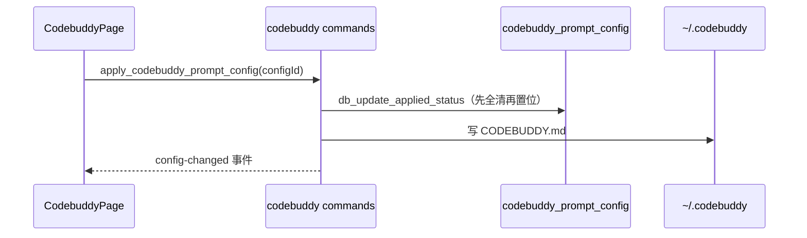

# CodeBuddy 前端模块说明

## 一句话职责

- `web/features/coding/codebuddy/` 是 CodeBuddy Code CLI 页面：配置根目录、`models.json` 渠道列表、`CODEBUDDY.md` 全局提示词、`settings.json` 只读预览。

## Source of Truth

- 渠道数据来自后端 `read_codebuddy_runtime_config`，与 WorkBuddy 桌面版**同源同格式**；渠道列表、卡片映射、模型弹窗都在 `web/features/coding/shared/modelsJson/`，本页面只负责自己独有的三块（配置根、提示词、设置预览）。
- `CODEBUDDY.md` 走标准 `GlobalPromptSettings`（可切换的多套预案，有「应用」语义），与 WorkBuddy 那四个「直接编辑」的身份文件是**两种语义**，不要互相套用。
- `settings.json` 只读：`read_codebuddy_settings_file` 返回原文，解析再序列化会丢键顺序和注释。

## 核心设计决策（Why）

- **渠道卡片是 `OpenCodeStyleCard`**，与 WorkBuddy 同形：扁平模型列表、无单一 active provider、无「应用」。切到卡片布局时渲染共享的 `ProviderCompactCard`（格子只写端点 + 模型数，模型管理进侧栏），与 WorkBuddy 完全一致——两边共用 `shared/modelsJson/`。
- **`settings.json` 用只读 `<pre>` 而不是编辑器**：这个文件由 CLI 拥有，本页没有写入路径；给一个不能保存的编辑器只会让用户以为改了会生效。
- **预览弹窗读原文**，理由同 WorkBuddy——任何 parse → serialize 往返都会改变用户文件的形状。

## 关键流程

## 易错点与历史坑（Gotchas）

- **MCP 文件是 `.mcp.json`，不是 `mcp.json`**：CLI 先读 `.mcp.json`，两者都存在时写 `mcp.json` 会被静默忽略。备份、WSL/SSH 映射、`builtin.rs` 的 `mcp_config_path` 全部用 `.mcp.json`。
- **页面外壳必须走 `SectionSidebarLayout` + `.pageContent { display: block }`**，且 `routeConfig` 要有 `contentPadding: 'compact'`（2026-10-30 初版这三处都漏了，全仓其余 16 个 coding 页面都有）。改外壳后跑 `pnpm run test:page-rhythm`。
- **`SidebarSettingsModal` 必须接线**（页头 `onMoreOptions` + 弹窗里的「显示侧栏」开关）。全仓 14 个 coding 页面都有；漏了它，侧栏一旦隐藏就无法恢复。
- **i18n 动态前缀已登记**（`useRootDirectoryConfig` 保护表加了 `codebuddy`）；漏登记时 `i18n:check` 仍通过，但 `i18n:prune` 会删掉整块 `codebuddy.rootPathSource.modal.*`。
- 三个区块标记（`codebuddy-providers` / `codebuddy-global-prompt` / `codebuddy-settings`）必须同时出现在 DOM 标记、`sidebarSections` 数组与 `SIDEBAR_ICON_BY_SECTION_ID` 三处。

## 最小验证

- `pnpm run test:codebuddy-page`：真实页面 + 桩 Tauri 桥的浏览器夹具（`CODEBUDDY_PAGE_THEME=dark` 跑暗色）。守卡片越界、横向滚动、卡片套卡片、四区块标记、`availableModels` 限制提示走的是受限分支、**「添加供应商」打开的是供应商表单且不含任何能力开关**（SOP §4.2.1），以及**卡片视图是紧凑格 + 模型管理在侧栏**。
- `pnpm run test:page-rhythm`（含 CodeBuddy 两项）。
- `pnpm run test:provider-card-layout` / `test:css-module-classes` / `test:form-modal-layout`。
- **`read_codebuddy_settings_file` 的返回类型是 `string | null`，不是对象**：页面直接渲染这个值，夹具桩返回 `{ exists, path, content }` 会触发 React error #31（对象不能作为 child）。写桩前先看 `web/services/codebuddyApi.ts` 的签名，别按 REST 习惯构造。
- `cargo test --lib codebuddy --jobs 2`（后端契约：形状往返、`__local__` 桥接、adapter 往返）。
- 手工：新建提示词预案 → 应用 → `CODEBUDDY.md` 内容变化 → 禁用 → 文件清空但 DB 记录仍在。
