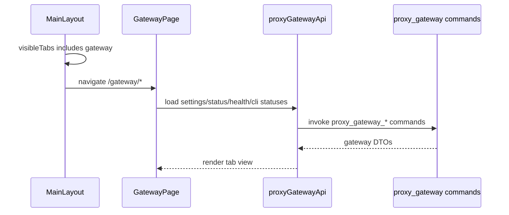

# Gateway 前端模块说明

## 一句话职责

- `gateway/` 页面负责本机代理网关的独立入口、状态统计视图、请求记录视图和网关设置视图。

## Source of Truth

- 子代理裸名模型的已选集合必须原样验证：如果当前站点已不再声明其中某个模型，继续显示可取消勾选的失效项，并阻止草稿保存/接管；只有用户显式取消全部失效项后才可提交，不能用有效子集静默替代原选择。
- 网关设置、运行状态、CLI 接管状态都以后端 `proxy_gateway_*` Tauri 命令返回为准，前端不自行持久化。
- 顶部 `网关` 入口可见性来自全局 `visibleTabs`，只表示 UI 入口是否显示，不代表启动、停止或禁用网关服务。
- 请求列表和统计聚合以后端 SQLite 摘要命令为准；前端只能通过 `proxy_gateway_request_logs`、`proxy_gateway_usage_*`、`proxy_gateway_provider_stats`、`proxy_gateway_model_stats` 读取，不直接扫描数据库或文件目录。
- 本地 session 用量是否出现在统计页和请求列表由网关设置 `session_usage_enabled`（设置页“日志与统计”区，默认开启）在后端查询层过滤决定，前端查询参数不变；关闭后请求页来源筛选选“Session”显示的是真实空态，前端不要按设置自行隐藏筛选选项或伪造来源标签。
- 模型定价管理入口放在统计页筛选栏右侧，前端通过 `get_model_pricing_list` / `upsert_model_pricing` / `delete_model_pricing` 操作后端 `model_pricing` 表；手动“同步官方价格”只调用后端远端同步命令并刷新列表；每 CLI 默认计费配置通过 `ProxyGatewaySettings.app_configs` 保存，不另建前端本地状态源。provider 级计费字段（`data.meta` 的 `costMultiplier` / `pricingModelSource` / `fastCostMultiplier` / `ultrafastCostMultiplier`，读写统一走 `shared/providerBilling/billingConfigUtils.ts`）与全局默认是两层，编辑入口是各 CLI 的“编辑供应商 → 计费配置”（`BillingConfigCollapse`）。Fast / Ultrafast 两个档位乘数只在能触达 OpenAI 协议档位的表单渲染（Codex 通过 `ProviderFormSections.showBillingServiceTiers` 打开）；它们是**用户显式选择**的额外倍率，未配置即按标准价记账，不要按“官方倍数”自动填默认值或在前端折算金额——OpenAI 对同一档位在不同计费口径下的倍数并不一致。请求列表/详情里的 Fast/Ultrafast 标记只是展示（`gatewayFormatters.serviceTierLabel`），不代表后端已加价。
- 请求详情优先以后端 JSONL 文件详情命令为准；`body`、`headers`、`response` 和 attempt/failover 过程只在详情文件里读取，不进入列表/统计状态。若详情文件不存在，后端可以用 SQLite 摘要降级返回基础字段，前端应继续把 body/header 显示为空态。
- 模型健康度仍以后端本地文件状态为准，前端只能通过后端命令读取。
- 聚合模式（第三种网关模式）的**生效态**以后端 `manifest.aggregate` 为准：前端通过 `engageProxyGatewayAggregate(cliKey, providerIds, separator, aliases, naming)` 调用 `proxy_gateway_engage_aggregate`，**不在本地 state 里持久化勾选站点、分隔符、别名或模板**，也不根据本地 state 推断当前模式。未启用时的草稿另有后端事实源（见下一条）。别名限 1–32 个 `[A-Za-z0-9_-]`；唯一性判定与后端 `validate_aggregate_site_prefixes` 一致，比的是**每个候选的有效前缀**（有别名用别名，否则用 provider id），所以别名既不能与别的别名重合，也不能吃掉某个**未选中**兜底站点的 provider id。`normalizeGatewayAggregateAliases` 之外不要另写校验。三种模板为站点.模型、模型@站点、仅模型，后者同名由后端确定性显示为 `#2/#3`（编号由后端在接管时固化进 manifest）。修改后需重新接管，Codex 重启后刷新模型列表。模式判断统一走 `providerProtocol.ts` 的 `isGatewayProxyMode` / `isGatewayFailoverMode` / `isGatewayAggregateMode`，不要在组件里重写 `mode === 'single' || mode === 'failover'` 这类硬编码比较——那会把聚合模式误判成未接管。
- 聚合**草稿**（未启用时的站点选择、分隔符、别名、模板）也以后端为准：读取走 `getProxyGatewayAggregateDraft` → `proxy_gateway_aggregate_draft`，保存走 `saveProxyGatewayAggregateDraft` → `proxy_gateway_save_aggregate_draft`（落 CLI manifest 同目录的 `aggregate-draft.json`，不要求网关在运行，也不改写 CLI 运行时配置）。表单种子优先级固定为：**已启用的 `manifest.aggregate` → 已保存草稿（按当前候选集清洗）→ 当前已应用供应商（`listCodexProviders()` 的 `isApplied`）→ 第一个候选站点**。已启用分支只做规范化、保留失效站点（暴露成 `invalidConfig`，不静默改写正在生效的接管）；未启用分支用 `reconcileAggregateSiteSelection` 丢弃失效站点并给出 `draftSitesDropped` 提示。种子逻辑集中在 `gatewayAggregateDraft.ts::resolveAggregateFormSeed`，不要在组件里各写一份。 Codex `[agents]` 默认值（`subagent.model` / `subagent.reasoning_effort`）是**启用态**状态：只从已启用的 `manifest.aggregate.subagent` 回填，草稿不携带，未启用时留空表示「本次接管不管理这两个键」，不要把空值当成用户显式设置写回。
- 聚合表单**不允许空选择**：最后一个已选站点的勾选框禁用并提示（`lastSiteRequired`），`清空` 按钮已移除、`全选` 常驻；只要 CLI 还有可代理站点，种子就不会是空列表。退出聚合模式只能走开关（`恢复直连` 的门控不变）。取消勾选站点时必须同时丢弃该站点的别名，否则 `normalizeGatewayAggregateAliases` 会一直返回 `null`、开关被静默禁用——这正是用户反馈过的「点了没反应」。
- 聚合站点**顺序只保留一份，唯一规范序就是该 CLI 的供应商列表顺序**（Codex 页拖拽落盘的 `sort_index`）。`orderAggregateSiteIdsByCandidates` 是唯一规范化入口：表单种子、每次勾选/全选、渲染顺序、草稿写盘和接管入参都必须先过它。面板**不再提供拖拽把手和上下移按钮**，只显示 `gateway.aggregate.orderHint` 指向供应商列表；不要重新引入 `@dnd-kit` 排序或 `moveAggregateSite` 这类面板本地排序，否则会出现「已选列表顺序」和「供应商列表顺序」两份互相打架的顺序。失效站点（不再可寻址）保留相对顺序排在末尾，继续暴露成 `invalidConfig`，不能被排序逻辑静默丢弃。
- **已接管时切换首个站点必须先恢复直连**：后端 `prepare_manifest` 在 manifest 仍 `enabled` 且本次 `primary_provider_id` 与已启用不同时直接报 `Restore direct mode before switching the primary Gateway proxy provider`，而聚合的 `primary_provider_id` 就是第一个选中站点。所以「顺序只保留一份」会自然导致：用户在供应商列表把别的站点拖到最前，再开启聚合时首位变了。`aggregateEngageRequiresDirectRestore` 是唯一判定处（`mode` 非空 = 已接管），命中时 `runEngage` 必须先在同一个 `runGatewayAggregateMutation` 通道里 `restoreProxyGatewayCliDirect`，再 `engageProxyGatewayAggregate`；这正是供应商列表切换主渠道走的同一条既有编排（后端 `provider_switch::apply_or_switch_provider`）。不要改后端守卫去放行聚合换主，也不要让面板绕过它。
- 承接上一条：恢复直连会落一份直连配置，所以**当前接管的主供应商需要网关做协议转换时必须拒绝而不是照做**，否则会写出 Codex 用不了的直连配置。这个门控以「当前 `primary_provider_id`」为准（`engageRequiresDirectRestore && primaryNeedsProxy.needsProxy`），不能只按 `engaged`（聚合已生效）判断——用户遇到的场景恰好是 single 已接管、聚合未生效。拒绝时显示既有 `restoreDirectUnavailableHintProtocol` 文案。
- 接管失败提示不要直接透传后端英文句子：`aggregateEngageErrorNoticeKey` 把主渠道守卫这一类可识别错误换成 `gateway.aggregate.notice.primarySwitchRequiresDirect`，其余错误保留后端细节；失败文案按「是否已经恢复过直连」区分 `enableFailed` / `enableFailedAfterRestore`，避免用户以为什么都没发生。
- 站点行的 id 列只做**展示降噪**：站点 id 是供应商的数据库主键（`tauri/src/coding/db_id.rs::db_new_id`，UUID v4 去连字符，32 字符），所以行内用 `shortAggregateSiteId` 只显示前 8 位，完整 id 保留在单元格 `title` 提示里，`.siteSlug` 的 `max-width` 按 8 位收紧。**这个短码只是显示**：草稿、`manifest.aggregate.provider_ids`、`primary_provider_id`、接管命令和兜底路由前缀一律继续使用完整 provider id，不要把它截断后写进后端。未选中行的「路由预览」显示长 id 是真实语义（未选中站点由 provider id 寻址），不要为了好看把它换成短码。
- `gatewayFailoverActive` 与聚合模式**语义不同**：aggregate 不是 failover 的一种。聚合模式下 `GatewayFailoverButton` 展示站点前缀说明并隐藏故障转移开关，只保留「恢复直连」，因为聚合没有 P0 主渠道可切、也没有单一渠道可故障转移。Codex 供应商列表标题行里的聚合入口是 `shared/gateway/GatewayAggregateButton`，和接管状态胶囊共用 `gatewayStatusChip.module.less` 的同一套 chip 样式，聚合生效时用主色 chip（`chipCurrent`）表示“当前就是这个模式”，点击打开聚合设置抽屉；不要再把它换回 AntD 默认 `size="small"` 灰边框按钮，也不要和状态胶囊各写一份胶囊样式。
- 聚合模式的「恢复直连」在两个入口必须用同一门控：`primary_provider_id`（= 第一个选中站点）需要网关做协议转换时，`GatewayFailoverButton` 和设置页聚合开关都拒绝恢复直连并显示 `restoreDirectUnavailableHintProtocol`（`codexGatewayProxyNeed.ts::primaryCodexProviderNeedsGatewayProxy` 是唯一判定处，不要各写一份格式推断）。退路是先换掉/取消勾选该站点或禁用该 provider，而不是把开关放开写出一份 Codex 用不了的直连配置。
- 接管弹窗里的 slug 预览必须走 `buildGatewayAggregateSitePreviewSlug`：有效前缀是 alias 或 provider id，并带 `naming` 模板；不能只拼 `<siteId><sep><model>`，否则 aliases、`model_at_site`、`model_only` 都会显示错。

## 核心设计决策（Why）

- `网关` 和 `Image` 一样是 AI Toolbox 的独立工作台能力，放在顶栏右侧动作区，不放进 OpenCode / Claude / Codex / Gemini CLI 的 coding 子 Tab。
- 页面内部使用 `统计 / 明细 / 设置` 三个路由化 Tab：`设置` 承载真实可写配置，`统计` 与 `明细` 只展示后端数据库摘要或详情文件能返回的真实数据和空态，不伪造请求量或图表数据。明细 Tab 即请求明细视图，路由路径仍是 `/gateway/requests`。
- 本地会话用量与网关请求共用统计/请求入口。应用后台独立同步本地记录，页面激活或恢复可见时也通过既有同步命令补齐并静默刷新；不能以 gateway running、CLI 接管或当前 Tab 是否为设置作为本地用量可见的前置条件。同步命令本身受设置页“本地会话统计”开关门控：开关关闭时后端导入是零计数 no-op，前端无需为它加额外的调用条件。
- 页面顶部的启动/启停和健康检查是网关级通用动作，放在内部 Tab 前；统计和明细 Tab 的数据刷新由各自内容区工具栏承载。
- 运行中顶部不再直接放“停止”主按钮，而使用“启停”下拉：`重启` / `停止`。停止仍走原 preflight；重启走后端热重启，允许在 CLI 已接管时执行。
- 设置 Tab 不再提供保存按钮，字段变更后由设置面板自动调用后端保存。
- 关闭设置页“模块显示”里的 `网关` 只隐藏顶部入口；如果用户仍打开 `/gateway/*`，布局层负责跳回可见页面，不修改网关运行态。

## 关键流程

## 易错点与历史坑（Gotchas）

- 「本页改动要重启 CLI 才会刷新模型列表」这类说明集中在面板页首的 `gateway.aggregate.restartHint` 一处（`{{cli}}` 插值），不要在模板、子代理裸名等各行再重复重启句；行内 hint 只讲该字段自己的语义。后端没有热重载机制，重启要求是 Codex 的真实行为，不是保守说法。
- 未启用聚合时，勾选站点/改分隔符/改别名/换模板都必须落草稿（组件里唯一入口是 `applySiteSelection` 与 `persistAggregateDraft`）；否则关闭抽屉（Codex 页抽屉是 `destroyOnHidden`）或切到统计/明细 Tab（设置面板随 Tab 卸载）后选择就丢了。已启用时同一批改动必须重新接管，因为生效态只有 manifest。站点顺序不在这里维护（见上一条），改顺序要回供应商列表拖，改完再回来重新勾选/接管。
- 聚合表单种子的 effect 只能依赖「已启用配置的内容 key（`activeAggregateKey`）+ 候选集 + 草稿加载 revision + provider 列表」，**不能依赖 `selectedStatus` 对象身份**：状态每轮刷新都会换新对象，按身份重新种子会把用户刚改的内容回滚。同理，保存草稿成功后只更新 ref 与提示状态，不要重新种子。
- 草稿写入必须串行化在 `runGatewayAggregateMutation` 通道内，避免慢的旧写入后到、把新选择覆盖回去；保存回调按 `draftRequestRef` 丢弃过期结果。
- `[agents]` 默认值只在**已启用**时应用：输入框失焦 / effort 下拉变更都只在 `engaged` 时重新接管；未启用时编辑它不会落任何后端文件（草稿只管站点选择、分隔符、别名和模板）。种子 effect 重跑时（候选集 / 草稿 revision / provider 列表变化）会从 `manifest.aggregate.subagent` 重新回填，未启用则清空——这是刻意的，避免把不再被接管的键显示成「接管中」。
- `transport=websocket` 的普通请求按 `stream_outcome` 显示业务终态，不展示内部 HTTP 占位 `0`，也不把握手 `101` 展示为模型成功。`websocket_handshake` 的 `426` 是 HTTP 回退提示，使用中性文本；真实握手错误仍展示状态。WS 标记和预热标记沿用现有紧凑副文本，主题状态色只作辅助。
- WS/HTTP 标记反映每条请求的实际传输，不由当前设置或 provider 推断；不同 Codex 会话可以对同一 provider 使用不同传输。默认关闭的 Codex WebSocket 开关在设置页“转发与容错 / 传输方式”，不隐藏或改写历史 WS 明细；排查混合记录要核对详情中的 path、会话标识和终态，不能直接当成重复记账或同会话回退。
- WS 握手不展示 Token/费用；预热只在后端有真实 Token 时展示用量。连接/response/previous/stream ID、握手状态/尝试和事件错误从 JSONL detail 读取，长 ID 要能悬停查看，回退原因允许换行；summary-only 不伪造这些详情。Headers tab 标明所显示的是客户端握手请求和网关握手响应。
- 不要把 `gateway` 加入 WSL/SSH 的 runtime 同步模块集合；它在 `visibleTabs` 里只是顶栏入口 key。
- 不要把隐藏 `gateway` 入口理解成停止服务。停止服务必须继续走网关设置里的停止按钮和后端 stop preflight。
- 明细 Tab 的列表占满主视图，筛选栏顺序为 CLI、时间、来源、状态、搜索、操作；点击记录后再以大弹窗展示“请求记录 / 请求体 / Headers / Response”详情。不要为了列表页一次性拉大 body，也不要把详情文件字段同步进列表 store。
- 请求列表只展示后端数据库摘要 DTO；点击具体请求后再读取详情文件。不要把 request/response body、完整 headers、attempt 明细或大块 JSON 放进列表状态。
- 请求列表应保持高密度表格展示：时间、供应商、请求摘要、词元、耗时、令牌/秒、成本、状态来自摘要表（成本、状态固定最后两列）；模型生成请求显示模型与用量，模型列表、上下文压缩、连接探测等无模型请求显示脱敏后的方法/路径摘要；尝试次数只放详情记录里，不在列表 badge 里展示，避免误解 provider 内尝试和总尝试。请求/模型列副标题显示紧凑 Token 明细（输入/输出/缓存），「不完整」与「额外 Token」标记追加其后。
- Codex 远程压缩 v2 的 `compaction` 徽章（`compactionModeKey`）是用户**唯一**能分辨「上游原生压缩」与「网关自封装」的地方——两者在线路上的 item 形状完全一样，所以后端专门持久化了 `compaction_mode`。三值语义不同不能合并：`native` 上游自己写了该项、`fallback` 先转发过 trigger 被拒才改由网关摘要、`simulated` 协议转换目标根本不可能原生。**失败轮次没有徽章**（没有任何一侧写出 item，没有「哪一侧」可报），所以前端遇到未知值要静默不渲染，不能在摘要里补一个默认值。
- 词元列展示两行：上 `总计: {total}`，下缓存命中率 `{rate} 缓存命中`（`缓存读取 /（非缓存输入 + 缓存写入 + 缓存读取）`；`null` 显示 `-`，真实 `0` 显示 `0.0% 缓存命中`）；不要把 token 数拆成独立「读缓存」列（已按用户决策移除，Token 明细由请求/模型列副标题承载）；耗时列展示 `首字 {value}` / `总耗时 {value}` 两行；数字用千分位全量格式，不用紧凑缩写。统计页供应商/模型统计表共用同一列骨架（主列、请求数、词元、缓存命中率、成功率、平均耗时、成本），成本固定最后一列；模型表的成功率/命中率由后端 `proxy_gateway_model_stats` 真实返回，成功率只统计网关（proxy）流量，纯 session 模型组显示 `-`，不要用空白占位列替代真实数据。
- 请求列表的词元 / 成本列只对模型生成请求和 Codex Compact 请求显示数值；模型列表、连接探测和普通无模型请求没有 usage 语义，应显示 `-`，不要把摘要里的 `0` 格式化成真实用量。
- `data_source=session` 的本地记录即使未记录模型名，也必须显示已有 token/费用，来源显示“Session”；HTTP 状态、流式标记、尝试次数显示 `-`，不能把 SQLite 的兼容占位值当成实测。耗时列改为展示解析器估算的端到端耗时（`sessionDurationText`：`duration_ms > 0` 才显示，否则 `-`），悬停文案 `gateway.page.requests.sessionDurationHint` 是用户唯一能看到估算口径的地方；TPS 对 session 行按估算的端到端耗时计算（含首字等待，`formatTps` 对 session 行忽略 `first_token_ms`），没有估算耗时显示 `-`。供应商不可从当前配置推测，native 供应商统计不显示 HTTP 成功率，模型统计的未知名称显示“未记录模型”，平均耗时 null 显示 `-`。
- 统计与请求筛选使用独立 `GatewayUsageTool`，原生采集工具不能混入网关接管配置；没有网关测量的工具 RPM 显示 `-`。Session 列表保留来源标签，并可显示原生 provider 历史标签；渠道搜索也匹配该标签，不把它映射到当前 provider 配置。
- Session 的逐调用/回合汇总/累计差额、原生调用数、完整性、原始总量及费用来源由后端 usage_metadata 提供。未知调用数不按一条明细推算一次；分页的条数与统计调用数可以不同。累计记录必须解释观察时间口径，支持负费用调整；额外 Token 在总量、详情和趋势中独立展示，不误标为普通输入。数据来源筛选只是显示过滤，不能代替后端跨源去重。
- 统计粒度（逐调用/回合汇总/累计差额）只是后端统计语义，不要在请求列表或请求详情里展示粒度文本（用户决策）：请求详情不出现「统计粒度」字段行，列表词元列的第二行固定为缓存命中率，不承载粒度文案。累计记录的观察口径由详情里 gated on `granularity === 'session'` 的「累计区间 / 时间口径」行解释。
- Gateway 页顶栏（状态/启停/内部 Tab）和统计/明细筛选栏都要 sticky：顶栏钉在内容区 `top: 0`（`main` 已用 `--content-top-offset` 垫过），筛选栏用 `top: var(--gateway-header-height, 64px)` 钉在顶栏下方。顶栏高度由内容决定（控件换行、subtitle 换行都会变高），所以这个高度必须实测：`GatewayPage` 用 ResizeObserver 把顶栏实测高度发布成 `--gateway-header-height`（取整向下、忽略 0，KeepAlive 用 `display: none` 隐藏时会量到 0），不要把它退回成写死的 `64px`——数字对不上时两条冻结栏之间会露出滚动内容，或筛选栏钻到顶栏下面。滚动浏览表格时仍可操作；页面滚出后自动解冻。不要改成 `fixed`，也不要把 offset 再写进 sticky `top`。
- 请求工具栏的日期使用与统计页相同的紧凑预设下拉，默认保留“全部时间”，只有选择“自定义”才展示起止时间。日期预设不能占据可拉伸的大块空白；自定义区间与操作区允许自然换行，不能把时间输入压成几个字符。验证英文标签与禁用/加载状态，避免按钮被挤出操作区域。
- 本地记录的正文/Headers/Response 空态应解释本地用量不包含 HTTP 明细，不能沿用“在网关设置开启记录”的提示；开启网关日志无法补出过去直连请求的明细。
- 手动同步展示新增/更新/跳过计数；部分失败使用独立的 warning notice 并保留成功数据，不能被紧随其后的列表刷新清掉，也不能当成全部失败或全部成功。后台同步事件仍只静默刷新。
- **工具栏刷新按钮 = 增量同步会话用量 + 重载当前页**：点击后先 `importProxyGatewaySessionUsage({cli_key:'all'})`，再 `loadRequests()`。它**不重置页码、不显示成功提示**（刷新出来的行就是反馈），只有 `failed_files > 0` 时才用 `refreshSyncPartialFailure` 提示；同步抛错时仍要重载列表，不能因为同步失败就隐藏已有数据。按钮标题用 `refreshWithSync` / `refreshWithSyncHint` 说明它不止是刷新。
- **刷新与重建必须用两个独立状态**：刷新用 `syncingForRefresh`，重建用 `rebuilding`。曾经共用 `importing`，导致每次点刷新省略号按钮也一起转圈——那个 spinner 的语义是「重建进行中」，不能被增量同步点亮。省略号按钮的 spinner 与禁用只看 `rebuilding`；两个入口的 `disabled` 都同时覆盖 `syncingForRefresh || rebuilding`，避免同步未结束时又启动重建（后端有 `sync_mutex` 串行兜底，但 UI 不应制造这种排队）。
- **省略号菜单只保留「重建 Session 用量」**：增量同步已并入刷新按钮，菜单里再放一个「同步会话用量」会让两个入口看起来不同、实际做同一件事（曾因此被用户指出）。重建是唯一有破坏性、需要解释后果的动作，菜单项标题下必须带一行说明（`rebuildSessionsHint`）并标 `danger`，保留确认弹窗。执行中整条入口禁用（`Dropdown` 与触发按钮同时 `disabled`），由触发按钮自己显示 spinner，点击处理器再兜一次同样的守卫；不要在菜单项里做进行中状态——入口禁用时菜单根本打不开，那份状态用户看不到。删除入口时同步删掉只服务于它的文案键（`importSessions` / `importSessionsHint` / `importDone`），`importPartialFailure` 仍被重建复用、不要删。
- **重建不能只转圈**：重建通过 `startProxyGatewaySessionRebuild` 后台启动，前端每秒轮询 `getProxyGatewaySessionRebuildProgress`，在提示条下方渲染 `role="status"` 的阶段进度（阶段文案 `gateway.page.requests.rebuildPhase.<phase>` + 已处理文件数 + 新增/更新数 + 进度条）。完成后用同一份快照渲染 `rebuildDone`/`importPartialFailure` 并刷新列表，失败渲染 `rebuildFailed`；轮询异常同样结束重建态。不要退回「await 整个重建 + 一个 spinner」的写法：真实历史要跑十几分钟，用户既看不到进度也离不开页面。
- **进度状态必须来自后端，不能只存组件 state**：`GatewayPage` 切 tab 会卸载 `GatewayRequestsView`，本地 `rebuilding`/`rebuildProgress` 随之丢失。轮询 effect 必须在每次挂载时无条件拉一次后端快照并据此恢复重建态，不能以本地 `rebuilding` 作为是否轮询的前置条件（那正是「切 tab 回来进度条消失」的原因）。后端对**运行中**任务返回可重复读取的快照，对**已结束**任务只返回一次（读取即消费），这样重新进入页面能补报一次结果，又不会每次访问都弹「重建完成」。
- 请求详情 Body tab 如果后端同时返回 `request_body` 与不同的 `upstream_request_body`，要分别显示“收到的请求体（原始）”和“实际发出的请求体（整流/转换后）”；相同或没有上游快照时只显示一段。
- 请求详情「请求记录」tab 在 `native_tools` / `rewrites` 非空时追加两段：原生工具（`kind · 已声明 · 已转发 · 已调用`，只列已成立的维度）与网关改写（`kind`，悬停显示 detail）。两者**只在详情里展示**：列表接口读 SQLite 摘要，不携带这些字段；请求记录关闭或只有 SQLite 摘要时字段为空，直接不渲染这两段，不要补默认值。未知 `kind` 在详情里原样显示（详情用于排查，与列表徽章的「未知值静默」规则不同）。
- 请求详情 Response tab 如果后端同时返回 `upstream_response_body` 与不同的 `response_body`，要分别显示“上游原始响应（转换前）”和“返回给客户端的响应（转换后）”；相同或没有上游快照时只显示一段。
- 请求详情里的长 body / headers / response 文本块默认折叠并提供复制，折叠条件要同时考虑行数和字符长度；压缩 JSON 这类大型单行文本也不能直接把 `<pre>` 全展开。
- `gateway-failover` 属于代理流量中的后台状态事件，只能用于刷新状态、统计或请求记录；不要触发全局 notification/message 弹窗，避免每次上游故障转移都打断客户端使用。
- `usage-log-recorded` 属于后台 usage 落库事件，只能静默刷新统计和请求列表；高频请求下必须做节流/防抖合并，不能每条请求都打断 UI 或触发全局 notification/message。
- 平均耗时列（供应商/模型统计）口径固定为「经过网关的真实模型请求的首字耗时均值」：只算 `data_source='proxy'` 且 `request_kind='request'` 的行（rollup 侧同条件），首字缺失时用总耗时，无样本显示 `-`。表头 tooltip 文案 `gateway.page.statistics.avgLatencyHint` 是用户唯一能看到这条口径的地方，改口径必须同步改它；本地 Session 行的 `duration_ms` 是解析器按转录事件估算的端到端时长（不是网关测量值），因此**不得**进入平均耗时样本：明细行展示估算值、悬停用 `sessionDurationHint` 说明口径，统计页的供应商/模型平均耗时继续排除 session 行，不要把估算值混进网关延迟统计。
- 统计页和请求页共用同一组时间预设（`GATEWAY_USAGE_RANGE_PRESETS`：今天 / 昨日 / 本周 / 上周 / 本月 / 上月 / 本年 / 自定义）。日历类预设以**本地时区**计算边界，`本周` 与 `上周` 都以**周一**为一周起点，`上月` 是上月 1 日到本月 1 日前一秒（跨年时回退到去年 12 月）。滚动 24 小时的 `1d` 已按用户要求移除，不要重新加回。昨日/上周/上月是固定区间，刷新时不能滑动；今天/本周/本月/本年有相对 `endDate`，必须在每次刷新请求发起时重新计算，不要用 `useMemo` 或搜索时生成的绝对时间把 `endDate` 冻结。
- 统计页的日期区间会**持久化**（`gateway_usage_range`，走 `get_gateway_usage_range` / `save_gateway_usage_range` 局部 patch，不整包保存 settings），因为托盘「当前用量」区块要跟随同一区间。只在用户实际切换后写回，首次加载时先读回再发第一个统计请求，避免用默认 `today` 覆盖已保存值；相对预设只存 preset 名、不存绝对时间，`custom` 才存起止秒。后端 `usage_range.rs` 必须与前端 `resolveGatewayUsageRange` 保持同一语义（本地时区、周一为周起点）。请求页的**文本输入**（供应商、模型）继续区分筛选草稿与已提交筛选：刷新/翻页只消费已提交范围，自定义绝对时间保持固定，清空和“全部时间”保留无日期限制的语义。**下拉类筛选（CLI、日期预设、来源、状态）必须选中即生效**——它们是一次性明确动作，压在搜索按钮后面会让「选了没反应」看起来像坏了；顶栏两个开关（排除模型列表、只看失败）本来就是即时的，两侧口径必须一致。
- 统计页的使用趋势是**单指标柱状图**（`GatewayUsageTrendChart`）：标题是 `trendsWithRange`（`使用趋势 · {{range}}`，与参考项目一致，必须透出当前区间），右上角 `ManagementSegmented` 在 Token / 费用 / 请求三个维度间切换（`utils/gatewayTrends.ts` 的 `GATEWAY_USAGE_METRICS`），图里只画当前选中的那一个指标，不叠加多序列、不使用双 Y 轴或图例点击隐藏——分段控件就是图例，不要重新加回 `<Legend>`。XAxis 的分类键必须是后端桶时间戳原文（`key`），显示文本才用 `formatTrendDateLabel` 得到的 `MM/DD[ HH:mm]`，否则跨年时同名的日期会合并成一根柱子。**后端只返回有数据的桶**，所以画之前必须用 `fillGatewayTrendBuckets` 按本次查询区间补齐空桶（小时桶与日桶的切换阈值与后端一致：`endDate - startDate <= 24h` 用小时桶），否则 X 轴会从第一个有数据的时刻开始、中间的空档直接塌掉——参考项目就是在后端逐桶补齐的（cc-switch `usage_stats.rs` 的 `bucket_count` 循环），AI-toolbox 选择在前端补，补桶用的 `startDate/endDate` 必须是产生这批数据的查询区间（`state.trendRange`），不能在渲染时用 preset 重新解析，否则相对区间会在两次解析之间漂移。三个维度的取值统一走 `gatewayTrendMetricValue`：费用解析失败归 0，不能把 `NaN` 传给 Recharts。工具提示必须给 `<Bar>` 传 `name`（指标标签），否则 Recharts 会回退显示内部字段名 `value`；Token 用「精确值（≈ 紧凑值）」与概览的 Token 总量一致，请求用千分位整数，费用统一用 `formatGatewayCost` 的小数位自适应（坐标轴、tooltip、图例同一口径）。面板高度保持紧凑（`chartBody` 220px，窄屏 200px），不要再回到旧的双轴面积图高度，也不要压到 cc-switch 的 132px——该面板占满统计页宽度。
- 统计页的活跃热力图（`GatewayActivityHeatmap` + `utils/gatewayHeatmap.ts`）是**固定 365 天、含今天**的独立窗口，与上方时间范围筛选解耦，只跟随 CLI 筛选；不要把它接到 `range` 上，也不要因为选了「今天」就只画一天。热力图同样支持 Token / 费用 / 请求三个维度切换，且**与趋势图各自独立**（两者时间窗口不同）：着色指标、分档阈值、图例文字必须同时跟随所选维度，阈值由 `buildGatewayHeatmapLayout` 按本窗口该指标的日峰值一次算出并随 layout 返回，图例与格子共用这一份，不要在组件里再算一遍。分档四档 + 零档，步长向下取整到 `1/1.25/…/10 × 10ⁿ`；Token/请求步长下限为 1，费用按本窗口峰值自适应（空窗口回落 0.01），图例与 tooltip 都用 `formatGatewayCost` 避免小额费用全显示成 `$0.0000`。「有没有请求」的提示语义继续看请求数（全部失败的日子请求数 > 0 但 Token 为 0，仍算活跃），与着色指标解耦。布局按周一为每周第一列、列数取整为周，格子边长由容器实测宽度反推并夹取在 7–26px，窄窗口横向滚动而不是把格子压到看不清。热力图复用 `proxy_gateway_usage_trends`（365 天范围，日聚合 + rollup 合并），不新增后端命令。**格子悬停必须是自绘卡片（`role="tooltip"`）而不是 SVG `<title>`**：原生 title 会被浏览器渲染成一行用 `·` 连缀的细字，三个数值糊在一起；卡片用 `dt/dd` 两列（标签左、数值右对齐）逐行列出 Token / 请求 / 费用，日期单独做标题，空白天只显示 `cellEmpty`。卡片 `position: fixed` 按指针坐标定位并做左右、上下翻转，避免被横向滚动容器裁切或跑出窗口。**Token 数值在卡片、图例、柱状图 Y 轴三处必须用同一套紧凑单位且同一 locale**（`formatCompactInteger(value, i18n.language)`）；漏传 locale 会让单位跟随操作系统语言而不是应用语言，同一页面出现 `40M` 与 `4000万` 两套写法。精确整数只允许出现在趋势图 Tooltip 的「精确值（≈ 紧凑值）」配对里。
- 两个面板的指标标签统一走 `utils/gatewayTrends.ts` 的 `gatewayMetricLabel`：它按 metric 分支返回**字面量** `t('gateway.page.statistics.metrics.*')`，因为 `scripts/i18n-keys.mjs` 只能展开同文件里的对象常量，跨文件 map 会让这些 key 静默逃过 `i18n:check`。新增指标时同步加三处字面量分支。
- 设置 Tab 自动保存有 debounce；顶部启动按钮必须优先使用设置面板当前 draft 立即保存后启动，不能重新读取旧的后端 settings 后启动。
- 统计图表直接使用 Recharts；不要为了网关统计引入额外图表封装层。图表必须有 tooltip；单指标趋势图用右上角分段控件替代 legend（多序列场景才需要 legend），并使用主题变量保证浅色/深色模式可读。
- 定价管理弹窗遵循全局 Modal 规范：不重度覆盖 Ant Design Modal chrome，上半部分用 `sectionCard` 风格承载默认配置，下半部分用 Ant Design Table 原生样式展示模型定价。
- 定价列表是后端返回的完整列表，页大小交给 Ant Design Table：默认每页 10 条使用 `defaultPageSize`，不能传固定 `pageSize` 却不接更新状态，否则用户选择 20/50/100 条会在下一次渲染被覆盖。`current` 可以受控，但只为「关键词变化回到第 1 页」服务；不得借此把 `pageSize` 也改成固定受控值。不要为这个显示偏好改动定价数据、总数或持久化接口。
- 定价列表的模型搜索是**本地即时过滤**：后端 `get_model_pricing_list` 已返回完整价格表，前端只按 `model_id` / `display_name` 做大小写不敏感的包含匹配（`utils/modelPricing.ts::filterModelPricing`，底层复用 `filterProviderItems`），不要新增后端查询命令或分页接口。价格字段不参与搜索——它们是 `"0"`、`"5"` 这类数字串，纳入后一位数就能命中几乎所有行。这条与请求页「文本输入草稿 + 提交」的规则（因为那里是服务端筛选）不冲突。
- 定价管理弹窗里的“同步官方价格”按钮位于模型定价标题行右侧、添加按钮左边；成功后提示新增条数并刷新表格，失败只在当前操作中提示错误。远端源列表由后端维护，前端只按 `attempts.length > 1` 区分“主源成功”和“镜像兜底”，镜像兜底用 `officialSyncFromMirror` 说明来源，不要在前端硬编码源 URL。
- 如果未来新增视图依赖的后端查询命令还没暴露，页面只能显示真实空态，不能用假数据填充图表。
- Gateway 辅助说明文字统一使用 `fontSize: 10` 和 `color: var(--color-text-tertiary)`，避免设置页和统计页说明文字风格漂移。
- 「未定价」必须和「免费」分开说：模型统计的 `has_pricing === false` 只表示价格表无法为该 model id 定价，提示与表内标记都不能写成“免费”或“金额错误”，并且要给出可操作路径（统计页提示组里紧跟提示的紧凑文字按钮 `.hintAction` 打开定价弹窗，按钮保持 24px 高度，不要压进 10px 说明行里）。派生集合统一走 `gatewayFormatters.ts::unpricedModelIds`（按 model 去重排序、复用 `isPlaceholderModel` 排除 `unknown` 伪行、不收录已定价的零费用行），不要在组件里各写一份过滤；请求明细的 `cost_source === 'unavailable'` 说明是同一件事的逐条版本。
- 请求模型后的 effort 只显示后端 `reasoning_effort`，不解析模型名或请求正文。Fast/Ultrafast 档位同理，只读后端 `service_tier`（`fast` / `ultrafast`），标签统一走 `gatewayFormatters.ts::serviceTierLabel`（未知值返回 `null`，不渲染徽标），列表用独立小徽标、明细并入模型括号（`formatModelQualifiers`）。不要用 `cost_multiplier` 或金额反推档位，也不要在模型名里匹配 `-fast` 之类的字符串。耗时按首字（近似首包）/总耗时展示并保留秒的小数精度；现有 TTFT 记录的是首个写出的非空 chunk，可能含 SSE 控制事件，不能宣传为严格的首个文字 token。
- TPS 只对有 usage 语义的请求派生，分子仅为输出 token：流式且已记录首包时除以 `duration_ms - first_token_ms`，非流式或缺首包时除以总耗时；本地 Session 行没有首包记录，一律除以估算的端到端耗时（速度含首字等待）；无输出或无有效生成区间显示 `-`。列表用独立「令牌/秒」列展示，列内只显示实际计算的带单位数值或 `-`，不加 TPS 前缀；明细保留 TPS 标签，使用相同的带单位数值。最多保留一位小数并省略末尾 `.0`。字段说明必须解释这几种计时口径。**Session 行的数值必须单独挂 `gateway.page.requests.sessionTpsHint`**（列表单元格与明细值都要）：它是转录估算口径，分母含排队、首字等待与工具执行空档，业主不能拿它跟代理行对比、也不能当成模型真实吞吐；表头的通用 `tpsHint` 不能替代这条说明。
- 供应商缓存命中率直接展示后端输入 token 加权比例（0..1）；用量概览从当前 CLI / 时间范围的 summary 总量计算同一比例：`cache_read / (fresh_input + cache_creation + cache_read)`，不要平均供应商百分比。`null` 显示 `-`，真实 `0` 显示 `0.0%`；输出 token 不参与命中率。
- 用量概览采用用户指定的 cc-switch 结构：上方 Token 总量、请求数和成本，下方分别展示新增输入、输出、缓存创建、缓存命中与命中率进度条；不再使用原来的三张装饰性大卡片。缓存创建展示后端已记录总量，不能仅根据 CLI 名称猜测是否支持并强行改成 N/A。
- 概览“总成本”保留两位小数；请求和维度统计中的细粒度费用仍保留原精度，避免小额请求都被显示成零。
- 概览成本是已报告费用与可匹配模型定价的估算之和；缺少定价的用量不包含在金额中，不能因为显示 0 或模型名称含 free 就宣称免费。保持已有辅助文字的密度与主题 token，用清晰口径说明这一边界。
- RPM 表示最近 60 秒外部请求到达数；HTTP 网关场景只展示 RPM，不重复显示相同口径的 QPM。用量概览右侧按 RPM、总请求数、总成本排列三个独立带边框的小模块，统一为标签与数值，不在总请求数下展示成功率。全部 CLI 取 `requests_per_minute`，指定 CLI 取 `requests_per_minute_by_cli` 中对应项，已加载但无该 CLI 流量时为 0；不重复展示“全部 CLI”说明，不随历史日期改变，不从落库事件、活跃连接数或本地会话导入累加。
- RPM 数值使用 tabular-nums 并与相邻模块对齐，保留稳定最小宽度；不再放置双列数值、斜杠或竖线。RPM、总请求数、总成本与下方 Token 明细统一采用“图标 + 标题、下一行数值”的结构，复用同一标签样式，保持图标尺寸、颜色和间距一致。
- 窄容器中的概览头部固定为 Token 总量一行、其余模块一行，避免从空态/加载态到大数字时动态折行导致整页跳动。
- 运行中每 5 秒静默刷新状态，KeepAlive 非活跃或 document 隐藏时停止轮询；document 可见性变化必须销毁旧刷新会话，恢复后立即发起新请求，不能被旧的慢请求挡住。`gateway-running-changed` 触发刷新；旧轮询结果不能覆盖启停/重启、设置面板返回的新状态或恢复可见后的结果。
- 统计异步响应必须按 request id 丢弃过期结果；切换 CLI / 日期范围时清空上一筛选的显示，避免旧用量在新筛选下被当成当前结果。静默刷新保留当前数据，旧请求也不能结束新请求的 loading 或覆盖错误信息。
- 请求列表的筛选/分页/后台刷新和详情查询也必须按 revision 丢弃过期结果，不能让旧列表关闭新详情、旧详情覆盖新选中记录或晚返回的请求结束当前 loading。
- 手动同步完成后用 state revision 触发当前筛选下的列表 effect，并与回到第一页一起更新；不能直接调用 await 之前捕获的 `loadRequests`，否则同步期间的分页/筛选变更会被旧闭包覆盖。验证“第一页开始同步 -> 切第二页或搜索新模型 -> 同步完成”，页码、筛选与展示内容必须一致。
- 请求和统计表使用固定表格布局配合列宽、横向滚动及单元格省略；仅对子元素设置 `min-width: 0` 不能阻止自动表格布局被长模型/供应商名称撑宽，否则状态、TPS、缓存命中率和耗时会被挤出视野。

## 跨模块依赖

- 依赖 `@/services/proxyGatewayApi` 暴露的 Tauri 命令包装。
- 依赖 `MainLayout` 的顶部动作区、`routeConfig` 的 KeepAlive 路由和 `settingsStore.visibleTabs`。
- 设置视图当前复用 `GatewaySettingsPanel`，其数据仍通过同一组后端命令读取和保存。
- `GatewayPage.tsx` 只保留页面 shell、标题和内部 Tab 路由；统计数据加载/展示放 `components/GatewayStatisticsView.tsx`（含 `GatewayUsageOverview`、`GatewayUsageTrendChart`、`GatewayActivityHeatmap`），请求列表/详情放 `components/GatewayRequestsView.tsx`，纯格式化函数放 `utils/gatewayFormatters.ts`，热力图日历/分档/布局纯函数放 `utils/gatewayHeatmap.ts`，趋势柱状图的指标映射与横轴标签放 `utils/gatewayTrends.ts`。新增统计或请求 UI 时优先扩展对应组件，不要把业务逻辑重新写进页面 shell。趋势图单独拆成 `GatewayUsageTrendChart` 是为了让浏览器夹具直接渲染真实组件，避免夹具复制一份图表实现后与线上漂移。
- 样式按组件边界拆分。页面 shell、统计视图、请求视图与用量概览各自维护 CSS Module；用量概览集中在 `GatewayUsageOverview`，不把总览布局重新堆进页面 shell。

## 数据脱敏边界

- 数据脱敏位于设置右列“接管状态”和“日志与统计”之间，不增加顶层 Tab。独立 `gatewayPrivacyApi` 读写：总开关自动保存 enabled，规则 Modal 一次保存 rules，不得用全量旧草稿覆盖另一项。关闭仍可编辑/测试；测试文本不能持久化或发送模型。
- 数据脱敏开关标题与辅助说明属于同一文字组，使用紧凑的 2px 间距，不能拆成各自占用 section gap 的独立行。规则摘要使用次级字号，管理入口采用带小图标的轻量文字按钮，避免普通灰边框按钮抢占开关的视觉层级。
- 规则弹窗底部的历史说明是独立内容组，与 Tabs 内最后一行操作保留 12px 外部间距；Tabs 与说明是兄弟节点，内部列表的 gap 不会自动为它们提供间距。
- 隐私设置与普通 settings 的保存状态独立，异步预览按 revision 丢弃过期结果。失败保持弹窗和草稿、提供行内错误；白名单输入保留正在编辑的换行，保存值才忽略空行。视觉继续使用 DESIGN.md 的紧凑横向表单、原生 Modal 和主题 token。
- 隐私详情仅在实际命中/还原/失败时展示，来自 JSONL 的 privacy 字段；不从当前开关推测旧请求是否脱敏。日志标注独立脱敏副本，不能把脱敏副本说成客户端实际收到的原始正文。

## 最小验证

- 定价页大小回归：`node --import ./scripts/register-node-ts-extension-loader.mjs --test web/test/features/coding/gateway/components/ModelPricingPagination.test.ts`。测试从真实 Table 提取分页 props，运行已安装 Ant Design 的真实分页 hook，仅模拟 React state（含组件受控的页码 state），覆盖页大小、当前页越界、总数变更、空结果、反复切换，以及「搜索回到第 1 页但保留已选页大小」；不是浏览器 DOM 或原生桌面验收。
- 定价搜索回归：`node --import ./scripts/register-node-ts-extension-loader.mjs --test web/test/features/coding/gateway/components/ModelPricingSearch.test.ts web/test/features/coding/gateway/utils/modelPricing.test.ts`。前者从组件源码提取搜索框 `onChange`、Table `dataSource` / `locale` / `pagination` 并真实执行，后者覆盖大小写、trim、空关键词返回原数组、无结果和「价格字段不可搜」。

- 至少验证：`visibleTabs` 包含 `gateway` 时，顶栏在 `Image` 左侧显示网关入口。
- 至少验证：关闭 `gateway` 后，`/gateway/*` 会跳回可见页面，但不会调用停止网关命令。
- 至少验证：`/gateway/statistics`、`/gateway/requests`、`/gateway/settings` 三个内部 Tab 可切换且 URL 稳定。
- 至少验证：顶部通用启动/启停、健康检查按钮在三个 Tab 前保持可用；运行中启停菜单可重启或停止；统计/请求内容区各自刷新按钮能重载当前视图。
- 至少验证：统计、请求、设置三个 Tab 内容区不再出现重复的标题/副标题/刷新工具栏。
- 至少验证：设置 Tab 修改字段会自动保存。
- 至少验证：统计页从真实 SQLite 摘要/日聚合命令读取数据，空数据时显示空态，不伪造请求量。
- 至少验证：统计页时间下拉包含「今天 / 昨日 / 本周 / 上周 / 本月 / 上月 / 本年 / 自定义」，请求页在同一组预设前多一个「全部时间」；切换后两端都立即生效，昨日/上周/上月不随刷新滑动。
- 至少验证：统计页切到「上月」或自定义区间后重新进入页面，区间仍是上次选择；托盘用量区块的标题与数字同步变成同一区间（相对预设按当前时钟重新解析，不冻结在保存时刻）。
- 至少验证：活跃热力图固定展示近 365 天，切换上方时间范围不改变热力图跨度；切换 CLI 或点刷新时热力图同步刷新，图例区间与格子着色一致；亮暗主题下四档色块可区分，窄窗口横向滚动不压扁格子；悬停格子弹出三行带标签的卡片（Token / 请求 / 费用各占一行），数值单位与图例、柱状图 Y 轴一致，卡片在窗口左右边缘与底部都会翻转而不被裁切。
- 至少验证：使用趋势是单指标柱状图，标题带当前区间；右上角 Token / 费用 / 请求切换后柱子、Y 轴刻度与 tooltip 数值同步变化；切「今天」为小时桶、「本月」为日桶，跨年区间的 X 轴标签不串位；区间首尾必须有刻度（即使首个/末个小时没有数据），中间的空桶保留占位而不是让相邻柱子挤过来。
- 至少验证：请求页列表只拉数据库摘要，点击记录后弹出 80% 窗口级大弹窗再按 trace id 拉文件详情，并能展示未保存 body/headers 的空态。
- 至少验证：设置 Tab 自动保存仍走原有后端保存命令，运行中保存会同步更新运行态共享 settings。
- 至少验证：未启用聚合时勾选站点/改分隔符后关闭抽屉或切到其它 Tab 再回来，选择与分隔符仍在；应用重启后仍在。
- 至少验证：已选站点在面板里的顺序与 Codex 供应商列表顺序一致，面板内没有拖拽把手/上下移按钮，只显示 `orderHint` 提示；在供应商列表调整顺序后重新打开面板，顺序随之一致。
- 至少验证：CLI 已由网关接管（single/failover/aggregate 任一），在供应商列表把另一个站点拖到最前后开启聚合，能成功接管（面板先恢复直连再聚合），不会再出现英文 `Restore direct mode before switching the primary ...` 报错；当前主供应商需要协议转换时则被拦下并显示本地化提示。
- 至少验证：没有草稿时打开聚合表单默认选中当前已应用的供应商；取消勾选最后一个站点被拒绝并提示，`全选` 仍可用。
- 至少验证：定价弹窗搜索框输入模型 ID 或显示名称时列表即时收窄（大小写不敏感），清空后恢复完整列表；停在第 5 页输入关键词后回到第 1 页，且已选的每页条数保持不变（搜索不重置页大小）；无匹配时显示「未找到匹配的模型」而不是通用空态；关闭再打开弹窗时搜索词与页码都已清空。
- 至少验证：草稿里存在已删除/已禁用的站点时，打开表单会丢弃它们、提示已移除，并把选择回落到当前已应用的供应商。
