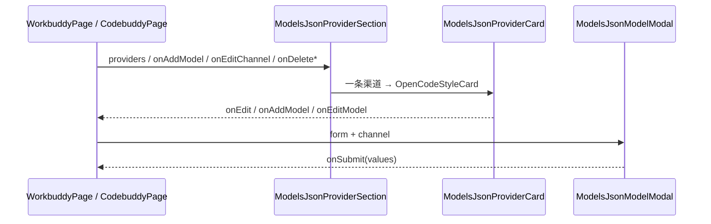

# modelsJson 共享前端模块说明

## 一句话职责

- `web/features/coding/shared/modelsJson/` 是 WorkBuddy 桌面版与 CodeBuddy Code 两个页面**共用**的渠道区块：列表外壳、卡片映射、模型增改弹窗。

## Source of Truth

- 数据来自各页面自己的 `read_*_runtime_config`（后端按 `(规范化 url, apiKey)` 分组出的渠道视图）。本目录不取数、不缓存，所有数据与回调由调用方以 props 传入。
- 渠道 / 模型 / 输入的 TypeScript 形状在 `web/types/workbuddyFamily.ts`，两个模块各自 `export type { X as Y }` 再导出。**不要在这里或者两个页面里各写一份**——那正是 `as unknown as` / `as never` 的来源。

## 核心设计决策（Why）

- **为什么共享而不是各写一份**：两个产品是同一引擎的两张皮，`models.json` 契约完全相同（见 `tauri/src/coding/workbuddy_family/AGENTS.md`）。分叉实现会让「改一个不知道另一个也在用」。
- **卡片用 `OpenCodeStyleCard`**：扁平模型列表、多渠道路由、没有单一 active provider → 无主操作、无「设为默认」（选型依据见根 `AGENTS.md` Hard Rule 14 与 SOP §4.2.1）。
- **模型弹窗 `layout="horizontal"` + `labelCol {span:6}`**：对齐 DESIGN.md 的弹窗表单形态；`okButtonProps={{ disabled: saving }}` 而非 `loading`，因为 antd 的 `loading` 会把「取消」一起锁死（SOP §4.0.2 A）。
- **endpoint 与 apiKey 在每条模型上都可编辑**，不是提到渠道级头部：文件里没有 channel 对象，改模型本来就是改渠道 endpoint 的方式。

## 关键流程

## 易错点与历史坑（Gotchas）

- **不要给渠道卡片加拖拽把手**：`models.json` 是扁平列表，产品从不读回渠道顺序，拖了也没有落点。也不要传 `ProviderListSection` 的 `dragDisabledBySort`——它的提示是「拖拽排序仅在选择『默认』排序时可用」，暗示切到默认就能拖，对这里不成立。
- **`draggable: false` 必须显式传**：`providerState.draggable` 缺省不是「不拖」，见 `providerCardVariants/types.ts`。
- **选择模式复用 `useProviderBatchSelection`**，`allIds` 来自当前可见（过滤 + 排序后）列表；这里没有不可选的默认项，所以 `providerSelectionDisabledReason(t, undefined)` 传 `undefined` 是对的。
- `useProviderListViewPrefs(moduleKey)` / `useProviderListSort(moduleKey)` 的 `moduleKey` 必须与页面 tab key 一致（`workbuddy` / `codebuddy`），否则两个页面会共用一份布局偏好。
- **`previousId` 必须是注册过的 `Form.Item`，不能只用 `setFieldsValue` 塞进表单**：改模型 ID 的语义是「合并到原条目」（后端 `upsert_model_renaming` 靠 `previous_id` 找目标行）。`Form.validateFields()` 只收集**已注册**字段名，未注册的 `previousId` 会被丢掉 → `previous_id=null` → 后端走追加分支 → 旧条目连同产品自有键（`credits`/`tags`）留在原地、新条目追加到末尾，界面提示成功。回归：`web/test/features/coding/shared/modelsJson/modelModalPreviousId.test.mjs`。
- **单卡删除的确认在页面层，不在这里**：卡片传 `deleteConfirm: false`（同 OpenClaw），页面 handler 里 `Modal.confirm` 后调删除。卡片没有自己的确认，漏掉页面层就是「一次误点清空整条渠道」。批量删除不再问第二次（批次栏已确认）。
- **排序只提供 `custom` / `name`**：`created` 需要创建时间、`recent` 需要 `provider_last_used`，而这两个模块都没有「应用」动作（这正是 OpenCode 式卡片的定义），`noteProviderUsed` 无处可调。列出来只会是一个永远不生效的菜单项。
- **渠道卡片没有「编辑渠道」入口**：渠道由 `(url, apiKey)` 派生，文件里没有渠道记录；卡片级 ✎ 只能打开一张空的「添加模型」表单，点确定还会因为缺 id 被拒。改渠道 endpoint 的方式是编辑它下面某条模型。
- **侧栏区块 id 与 `ProviderListSection` 的 `sectionId` 不能同名**：页面外层用 `id="<module>-providers"` 做侧栏锚点，共享外壳因此取 `<module>-providers-section`（与 Hermes 同一约定）。两个同名 id 是无效 HTML，`getElementById` 只会命中外层。

## 最小验证

- `pnpm run test:provider-card-layout`（本目录的映射层必须是 `providerCardVariants` 的薄映射层）
- `pnpm run test:form-modal-layout`（弹窗横向布局）
- 手工：在 WorkBuddy 加一条模型 → 在 CodeBuddy 打开另一个配置根，确认两边的布局偏好互不影响；切换列表/卡片视图后重启仍保持。
