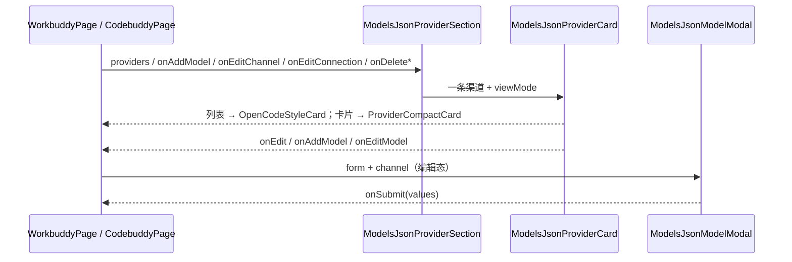

# modelsJson 共享前端模块说明

## 一句话职责

- `web/features/coding/shared/modelsJson/` 是 WorkBuddy 桌面版与 CodeBuddy Code 两个页面**共用**的渠道区块：列表外壳、卡片映射、模型增改弹窗。

## Source of Truth

- 数据来自各页面自己的 `read_*_runtime_config`（后端按 `(规范化 url, apiKey)` 分组出的渠道视图）。本目录不取数、不缓存，所有数据与回调由调用方以 props 传入。
- 渠道 / 模型 / 输入的 TypeScript 形状在 `web/types/workbuddyFamily.ts`，两个模块各自 `export type { X as Y }` 再导出。**不要在这里或者两个页面里各写一份**——那正是 `as unknown as` / `as never` 的来源。

## 核心设计决策（Why）

- **为什么共享而不是各写一份**：两个产品是同一引擎的两张皮，`models.json` 契约完全相同（见 `tauri/src/coding/workbuddy_family/AGENTS.md`）。分叉实现会让「改一个不知道另一个也在用」。
- **列表布局用 `OpenCodeStyleCard`，卡片布局用 `ProviderCompactCard`**：扁平模型列表、多渠道路由、没有单一 active provider → 无主操作、无「设为默认」（选型依据见根 `AGENTS.md` Hard Rule 14 与 SOP §4.2.1）。**两种布局是密度差异，不是能力差异**——格子只陈述「端点 + 模型数」，模型管理进侧栏（`ProviderModelSection appearance="detail"`，常开），列表卡片照旧折叠。把列表卡片塞进网格格是错误形态：它的工具栏有五个文字按钮，350px 的格放不下，「模型列表」会竖排成单字一行、添加模型被挤出头部（2026-10-31 用户报障）。
- **模型弹窗用 `layout={MODEL_FORM_LAYOUT}`（纵排，标签在字段上方）**：常量在 `shared/modelFormLayout.ts`，与共享 `ModelFormModal` 及 codex / grok / kimi / zcode / openclaw 的自建弹窗同一形态。**不要再传 `labelCol` / `wrapperCol`**——列配置会压过 `layout`，得到「标签在上但仍被缩进」的混合形态，守卫会报错。`okButtonProps={{ disabled: saving }}` 而非 `loading`，因为 antd 的 `loading` 会把「取消」一起锁死（SOP §4.0.2 A）。
- **预设展开区要限高**（`maxHeight` + `overflowY: auto`）：目录有 100+ 条，不限高时它会占满整个弹窗，其余字段全被挤到滚动条以下——弹窗看起来像预设浏览器挂了个表单。
- **数值字段三合一、布尔字段合成一行**：`maxInputTokens` / `maxOutputTokens` / `temperature` 用 `MODEL_FORM_TRIPLE_STYLE` 并排；五个能力开关用一个标题 + 一行 `Checkbox`（`MODEL_FORM_CHIP_ROW_STYLE`，每个 `Form.Item` 用 `noStyle`）。纵排时每个开关占「标签行 + 控件行」两行，五个开关吃掉十行——布尔是最密的字段，一个 bit 不该占两行。回归断言：`the capability switches share one inline row`（按 `getBoundingClientRect().top` 的行数判断，折行回竖排会红）。
- **字号三层，全部来自共享常量，不要逐字段写 `fontSize`**：标题 14px（antd 默认）+ `classNames={{ label: modelFormStyles.label }}` 补颜色与冒号；勾选框文字 13px（`<Checkbox styles={MODEL_FORM_CHECKBOX_STYLES}>`）；`extra` 说明 12px（`<Form styles={{ extra: MODEL_FORM_EXTRA_STYLE }}>`，一处生效全局）。**必须走 antd 语义 `styles`（内联）而不是 CSS 类**：antd 自己给 `-extra` 与 `.ant-checkbox-wrapper` 写了 `font-size`，同权重类规则谁赢取决于样式表产出顺序。2026-11-01 用户两次指出（「标题和下面的内容字体都是一样大」→「下面内容的这些字体比标题小一点」）。
- **endpoint 与 apiKey 在每条模型上都可编辑**，不是提到渠道级头部：文件里没有 channel 对象，改模型本来就是改渠道 endpoint 的方式。

## 关键流程

## 易错点与历史坑（Gotchas）

- **不要给渠道卡片加拖拽把手**：`models.json` 是扁平列表，产品从不读回渠道顺序，拖了也没有落点。也不要传 `ProviderListSection` 的 `dragDisabledBySort`——它的提示是「拖拽排序仅在选择『默认』排序时可用」，暗示切到默认就能拖，对这里不成立。
- **`draggable: false` 必须显式传**：`providerState.draggable` 缺省不是「不拖」，见 `providerCardVariants/types.ts`。
- **选择模式复用 `useProviderBatchSelection`**，`allIds` 来自当前可见（过滤 + 排序后）列表；这里没有不可选的默认项，所以 `providerSelectionDisabledReason(t, undefined)` 传 `undefined` 是对的。
- `useProviderListViewPrefs(moduleKey)` / `useProviderListSort(moduleKey)` 的 `moduleKey` 必须与页面 tab key 一致（`workbuddy` / `codebuddy`），否则两个页面会共用一份布局偏好。
- **`previousId` 必须是注册过的 `Form.Item`，不能只用 `setFieldsValue` 塞进表单**：改模型 ID 的语义是「合并到原条目」（后端 `upsert_model_renaming` 靠 `previous_id` 找目标行）。`Form.validateFields()` 只收集**已注册**字段名，未注册的 `previousId` 会被丢掉 → `previous_id=null` → 后端走追加分支 → 旧条目连同产品自有键（`credits`/`tags`）留在原地、新条目追加到末尾，界面提示成功。回归：`web/test/features/coding/shared/modelsJson/modelModalPreviousId.test.mjs`。
- **单卡删除的确认在页面层，不在这里**：卡片传 `deleteConfirm: false`（同 OpenClaw），页面 handler 里 `Modal.confirm` 后调删除。卡片没有自己的确认，漏掉页面层就是「一次误点清空整条渠道」。批量删除不再问第二次（批次栏已确认）。
- **排序只提供 `custom` / `name`**：`created` 需要创建时间、`recent` 需要 `provider_last_used`，而这两个模块都没有「应用」动作（这正是 OpenCode 式卡片的定义），`noteProviderUsed` 无处可调。列出来只会是一个永远不生效的菜单项。
- **渠道级「编辑」= 批量改整条渠道的连接**（2026-10-31 用户指定）：渠道由 `(url, apiKey)` 派生，文件里没有渠道记录，所以 ✎ 打开的仍是供应商表单（`ModelsJsonProviderFormModal`，传 `channel` 进编辑态），保存时把新的 `vendor` / `baseUrl` / `apiKey` 逐条写回该渠道的**每一个**模型。页面侧的循环必须原样带上每条模型自己的 `id` / `name` / `maxInputTokens` / 能力开关——`upsert_model_renaming` 按 id 合并，漏字段会被 `build_model_entry` 的默认值覆盖掉。编辑态隐藏「首条模型 ID」：渠道已经有模型，从这儿再建一条会让一个看起来像改名的弹窗静默加一行。
- **`onEditChannel` 与 `onEditConnection` 是两个不同的回调**：前者带 `modelId`，改的是某条模型；后者是渠道级连接改写。合用一个会让 `onEdit` 无从表达（它没有 `modelId`）。
- **「添加供应商」必须是供应商表单，不是模型表单**（SOP §4.2.1）：`ProviderListSection.onAddProvider` 打开 `ModelsJsonProviderFormModal`。这个弹窗只填渠道连接信息（`vendor` / `baseUrl` / `apiKey`）**加一条首条模型 ID** —— `models.json` 没有渠道记录，创建渠道的唯一办法就是写一条携带该连接的模型条目。**能力开关（tool call / images / reasoning / useCustomProtocol）不进这个弹窗**：它们属于模型，进卡片后用「添加模型」或铅笔改。上一轮把 `onAddProvider` 直接接到模型表单，用户点「添加供应商」却被要求填模型 ID 和一屏开关，回归由两个页面的浏览器夹具守护（`add-provider opens the provider form, not the model form` + `the provider form carries no capability switches`）。
- **模型级批量删除一次只允许一个渠道处于选择模式**：`modelSelectionChannelId` 是单个 id 而不是集合。每张卡都渲染自己的模型列表，两张卡同时收集选择，用户无法判断「删除已选」作用于谁。
- **「选择预设模型」必须接**（SOP §4.2.4）：模型弹窗 ID 行右侧的链接 → 展开标签列表 → 点选填充 `name` / 两个 limit / 三个能力开关。**编辑态不改 ID**（改了会让整行换身份）。映射规则在 `modelsJsonPresetFields.ts`，三条判据都可能有坑：① `temperature` **不映射**——预设里是"模型接受 temperature 参数"（布尔），文件里是"要发送的默认值"（数值）；② 只有 `modalities.input` 含 `image` 才置 `supportsImages`，pdf/audio/video 不折进去（文件只有一个图片位，折进去会把 pdf-only 模型标成支持图片）；③ 预设没声明 `tool_call` / `reasoning` 时**保持表单原值**而不是写 `false`。回归：`modelsJsonPresetFields.test.mjs`。
- **「获取模型 → 应用」必须做预设匹配**（SOP §4.2.5）：`buildFetchedModelsJsonModel` 按 id 查目录，命中就把 limit 与能力带进新条目。只写裸 id 不报错、界面正常，只是用户拿不到参数——这是 ZCode #31 的原样复现。
- **`onSetPrimaryModel` 不接**：`models.json` 没有默认模型指针。唯一候选 `availableModels` 是**白名单**——写它会隐藏产品自带的全部内置模型，与「选默认」正好相反。`ModelDisplayData.isPrimary` 因此始终省略。
- **`onFetchModels` 在含 `useCustomProtocol` 的渠道上必须禁用**：这类条目的 `url` 不一定是 `chat/completions` 形式，自动拼 `{base}/models` 会拼错。判据是渠道内**任一**模型带该标记。
- **侧栏区块 id 与 `ProviderListSection` 的 `sectionId` 不能同名**：页面外层用 `id="<module>-providers"` 做侧栏锚点，共享外壳因此取 `<module>-providers-section`（与 Hermes 同一约定）。两个同名 id 是无效 HTML，`getElementById` 只会命中外层。

## 最小验证

- `pnpm run test:provider-card-layout`（本目录的映射层必须是 `providerCardVariants` 的薄映射层）
- `pnpm run test:form-modal-layout`（弹窗横向布局；`ModelsJsonProviderFormModal` 靠文件名里的 `ProviderFormModal` 被扫描到）
- `pnpm run test:workbuddy-page` / `test:codebuddy-page`：真实页面 + 桩桥，断言「添加供应商」打开的是供应商表单且不含任何 `.ant-switch`、**模型弹窗有「选择预设模型」且展开后有条目**、**卡片视图渲染的是紧凑格、格子里没有「模型列表」、模型管理在侧栏里**（切到卡片视图 → 检查 `[data-provider-grid-cell]` → 点开格子 → 断言 `[data-provider-detail-panel]` 含模型列表）
- **夹具必须自己灌预设目录**：真实应用在启动时调 `load_cached_preset_models` / `fetch_remote_preset_models` 填充 `PRESET_MODELS`，夹具不跑那段 bootstrap，于是预设列表是空的——断言会以「入口不存在」的形式失败，看起来像功能没做，实际是夹具缺数据。两个页面夹具都已 `updatePresetModels(bundled)`（读 `tauri/resources/preset_models.json`）
- `waitFor` / `evaluate` 的表达式必须返回**可序列化值**：`document.querySelector(...)` 直接返回会抛 `Object reference chain is too long`，要包 `Boolean(...)`
- 手工：在 WorkBuddy 加一条模型 → 在 CodeBuddy 打开另一个配置根，确认两边的布局偏好互不影响；切换列表/卡片视图后重启仍保持。
