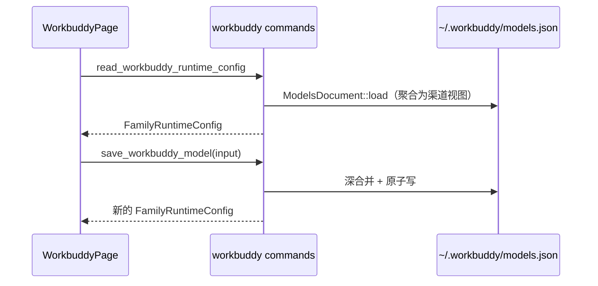

# WorkBuddy 前端模块说明

## 一句话职责

- `web/features/coding/workbuddy/` 是 WorkBuddy 桌面版页面：配置根目录、`models.json` 渠道列表、四个按账号隔离的身份文件。

## Source of Truth

- 渠道数据来自后端 `read_workbuddy_runtime_config`（现读 `models.json` 聚合出的视图），页面**不保留第二份副本**。新增/编辑/删除后一律用命令返回值整体替换 state。
- 身份文件（`IDENTITY.md` / `USER.md` / `SOUL.md` / `BOOTSTRAP.md`）是**直接编辑的活文档**，不是可切换的提示词预案。页面没有「应用」动作，只有「保存」。
- 渠道列表、模型弹窗与 CodeBuddy 页面**共用** `web/features/coding/shared/modelsJson/`：两个产品同引擎、同文件，这一层不允许在任一页面里分叉。

## 核心设计决策（Why）

- **渠道卡片是 `OpenCodeStyleCard`**：`models.json` 是扁平的模型列表，没有 provider 概念，多个渠道同时可用、没有「当前生效」的那一个，所以卡片没有主操作、没有「设为默认」。
- **预览读原文**：`read_workbuddy_models_file` 直接 `read_to_string`。用运行时视图重新 `JSON.stringify` 会丢掉没有 URL 的条目、重排字段、丢掉产品自有键——预览的意义就是「磁盘上到底是什么」。
- **身份文件面板按账号可用性分态**：未登录时 `unavailableReason` 有值，面板只显示原因，不显示不存在的路径。

## 关键流程

## 易错点与历史坑（Gotchas）

- **页面外壳必须走 `SectionSidebarLayout` + `.pageContent { display: block }`**（2026-10-30 初版漏了，全仓其余 16 个 coding 页面都有）。当时还漏了 `routeConfig` 的 `contentPadding: 'compact'`，内容区退回 24px。三处都不报错。改页面外壳后跑 `pnpm run test:page-rhythm`。
- **`SidebarSettingsModal` 必须接线**（页头 `onMoreOptions` + 弹窗里的「显示侧栏」开关）。全仓 14 个 coding 页面都有；漏了它，用户把侧栏隐藏后**没有任何办法再打开**——这是个不可逆的界面状态。
- **「预览配置」必须读文件原文**（`readWorkbuddyModelsFile`），不要用运行时视图重新 `JSON.stringify`：视图会丢掉无 URL 条目、重排字段、丢产品自有键。回归：`workbuddy::commands::tests::a_saved_model_survives_the_runtime_view_and_the_raw_file_read`。
- **新增区块必须同时进三处**：DOM 上的 `data-workbuddy-sidebar-section="true"` + `data-sidebar-title`、页面顶部的 `sidebarSections` 数组、`SIDEBAR_ICON_BY_SECTION_ID` 映射。漏了第一处，侧栏点了不会滚动；漏了后两处，侧栏里没有这一项。
- **i18n 动态前缀已登记进 `scripts/i18n-keys.mjs` 的 `useRootDirectoryConfig` 保护表**。漏登记时 `i18n:check` 是**通过**的（它按保护表决定扫哪些展开式），而 `i18n:prune` 会把 `workbuddy.rootPathSource.modal.*` 整块删掉——第一次补登记就一次性暴露了 18 个缺失 key。
- `translationKeyPrefix: 'workbuddy'` 与 `sidebarHiddenByPage.workbuddy` 必须同名；从别的 CLI 复制页面时读侧最容易残留来源模块的 key。
- **页面夹具的桩必须复刻后端的「未登录 / 空文件」形状，不能返回 `null`**：`get_workbuddy_identity_state` 的真实形状是 `{ identity_dir, unavailable_reason, files }`，返回裸 `null` 会让身份面板解析失败并在页面右上角弹出「操作失败」——截图里能看到，断言却一条都不会红（`null` 也能渲染成空）。同理 `WorkbuddyProviderView.id` 必须给：卡片用 `data-provider-id` 做定位锚点，缺了它卡片仍然渲染，但「定位」静默失效。两条都是 2026-10-30 做真机视觉核对时踩到的。
- **`App` provider 不能省**：页面用 `App.useApp()` 取 `message`，夹具只包 `ConfigProvider` 时会抛 `t.error is not a function`。

## 最小验证

- `pnpm run test:workbuddy-page`：真实页面 + 桩 Tauri 桥的浏览器夹具（亮/暗或 `WORKBUDDY_PAGE_THEME=dark`）。它守的是组件级测试看不见的东西：卡片越界、页面横向滚动、卡片套卡片、侧栏三区块标记齐全。
- `pnpm run test:page-rhythm`（含 WorkBuddy 两项：页头→首区块 16px、区块→区块 16px）。
- `pnpm run test:provider-card-layout` / `test:css-module-classes` / `test:form-modal-layout`。
- 手工：在产品里加一条模型 → 本页能看到 → 在本页编辑另一条 → 第一条不丢；点「预览配置」看到的是 `models.json` 原文（含注释/未知键）。
