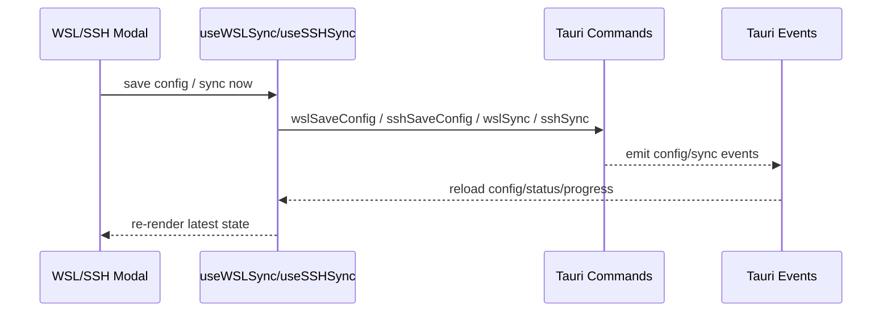

# Settings 前端模块说明

## 一句话职责

- `web/features/settings/` 负责应用设置页、WSL Sync、SSH Sync 以及备份恢复相关前端交互。

## Source of Truth

- 设置页的持久化数据主来源是后端 Tauri 命令和 SQLite JSONB，不允许前端自己持久化到 localStorage。
- WSL/SSH 设置页中的 `moduleStatuses` 来自后端统一计算，不是前端基于路径字符串自己推导。
- WSL 与 SSH 虽然都会消费 `moduleStatuses`，但 skip 规则不同：WSL 会基于 `isWslDirect` 构造 `skipModules`，SSH 只会按可见模块构造 `skipModules`，不会因为 `isWslDirect` 禁用模块。
- 同步结果、进度和警告都来自事件：`wsl-config-changed`、`wsl-sync-completed`、`wsl-sync-progress`、`ssh-config-changed`、`ssh-sync-completed`、`ssh-sync-progress`。
- Skills 同步警告有两条展示路径：`wsl-sync-warning` / `ssh-sync-warning` 事件在同步过程中实时展示在弹窗（`syncWarning`，可关闭）；同步结束后持久化的 `status.lastSyncWarnings` 在 WSL/SSH 弹窗内常驻展示（warning Alert 列表）。警告文案经 `syncMessageTranslator` 的正则模式翻译，新增后端警告格式时必须同步补翻译模式和 i18n key。
- WSL 的持久化警告不只来自 Skills：后端已把文件/MCP/Onboarding 的非致命问题也并入同一次 `lastSyncWarnings` 快照，因此 WSL 侧该字段的标题是「上次同步警告」（`settings.wsl.lastSyncWarnings`），SSH 侧仍只承载 Skills 警告。不要把 WSL 文案改回「上次 Skills 同步警告」。
- Claude Onboarding 同步失败属于 warning 而非 error（issue #449）：后端把它 push 进 `warnings`，前端经 `Onboarding sync: …` 前缀进入 `onboardingSyncFailed`，再由 `onboardingSyncParseFailed` / `onboardingSyncNotObject` 拆出 distro、目标路径和“原文件未修改”。文案必须保留“其余同步结果不受影响”的语义，不能写成整轮同步失败。
- 同一段 claude.json 诊断有两条到达路径：onboarding 同步用 `Onboarding sync: ` 包装，MCP 同步用 `Claude Code: ` 包装后又套进旧的 `WSL ~/.claude.json 同步已跳过：…` 句子。`translateClaudeJsonWarning` 必须同时接受这两种前缀（并且整体解析先于通用的 `"; "` 拆串），否则中文界面会嵌进一整段英文。`Claude plugins metadata rewrite` 属于 best-effort，走 warning 通道而不是 error，否则同一次同步会同时显示成功图标和红色错误横幅。

## 核心设计决策（Why）

- WSL 和 SSH 前端看起来相似，但产品语义不同：WSL 有自动同步和 WSL Direct 跳过逻辑；SSH 当前以手动同步为主。
- 默认 mappings 的初始化放在 hook 里做一次性补全，避免后端返回空映射后页面无法操作。
- WSL/SSH 模块 tab 的可见性依赖 `visibleTabs`，这样同步 UI 和主功能页的启用范围保持一致。

## 关键流程

## 易错点与历史坑（Gotchas）

- Linux 渲染偏好走独立的启动配置命令，不进入全量 `AppSettings`。界面必须区分已保存模式和当前进程模式：保存后保留“下次启动生效”和重启入口，失败不切换已保存选项；环境变量覆盖时禁用选择并说明原因，性能模式启动失败后的兼容回退也要显示。组件只在 Linux 挂载，不增加其它平台的启动读取。

- 备份设置三渠道（local/webdav/repository）保存走统一入口 `saveBackupSettingsUnified` → 后端 `save_backup_settings`（只 patch 备份字段 + 同事务更新 `settings:backup_repository`）。不要改回两次全量 `save_settings` 或把仓库 Token 放进 AppSettings payload；保存失败要展示后端错误、保留草稿并禁用重复提交。
- `BackupSettingsModal` 保存时 `validateFields()` 只返回当前挂载的表单项：webdav/repository 的 Form.Item 按渠道条件渲染，缺渠道的值必须从 `form.getFieldsValue(true)`（打开时 setFieldsValue 过的保留值）取，再兜底到打开时加载的 store 值（`loadedRepositoryConfig`）；直接用 `validateFields()` 返回值会得到 undefined 导致崩溃或静默清空已存连接。保存后的 store 同步走 `settingsStoreUtils.ts::backupSettingsStatePatch`——**新增保存字段时必须同时补这个 patch**（曾漏掉 autoBackup 三参数导致弹窗重开读旧值、再保存覆盖新值）。
- 仓库草稿仅在选择仓库渠道保存时提交为修改；本地/WebDAV 保存使用已加载连接，后端也必须保留自己的当前仓库记录，忽略隐藏的半填或过期草稿。仓库加载完成前禁用保存与编辑，加载失败不允许用默认空草稿清空旧连接；关闭弹窗后忽略未完成加载的返回。已配置仓库的空 directory 表示根目录，不能用 truthy 默认值替换。
- 切换 GitHub/Gitee 时立即清空输入中的 Token，已保存状态也只对原平台有效；后端仍须拒绝跨平台复用已存 Token。清空前端输入并不能替代后端校验。
- 备份加密密码只在设置弹窗内出现：提交非空才写入本机系统凭据库，保存成功或关闭后立即从 state 清空；前端只能看到 `has_password` + `password_known` 状态。`password_known=false` 表示本机凭据库读不到（显示"未知"态，不能显示"未设置"）。恢复时后端先读凭据库（凭据库读失败也按 `passwordRequired` 返回，用户仍可手动输密码），前端据此在同一选择上弹密码框重试，取消必须保证零恢复写入。
- 远端备份列表（WebDAV/仓库）共用 `RemoteBackupRestoreModal`，只消费统一 `BackupFileInfo`（filename/size/encrypted + 仓库条目的 sha）；文件名解析统一走 `utils/backupFilename.ts`（镜像后端契约，支持两类历史命名、新唯一标识与 `.zip`/`.zip.enc`，含多字节 legacy 前缀）。不要在组件里写只匹配 `.zip` 的正则或各自的解析规则；仓库删除/恢复必须带列表返回的 sha。
- 本地恢复文件选择器同时接受 `.zip` 与 `.zip.enc`（扩展名过滤器 `['zip', 'enc']`），真实格式由后端按文件头判断，与当前是否启用加密无关。
- `ScrollFadeHint` 用 callback ref 取得实际 `.ant-modal-body`，`afterOpenChange` 在复用未销毁的 Modal 时重新绑定。提示使用零高度 sticky 锚点加向上绘制的伪元素，必须放在表单 flex 分组之外，避免 gap 或提示自身新增滚动高度；使用主题阴影变量、`pointer-events: none` 和 `aria-hidden`，到底或无溢出时隐藏。验收首次打开、异步加载、重新打开、缩放、亮暗/system、中英文长标签及 footer 可见性。
- 数据目录设置区必须分别呈现本进程 `effective/is_custom` 与下次启动 `next_start/restart_required`；不能用保存的 override 标记当前目录，也不能把“稍后重启”说成撤销保存。待生效状态常驻提供重启和撤销入口。目录选择、保存和重置须互斥；后端保存成功响应直接返回最新状态，失败保留当前路径并呈现具体错误。
- 自定义数据目录只切换应用自己的数据根目录，不自动迁移数据，不覆盖外部 CLI/独立 Skills 路径。迁移引导要先恢复 Gateway 直连，并明确备份范围；重启失败要保留待生效状态且可重试。

- WSL 设置页里 `isWslDirect` 模块需要禁用相关映射编辑和手动同步入口；SSH 设置页不要照抄这套禁用逻辑。
- dsh/Hermes 也消费同一 `moduleStatuses`，不能因工具自行解析配置目录而漏掉 Direct 状态。保存/清除目录会发出 `wsl-config-changed` 刷新设置页；后端在同步开始时仍会重读 Direct 集合，首次启用不能依赖 UI 快照。
- SSH 设置页可以显示 WSL UNC 本地路径，但这只是展示优化，不代表 SSH 模块也具备 WSL 那套自动同步语义。
- SSH 连接测试结果带 `shellKind`；非 `posix` 时弹窗必须显示明确的不支持警告。前端提示只是辅助，后端 `do_full_sync` 写入前的 Shell 预检才是最终防线。
- `skipModules` 在两个页面里的来源不同。WSL 的 `skipModules` 包含 WSL Direct 模块，SSH 的 `skipModules` 只反映当前不可见模块；不要把一边的 hook 逻辑复制到另一边。
- `visibleTabs` 现在可能包含 `gateway`、`image` 和 `miniBrowser`。它们只控制顶栏 `网关` / `Image` / `浏览器` 入口是否显示，不是可同步 runtime 模块；WSL/SSH 的 `skipModules`、模块状态和 mappings 仍只围绕 coding runtime（OpenCode / Claude Code / Codex / Grok CLI / OpenClaw / Gemini CLI）+ WSL/SSH 自身语义，不要把 `gateway`、`image` 或 `miniBrowser` 塞进去。
- “模块显示”右侧那一行（`GeneralSettingsPage.tsx::OTHER_TABS`）的 chips 顺序要和顶栏工具条顺序一致，新增入口在这里追加即可，`handleOtherTabToggle` 只做 append/remove，不参与左侧编码工具的 `reorderMode`。`miniBrowser` 是**可选开通**项：它只控制 `MainLayout` 里的内置浏览器入口，没有自己的路由，也**不能**加进后端默认 `visible_tabs`（`tauri/src/settings/types.rs`）或 `adapter.rs` 的历史默认基线——历史默认只用于“整份匹配就全量替换”，一旦写进基线，用户显式关掉的浏览器入口会在下次读取时被加回来。默认不显示由「两边默认值都不含该 key」保证，边界回归见 `web/test/components/layout/MainLayout/index.test.ts`。
- 同步文案翻译要走 `syncMessageTranslator`，不要在组件里硬编码后端错误文本。
- Skills 目标既可能是链接，也可能是带归属标记的复制目录；警告统一称“同步目标”，翻译解析仍兼容已持久化的旧“链接”警告。
- Skills 警告需要先按完整文案解析，再处理通用的 `; ` 错误拼接；技能名/路径本身允许分号和引号，命令诊断可能包含换行，不能先拆分或使用不匹配换行的表达式。`lastSyncWarnings` 表示最近一次 Skills 同步，普通文件/MCP 同步不清空它；开始新的手动同步或 Skills 阶段时清理旧实时警告，状态读回已有同条常驻警告时移除重复实时提示。
- 设置项如果同时有数据库偏好和系统副作用（例如开机自启），用户偏好必须先落库，系统调用失败不能阻止偏好保存。一个用户动作需要联动多个字段时，应构造一次 settings payload 保存，避免多个异步全量保存互相覆盖。
- 防休眠开关的完整“读取偏好 → 保存 → 应用系统状态”流程必须串行执行。`save_settings` 保存后会等待托盘刷新，而合并刷新可能让后发请求先返回；不能只依靠后端系统调用互斥来保证最后一次操作生效。操作期间显示 loading/disabled，失败后解除忙碌状态并允许重试。
- 防休眠开关显示持久化偏好；系统应用失败时保留已保存的偏好，单独显示可访问的行内错误，不能让 rejected Promise 静默消失，也不能把尚未保存的值显示成已保存。启动恢复失败必须记录后端日志；系统资源的线程归属遵守根文档的 Async Runtime Safety 规则。
- Gateway 设置页会按 `appProxyConfigKeys` 判断每 CLI 的 `app_configs` 是否为空。后续给 `AppProxyConfig` 增加字段时必须同步更新这个 key 集合，否则设置页清空超时/重试字段时可能误删相邻功能保存的配置。
- Gateway 的“数据脱敏”分区委托 gateway 模块组件处理，使用独立 privacy 配置命令；不能放进此页普通 settings 的全量自动保存 payload。开关和规则分别更新，本地预览不启用实际流量处理，详细规则见 `web/features/coding/gateway/AGENTS.md`。
- Gateway 设置页的 `ProxyGatewaySettings` 运行态开关必须和后端字段同步暴露；例如 `lossy_rejection_enabled` 是用户控制“有损转换是否直接 400”的开关，默认关闭，UI 放在“转发与容错 / 请求整流”里 `Thinking budget 修正` 下方。
- Codex WebSocket 总开关位于“转发与容错 / 传输方式”，默认关闭，沿用普通网关 settings 的自动保存；保存期间禁用操作，后端保存响应作为持久化状态。说明需保留“关闭后新连接走 HTTP/SSE、已有连接空闲后关闭；开启后新建 Codex 会话或重启客户端重试”的边界，不能把开关开启描述成所有请求强制 WS，也不能通过切换开关改写 CLI 接管配置。
- Gateway 的 Claude Thinking 整流和 OpenAI Responses `encrypted_content` 恢复是两个独立运行态开关：前者只控制 `thinking_rectifier_enabled`，后者只控制 `responses_encrypted_content_rectifier_enabled`。新增恢复策略时不能借用名称或说明仅覆盖其他协议的既有开关。
- 本地/WebDAV restore 成功后，前端内存 store、路由可见性和模块缓存都可能与新数据库不一致；成功弹窗必须强制用户重启/刷新应用，不能提供可关闭后继续使用旧内存态的路径。

## 跨模块依赖

- 依赖 `@/services/wslSyncApi`、`@/services/sshSyncApi` 和对应 hooks。
- 依赖 `useSettingsStore().visibleTabs` 来决定哪些模块应出现在同步 UI 中。
- 与 coding runtime 页面共享 `moduleStatuses` 语义，但不共享同一状态对象实例。

## 典型变更场景（按需）

- 改 WSL/SSH 交互时：
  先确认是状态语义变化还是纯 UI 调整，避免把 WSL 行为误复制到 SSH。
- 改 `moduleStatuses` 消费时：
  同时检查 WSL modal 的置灰、tooltip、`skipModules`，以及 SSH modal 的 UNC 展示是否仍符合当前产品语义。
- 新增同步事件时：
  同时更新 hook 监听和结果提示翻译。

## 最小验证

- `pnpm test:backup-settings`（`scripts/verify-backup-settings.mjs`，40 项断言，已在 `pnpm test` 链上）运行真实设置表单、真实 store 与远端列表，模拟 Tauri 持久化响应；验证三渠道保存往返、自动备份回显、加载前禁止保存、Token 平台切换、失败保留密码草稿、目录条目的排除正则，以及零额外滚动高度的渐变。**排除正则的前端检查只拦 Rust 不兼容语法**（`rustRegexCompat.ts` 的 `findRustRegexIncompatibility`），结构错误（如 `[`、`*a`）故意放给后端编译器——所以浏览器断言必须用 `\1` 这类 Rust 拒绝、JS 接受的构造，用 `[` 会误判为前端该拦。HTTP/SQLite/系统凭据的后端行为必须另跑 Rust 回归，不能把前端 mock 当成真实远端验证。
- Skills 警告翻译回归位于 `web/test/features/settings/utils/syncMessageTranslator.test.ts`；同步 UI 需验证有警告完成后的单次展示，以及下一次无警告同步后提示清空。
- 防休眠改动验证 `web/test/stores/keepAwakeSettings.test.ts` 和 Rust `keep_awake::tests` / `keep_awake_preference_round_trips_and_old_records_default_to_disabled`；覆盖连续开关、保存失败、系统失败后重试、跨线程释放和旧配置的默认值。
- 至少验证：打开设置页能正常加载 config、status 和默认 mappings。
- 至少验证：WSL Direct 模块在 WSL 设置页被置灰，但在 SSH 设置页仅改变本地路径显示。
- 至少验证：默认设置下顶栏没有内置浏览器入口；在“模块显示 / 右侧”打开 `浏览器` 后入口出现，关闭后消失，且开关状态在重启后保持。
- 至少验证：手动点击 Sync Now 时能看到进度和完成状态更新。
